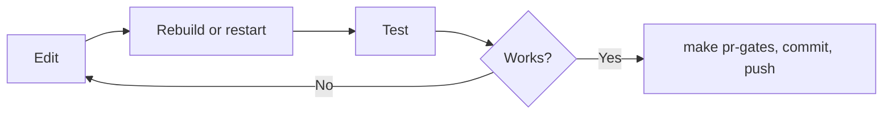

# JoustMania Development Guide

How to build, run, test and debug the stack. This is a guide: ports, RPCs, flags and
compose variants are owned by the specs, and this page links to them instead of repeating them.
Process and CI rules are in [CONTRIBUTING.md](CONTRIBUTING.md); the service layout and per-service
gotchas are in [`.claude/rules/development.md`](../.claude/rules/development.md).

## Contents

1. [Prerequisites](#prerequisites)
2. [Quick start](#quick-start)
3. [Compose and images](#compose-and-images)
4. [Development workflow](#development-workflow)
5. [Testing](#testing)
6. [Debugging](#debugging)
7. [Code organization](#code-organization)
8. [Adding features](#adding-features)
9. [Containers and privileges](#containers-and-privileges)
10. [Troubleshooting](#troubleshooting)

## Prerequisites

| Tool | Why |
|---|---|
| Docker with Compose v2.24+ | The stack. The CI overlay uses `!reset`, which needs v2.24 |
| Git | |
| [uv](https://docs.astral.sh/uv/) | Python environments, tests, lint (`uv run ...`) |
| Python 3.14 | The services pin `requires-python = ">=3.14,<3.15"` in each `pyproject.toml`; uv installs it for you |
| make | Shortcuts below |
| grpcurl (optional) | Calling gRPC by hand |
| Go, Rust toolchains (optional) | Only when you change `services/agent`, `services/flag-service`, `services/connect-proxy` or `services/rust-hid` outside Docker |

Hardware is optional: PS Move controllers, and a USB Bluetooth adapter for a real venue (see the
[hardware guide](hardware-setup-guide.md#bluetooth-adapter-recommendations)). Everything except real
Bluetooth runs with the mock controller backend.

```bash
curl -LsSf https://astral.sh/uv/install.sh | sh      # uv
sudo apt-get install grpcurl                          # or: brew install grpcurl
```

## Quick start

```bash
git clone https://github.com/WatchMeJoustMyFlags/JoustMania.git
cd JoustMania
uv sync                                       # optional: local Python env for editors and unit tests
make up-mock                                  # services and observability, mock controllers, no hardware
docker compose -f docker-compose.yml -f docker-compose.ci.yml --profile dashboard up -d   # adds envoy, dashboard, connect-proxy
docker compose -f docker-compose.yml -f docker-compose.ci.yml --profile dashboard ps
```

`make up-mock` runs `docker compose -f docker-compose.yml -f docker-compose.ci.yml up -d` (add
`BUILD=1` to build from your checkout). The CI overlay puts envoy, connect-proxy and the dashboard in the
compose profile `dashboard`, so `make up-mock` alone does **not** serve port 80; the second command adds
them. (`make dry-run` also passes `--profile dashboard`, plus `agent`.) Everything runs with `backend=mock`
(the CI flag baseline, `services/flagd/ci/`). Stop it with the same `-f` and `--profile` flags and `down`.
The repo has a `.pre-commit-config.yaml`; `pre-commit install` enables the hooks. Lint and CI checks: [CONTRIBUTING](CONTRIBUTING.md).

With the `dashboard` profile up, everything a browser needs is behind **envoy on port 80** (the only port
reachable from the network):

| URL | What |
|---|---|
| `http://localhost/` | Dashboard |
| `http://localhost/jaeger/` | Traces |
| `http://localhost/grafana/` | Dashboards |
| `http://localhost/victoria-metrics/vmui/` | Metrics (the only metric store) |

For real controllers, `docker compose up -d` (or the Pi path in [Compose and images](#compose-and-images))
reads them through `rust-hid`, the default Bluetooth backend (`backend=rust` in
`services/flagd/controller.json`). `python-hid` is opt-in; the three switches are in
[hardware-setup-guide.md](hardware-setup-guide.md#opting-in-to-python-hid) and [services.md, Backend layering](specs/services.md#backend-layering).

## Compose and images

The stack is one base file plus overlays. Which overlay does what, which `make` target uses it and which
host ports are published: [services.md, Compose variants and host ports](specs/services.md#compose-variants-and-host-ports).
Pick the entry point that matches what you are doing:

| Goal | Command |
|---|---|
| No hardware, mock controllers | `make up-mock` |
| Hot-reload Python source | `make dev` |
| Agent experiment dry run (mock controllers, agent + dashboard profiles) | `make dry-run`, see [agent-dry-run-runbook.md](agent-dry-run-runbook.md) |
| Real hardware on a dev machine | `docker compose up -d` |
| Raspberry Pi, as the venue runs it | `./scripts/setup/joustmania-compose.sh up -d` |
| Pi without observability | `docker compose -f docker-compose.lite.yml up -d` |

A bare `docker compose` also loads `docker-compose.override.yml`, which publishes the dev gRPC ports on all
interfaces. That is fine on a dev machine and wrong on the Pi, so the Pi wrapper names
`-f docker-compose.yml` and the env files explicitly (#1319, #1488).

### Upgrade, rollback and the one-time migration (UC-060 A2, A3)

The Pi runs a pinned checkout (a `joustmania-vX.Y.Z` release tag or an exact commit sha, UC-060 BR-003); the
image tag derives from it, so never set `IMAGE_TAG` in `.env.local`. Change the version only with
`./scripts/setup/joustmania-upgrade.sh <joustmania-vX.Y.Z | 40-hex sha>`: it pulls the target's images while
the current version runs, switches the checkout, restarts the unit and rolls back on its own when the game
services do not come up healthy (`--no-rollback` keeps the failed version for inspection;
`--rollback` returns to the other recorded version offline, back on its branch when it ran from one, and
only when every image compose resolves there is on the Pi; `--status` shows both). Put opt-in profiles
(`COMPOSE_PROFILES=python-hid`, `COMPOSE_PROFILES=operator-pad`, or `python-hid,operator-pad`) in `.env.local`; a `systemctl edit`
drop-in is honoured too. Set the whole comma-separated list in one place: a unit drop-in `Environment=` wins over
`.env.local`, and a profile missing from the winning list is off. The start script removes the container of a profile that is off (python-hid, operator-pad), so
switching a profile off takes effect at the next start. The operator pad ([UC-015](use_cases/UC-015.md)) reads `/dev/input`
as the host's `input` group: set `INPUT_GID` in `.env.local` when `getent group input` is not 996.

Operator pad keys on stage (short form; the full table and rules are in [UC-015](use_cases/UC-015.md) BR-016 and BR-011).
"Knob" means: hold the key, turn the knob, release the key to commit.

| F key | Pad key | Tap | Hold | Knob |
|---|---|---|---|---|
| F13 | K1 | start a game (lobby) | | choose the mode (voice + colour pulse on the lobby controllers) |
| F14 | K2 | announce sensitivity | | sensitivity (lobby) |
| F18 | K3 | announce agent status | 1 s: stop / resume the agent | intervention level |
| F19 | K4 | | 1.5 s: force-end (game) / force-start (lobby) | |
| F20 | K5 | announce teams | | number of teams (lobby) |
| F21 | K6 | toggle spoken instructions (lobby) | | |
| F22 | K7 | announce backend | | decision backend |
| F23 | K8 | reserved | 3 s: lock / unlock the pad | |
| F15 | knob press | mute / unmute | | |
| F16 / F17 | knob left / right | volume down / up (no key held) | | |

Cut-off runs (power loss, ssh hang-up) and manual recovery:

- A rollback cut off part-way is finished by running `--rollback` again: it stays on the version it was moving
  to (`--status` WARNs `a rollback to <sha> was cut off`).
- An upgrade cut off after its checkout leaves HEAD at the target but `.joustmania-release` naming the version
  before; `--status` WARNs `HEAD ... is neither recorded version` and `--rollback` refuses. Re-run the same
  upgrade command: it repairs the record (current = HEAD, previous = the recorded current) without a restart;
  then run `sudo systemctl restart joustmania`, or `--rollback` to go back.
- The unit's start limit (3 starts in 15 minutes, UC-060 A5) guards boot crash loops only: every restart the
  upgrade command does runs `sudo systemctl reset-failed joustmania` first (UC-060 BR-006), so upgrades and
  rollbacks in quick succession still start. A start systemd refuses anyway is reported as `refused by systemd
  (start-limit-hit)` and never rolled back; `--status` shows `start-limit-hit`. Recover with
  `sudo systemctl reset-failed joustmania && sudo systemctl start joustmania`.
- The migration cut off the same way has no record, so the branch it ran from is lost. Go back by hand:
  `git checkout main && sudo systemctl restart joustmania` (the branch takes `IMAGE_TAG` from `.env.local`
  again), then repeat the migration.

One-time migration of a Pi still on the `main` branch (once the first pinnable release, `MIN_PINNABLE`, exists):

```bash
cd ~/JoustMania
git fetch --tags && ./scripts/setup/joustmania-upgrade.sh joustmania-vX.Y.Z && sudo ./scripts/setup/install_autostart.sh
```

### Image names and tags

Each service has both `build:` and `image:` in the compose file, so a local build and a pulled image carry
the same canonical GHCR name:

```
ghcr.io/watchmejoustmyflags/joustmania/<image>:${IMAGE_TAG:-latest}
```

Images in `docker-compose.yml`: `agent`, `audio-service`, `connect-proxy`, `controller-manager-service`,
`dashboard`, `flag-service`, `game-coordinator-service`, `menu-service`, `otel-collector`,
`operator-pad`, `pairing-daemon-service`, `python-hid`, `rust-hid`. Third-party images (envoy, flagd, jaeger, victoria-metrics,
grafana, loki) are pinned to exact versions in the compose file.

`IMAGE_TAG` defaults to `latest` in the compose file, but a plain `docker compose` also reads `.env`, which
pins the **release** tag (`IMAGE_TAG=0.7.0`). For current builds override it, and never commit that change:

```bash
IMAGE_TAG=latest docker compose pull && IMAGE_TAG=latest docker compose up -d
```

`make up-mock`, `make dev` and `make dry-run` do not set it for you (only `dry-run` pins `latest`), so a stale
release tag is the first thing to check when a stack runs old code.

```bash
docker compose pull              # fetch images from GHCR
docker compose up -d --build     # build from your checkout instead
```

CI builds each service image separately, tags it with the commit SHA and the branch, and pushes to GHCR
(`.github/workflows/`). Public images pull without login; for a private fork, authenticate once:

```bash
echo "$GITHUB_TOKEN" | docker login ghcr.io -u YOUR_GITHUB_USERNAME --password-stdin   # token with read:packages
```

Fixed `container_name`s (`joustmania-<service>`) mean a service cannot be scaled: `--scale
game-coordinator=3` fails. A second coordinator is a separate service with its
own name and instance id.

## Development workflow



- **Python services**: `make dev` volume-mounts `services/*` and `lib/`; after an edit,
  `docker compose restart game-coordinator` (use the `-f` files from the `dev` target in the `Makefile`, or export
  `COMPOSE_FILE=docker-compose.yml:docker-compose.override.yml:docker-compose.dev.yml`).
- **Rust (`rust-hid`), Go (`agent`, `flag-service`, `connect-proxy`), dashboard, Dockerfile changes**: rebuild:
  `docker compose up -d --build <service>`.
- **Rust toolchain pin**: `services/rust-hid/rust-toolchain.toml` pins the exact rustc (with clippy and rustfmt);
  rustup picks it up automatically in that directory and CI (Rust Checks) reads the same file. The `rust:<version>-slim`
  base in `services/rust-hid/Dockerfile` must carry the same version. Renovate proposes bumps (regex manager in
  `renovate.json`), so new lints show up in a reviewed PR, not on main (#1255).
- **Flags**: change them live with `scripts/flags.sh`, not by editing files while the stack runs; see
  [flags.md](specs/flags.md) and [feature-flags.md](feature-flags.md).
- **Before every commit**: `make lint`, the tests for what you touched, then `make pr-gates` (the local
  version of the PR gates for the files you changed; `SERVICE=menu,agent` picks gates explicitly).

```bash
docker compose build <service>              # one image (--no-cache, --pull as needed)
docker compose up -d --build <service>      # rebuild and restart
docker compose up -d flagd flag-service     # a subset
```

Service names are the compose names in [services.md section 2](specs/services.md#2-service-catalog).

## Testing

Run the narrowest test that proves your change; the full suites are for CI and for the end of a task.

| Tier | Command | Needs |
|---|---|---|
| Unit, one service | `cd services/<service> && uv run pytest -v` | uv |
| Unit and integration | `make test` (`TEST=name` filters with `-k`) | uv, docker |
| Integration only (CI) | `make test-integration` | docker |
| Service tier (T2): services from source, fake audio, real flag plane | `make test-service` | uv, go, docker |
| Contract tier: telemetry and infra static checks, flagd contract | `make test-contract`, `make test-contract-flagd` | uv, docker |
| Integration against pulled images | `make test-pulled` (`IMAGE_TAG=main`) | docker, GHCR |
| Integration against pulled images plus source mounts | `make test-dev` | docker, `make dev` images |
| Integration, pause before teardown for Jaeger | `make test-debug` | docker |

Integration tests start the stack from `docker-compose.yml`, `docker-compose.override.yml` and
`docker-compose.ci.yml` (`tests/integration/conftest.py`). `SKIP_TEARDOWN=1` (or `CI`) leaves it running; stop it with
`docker compose -f docker-compose.yml -f docker-compose.override.yml -f docker-compose.ci.yml down`.
Tag tests per the traceability rules in [CONTRIBUTING.md](CONTRIBUTING.md#spec-driven-development-aiup);
service-tier details are in `tests/service/README.md`.

Test conventions that bite (OTEL off in `conftest.py`, metric patching, shared state in parallel tests) are in
[`.claude/rules/development.md`](../.claude/rules/development.md#testing). If `.venv-test` is root-owned after
a Docker run, `make` removes it for you; otherwise `sudo rm -rf .venv-test`.

### Calling a service by hand

The gRPC servers do not enable reflection, so give grpcurl the proto. The dev ports are published by
`docker-compose.override.yml` only (so not on the Pi, #1319):

```bash
grpcurl -plaintext -import-path proto -proto game_coordinator.proto localhost:50053 list
grpcurl -plaintext -import-path proto -proto game_coordinator.proto \
  -d '{}' localhost:50053 joustmania.game_coordinator.GameCoordinatorService/ListGames
```

The RPC list and the service ports are in [services.md](specs/services.md#3-grpc-services).

### Hardware

```bash
scripts/hardware/reset_bluetooth_connections.sh --dry-run    # remove PS Move registrations only
scripts/hardware/reset_bluetooth_connections.sh
```

## Debugging

```bash
docker compose logs -f game-coordinator                 # follow; --tail=100, -t for timestamps
docker compose exec game-coordinator sh                 # a shell (bash is not in every image)
docker inspect joustmania-game-coordinator | jq '.[0].Config.Env'
docker network inspect joustmania-network               # the compose network (name set in the file)
```

Use the same `-f` flags the stack was started with, or `docker compose` will not see overlay services.

- **Traces**: `http://localhost/jaeger/`, pick the service, filter by operation or `error=true`. Span names
  and attributes: [telemetry.md](specs/telemetry.md).
- **Metrics and dashboards**: `http://localhost/victoria-metrics/vmui/` and `http://localhost/grafana/`
  (dashboards in `services/grafana/dashboards/`); see [observability-quickstart.md](observability-quickstart.md).
- **No traces**: check `docker compose logs otel-collector` and that the service has
  `OTEL_EXPORTER_OTLP_ENDPOINT` set (`docker compose exec <service> env | grep OTEL`). OTLP is published on
  `127.0.0.1:4317` only, for the host-networked pairing daemon.
- **Flags**: `scripts/flags.sh` shows and changes live state; the flag service is at `http://localhost/flags/`
  through envoy ([services.md section 7](specs/services.md#7-flag-service-epic-1407)).
- **Service-to-service connectivity**: DNS names are the compose service names on `joustmania-network`
  (`controller-manager:50052`), for example `docker compose exec game-coordinator python -c "import socket; print(socket.getaddrinfo('controller-manager', 50052))"`.
- **Agent**: [agent runbooks](agent-dry-run-runbook.md) and `http://localhost/experiments`.
- **Bluetooth and pairing**: [CONTROLLER_CONNECTIVITY.md](CONTROLLER_CONNECTIVITY.md).

## Code organization

```
lib/            shared Python: types.py (enums), colors.py, telemetry.py, otel_metrics.py,
                grpc_tracing.py, feature_flags.py, ... (list: services.md section 6)
proto/          .proto files; generated *_pb2*.py are committed
services/       controller_manager, game_coordinator, menu, audio, python_hid, pairing_daemon, operator_pad (Python);
                agent, flag-service, connect-proxy (Go); rust-hid (Rust); dashboard (TypeScript);
                flagd, envoy, otel-collector, jaeger, loki, grafana (config)
tests/          integration/ (docker), service/ (T2), contract/
scripts/        ci/, setup/ (Pi install and start), hardware/, aiup/, flags.sh, ...
tools/          live_dashboard.py, ci-proto/, ...
docs/           specs/ (normative), use_cases/, test_cases/, guides
docker-compose*.yml
```

A Python service is `server.py` (entry), `servicer.py` (gRPC), `metrics.py`, `tests/`, `pyproject.toml`
([layout](../.claude/rules/development.md#service-layout)). Language, ports and source of each service:
[services.md section 2](specs/services.md#2-service-catalog). Shared libraries, proto files and the mode to
config-message table: [services.md](specs/services.md#mode-to-config-message-privileges-libraries-and-proto-files).

Proto changes:

```bash
make protos        # Python bindings (generated files are committed)
make protos-all    # also Go (connect-proxy, agent)
git diff proto/
```

A new browser-reachable RPC also needs a forwarding method in `services/connect-proxy/main.go`; a new or
changed RPC needs its description in `docs/specs/notes/grpc-rpcs.yaml` and `make specs`
([services.md section 3](specs/services.md#3-grpc-services)).

Import conventions: `from lib.types import Games`, `from lib.otel_metrics import Counter` (never
`prometheus_client` directly), `from proto import game_coordinator_pb2`. Metric and span naming:
[`.claude/rules/development.md`](../.claude/rules/development.md#metrics-and-spans).

## Adding features

All feature work starts spec-first ([CONTRIBUTING.md](CONTRIBUTING.md#spec-driven-development-aiup)); the
checklists below are the code side.

- **Game mode**: steps in [`.claude/rules/development.md`](../.claude/rules/development.md#adding-a-game-mode)
  and `services/game_coordinator/games/README.md`.
- **RPC on an existing service**: edit the `.proto`, `make protos` (and `make protos-all` for Go clients),
  implement it in the servicer, add the forwarder in connect-proxy if browsers call it, add the RPC note,
  `make specs`, then tests.
- **Flag**: register it in the right set under `services/flagd/` and in [flags.md](specs/flags.md); read it at
  use time, and fail closed for safety gates.
- **New service**:
  1. `services/<name>/` with the [standard layout](../.claude/rules/development.md#service-layout), a
     multi-stage Dockerfile on `python:3.14-slim` (copy `services/game_coordinator/Dockerfile`; it has no
     compiler, only audio installs a toolchain), non-root user, pinned base.
  2. Proto in `proto/`, `make protos`, a servicer and `server.py` that reads its port with
     `lib.grpc_utils.port_from_env`.
  3. A compose entry with `build:`, `image: ghcr.io/watchmejoustmyflags/joustmania/<name>:${IMAGE_TAG:-latest}`,
     `container_name: joustmania-<name>`, the `joustmania` network, a healthcheck, memory and CPU limits
     (budget for a 4 GB Pi), and `OTEL_*` env. Publish no host port unless a test or the pairing daemon needs
     one, and then bind `127.0.0.1` ([host ports](specs/services.md#compose-variants-and-host-ports)).
  4. Mirror it in the CI and lite overlays when they must run there, add a row to
     [services.md section 2](specs/services.md#2-service-catalog), and cover its environment variables in
     the env coverage contract test (`tests/contract/test_env_coverage.py`).

## Containers and privileges

`controller-manager`, `python-hid`, `rust-hid` and `pairing-daemon` run `privileged` for USB/HID and
Bluetooth access; `pairing-daemon` also uses the host network (raw HCI). `audio` is unprivileged and gets the
sound devices. `operator-pad` (opt-in profile) is unprivileged: a read-only `/dev/input` mount, the cgroup
rule `c 13:* rw` and the host's `input` group (`INPUT_GID`). Details and the reasons: [services.md](specs/services.md#mode-to-config-message-privileges-libraries-and-proto-files).
Without hardware, `docker-compose.ci.yml` removes the audio devices and moves the hardware services behind
the `hardware` profile.

Base images are pinned and Dockerfiles are linted in CI (`make ci-lint-dockerfiles`). Python service
images are multi-stage: a builder stage with uv, a slim runtime stage copying the virtual environment.

## Troubleshooting

| Symptom | Check |
|---|---|
| A service will not start | `docker compose logs <service>`; `docker compose ps` for restarts and health |
| Old behaviour after a rebuild | `.env` pins the release `IMAGE_TAG`; set `IMAGE_TAG=latest` and verify the image, not just the tag |
| Port in use on 80 or 50052-50056 | Another stack or process holds it: `ss -ltnp \| grep -E ':(80\|5005)'` |
| gRPC connection refused from the host | Dev ports exist only with `docker-compose.override.yml`; the Pi start path does not publish them |
| Overlay service missing from `docker compose ps` | Profiles: `agent`, `dashboard`, `hardware`, `python-hid`, `operator-pad` ([matrix](specs/services.md#compose-variants-and-host-ports)) |
| Hardware access denied | The hardware services must run `privileged` with the USB devices; check the compose entry |
| Traces missing | `docker compose logs otel-collector`; service `OTEL_*` env |
| `compose config` prints secrets | Use `config -q` or `--services` when output is logged |
| Disk full of images | `docker image prune`; `docker images \| grep joustmania` |
| `pull` fails with "not found" | The tag is not published (or the images are private): build with `up -d --build` or log in to GHCR |

## Resources

- [Services spec](specs/services.md), [flags spec](specs/flags.md), [telemetry spec](specs/telemetry.md)
- [CONTRIBUTING.md](CONTRIBUTING.md) and the [documentation map](README.md)
- [gRPC Python](https://grpc.io/docs/languages/python/), [OpenTelemetry Python](https://opentelemetry.io/docs/languages/python/),
  [Compose reference](https://docs.docker.com/compose/compose-file/), [grpcurl](https://github.com/fullstorydev/grpcurl)
- Issues: https://github.com/WatchMeJoustMyFlags/JoustMania/issues
