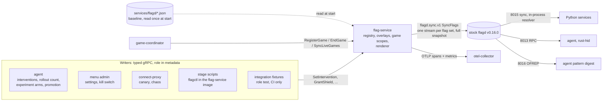

# Flag service: in-memory runtime flags as a gRPC sync source for flagd

> Architecture note. Status: **planned** (epic #1407). Written 2026-10-16 against `main` @ 2cdb3313.
> Spec rows: [UC-053](../use_cases/UC-053.md), FR-120 to FR-129, NFR-050 to NFR-053, C-030 to C-033
> ([requirements](../requirements.md)); [services.md §7](../specs/services.md#7-flag-service-planned-epic-1407),
> [flags.md §13](../specs/flags.md#13-mutable-flag-registry), [telemetry.md §10](../specs/telemetry.md#10-flag-service-planned-epic-1407),
> entities FLAG_OVERLAY, GAME_SCOPE, MUTABLE_FLAG_POLICY in the [entity model](../entity_model.md).

## 1. Summary

Today every runtime flag change is a read-modify-write of a JSON file in `services/flagd/` that flagd
picks up by polling the file's mtime (about 1 s). Seven production writers and a dozen test helpers
edit the same eight files in place, without a cross-process lock, and per-game and per-player state is
encoded as targeting ladders that nobody prunes. That design produced a run of safety bugs: game
scoping (#1269), replayed edge interventions (#1299 / PR #1306), `end_game` ending the wrong game
(#1310), re-granted shields (#1313, both fixed in PR #1315), and unbounded flag-file growth (#1323).

The maintainer's idea, in their words:

> "a flag mgmt service (without a db, just inmemory) ... we could send a game information to it, and
> the player, and the flag mgmt service could store the configuration in memory, and create the flagd
> configuration. it could be a grpc sync source for flagd. instead of writing to a file, we would be
> writing to the flag mgmt service (maybe it is just one binary with flagd included). at startup, it
> could load the files from the files, but never persist any thing into the files. this would also
> allow us to be more decisive with which flags are changable"

The **flag service** (`services/flag-service/`, Go) holds the runtime flag state in memory, renders
the flagd configuration for each flag set, and serves it to a stock flagd through flagd's gRPC sync
source. Writers call typed RPCs that say what they mean; the service generates the targeting. A
mutable-flag registry decides which flag may change, by whom and within which bounds. The game
coordinator tells the service when a game starts and ends, and game-scoped state dies with its game.

### Decisions

| # | Decision | Status |
|---|---|---|
| D1 | In memory only, no database. At start the service loads `services/flagd/*.json` (or `ci/*.json`) as the baseline and **never writes a file**. A restart returns to the baseline (C-030). | decided by the maintainer |
| D2 | The service is a **gRPC sync source** (`flagd.sync.v1.FlagSyncService`: `SyncFlags`, `FetchAllFlags`). Every OpenFeature client keeps evaluating on **stock flagd** (C-031). | decided by the maintainer |
| D3 | **Separate containers**: stock flagd plus the flag service. Embedding flagd in the same binary is rejected for now (§7.1). | recommendation |
| D4 | **Typed write API**, never raw flag JSON (C-032). | decided by the maintainer |
| D5 | The **game coordinator** reports the game lifecycle, not the agent (§8). | recommendation |
| D6 | **One-shot interventions stay flags**, rendered as a per-game sequence; no command channel (§6). | recommendation |
| D7 | A **mutable-flag registry** declares every runtime-mutable flag, its writer roles and bounds; everything else is read-only baseline (§9, [flags.md §13](../specs/flags.md#13-mutable-flag-registry)). | decided by the maintainer |
| D8 | Every write is an OTel span and a metric ([telemetry.md §10](../specs/telemetry.md#10-flag-service-planned-epic-1407)). | decided by the maintainer |
| D9 | **Full migration before the talk**: every writer moves to the service, then the file-write paths, nonce baselines and prune logic are deleted. No file-based fallback. A readiness checkpoint at T−14 days is a stabilisation gate, not a fallback decision (§12). | decided by the maintainer (2026-10-16) |

## 2. Target architecture



Nothing changes on the read side: flagd keeps its ports 8013 / 8014 / 8015 / 8016, the Python
services keep the in-process resolver against `flagd:8015` with `flagSetId=<set>` selectors, the agent
and rust-hid keep the RPC resolver on 8013, and the agent's pattern digest keeps OFREP on 8016.

The flag directory is mounted **read-only** into the flag service only. The menu, the agent and the
connect-proxy lose their writable `./services/flagd` mounts (today nothing is mounted `:ro`, and the
`:ro` claims in `services/agent/experiment/*.go` comments are stale), so C-033 is enforced by the
filesystem as well as by review.

## 3. Today: the writer inventory

Every writer below does a read-modify-write **in place** (truncate and write; temp+rename fails with
EBUSY on the bind mount). Locks are per process or per writer instance; there is no cross-process lock.

| # | Writer | Code | File | Flags | Mechanism | Trigger | Game-scoped? |
|---|---|---|---|---|---|---|---|
| W1 | Agent intervention sink | `services/agent/actions/writer.go` (`Apply` :249, `edit` :292, `writeInPlace` :745), `nonce.go`, `heal.go`, `gated.go` | `interventions.json` | edge: `eliminate_player`, `revive_player`, `audio_cue`, `controller_effect`, `end_game` (`<nonce>:<payload>` in variant `active`); state: `music_tempo_override`, `volume_override`, `global_sensitivity_override`, `global_difficulty_factor`, `pacing_profile`, `tempo_ramp`, `auto_rubberband` (`active` + `defaultVariant`); level: `player_sensitivity_factor`, `player_handicap_factor` (`agent_<serial>` + if-ladder on `targetingKey`); grant: `shield_seconds`, `partial_shield_seconds`, `soft_penalty_action` (`agent_<serial>#<nonce>`) | in place, re-parse after write, restore last good bytes; startup self-heal writes the embedded neutral file | each decision, gated by `interventions_enabled` | only `end_game` (payload); the rest per serial or global (#1269) |
| W2 | Agent rollout writer | `services/agent/actions/rollout_writer.go` (`SetControllerCount` :97) | `rollout.json` | `current_controller_count` (`defaultVariant`) | in place, own mutex | infra loop, gated by `rollout_enabled` | no |
| W3 | Agent experiment writer | `services/agent/experiment/writer.go` (`Apply` :70, `Strip` :91), `targeting.go`, `gate.go` | `game.json` | variant `agent_experiment__<id>` plus a chained if on `experiment_id`/`arm`; the proposer path writes the legacy unscoped `agent_experiment` with `game_kind != "real"`, which nothing strips | in place, `O_NOFOLLOW`; **two Writer instances on one file** (`experiment_loop.go:280`, `main.go:801`) | experiment start / teardown / proposer | by experiment, never by game |
| W4 | Dynamic declarer | `services/agent/dynamic_declarer.go` | none | none ("performs NO writes", :189); it feeds W3 | n/a | experiment tick | n/a |
| W5 | Autonomous promotion | `services/agent/promote/realdefault.go` (`SetRealDefault` :157, `RevertRealDefault` :285) | any file `AGENT_REAL_DEFAULT_FLAG_PATH` names (unchecked, #1293) | the real `defaultVariant` (or a new `promoted` variant); prior state snapshotted in `real_default_snapshots.json` | in place, `O_NOFOLLOW` | promote verdict, gated by env (off in the stock stack) | no |
| W6 | Menu admin | `lib/flag_config_writer.py` (`update_default_variant` :35, `cycle_variant` :215), `services/menu/servicer.py:101-108`, `handlers/admin.py` | `user.json`, `game.json`, `agent.json` | `current_game`, `game_instructions`; `sensitivity`, `num_teams`, `force_all_start`; `interventions_allowed` | in place, no lock | host in admin mode, game selection | no |
| W7 | connect-proxy | `services/connect-proxy/chaos.go` (`setChaosVariant` :181), `canary.go` (`setCanaryRouting` :103) | `controller.json` | `chaos_fault_type`, `bluetooth_backend` (`defaultVariant` or `fractional` on `targetingKey`) | typed remarshal (drops unknown keys), `os.WriteFile`; in CI it writes the base dir while flagd serves `ci/` | operator HTTP POST | no |
| W8 | Stage and operator scripts | `scripts/talk-stage.sh` (`set`, `reset`, `permissions`), `scripts/agent-backend.sh`, `scripts/agent-dryrun-enable.sh`, `scripts/agent-killswitch.sh` | `ci/agent.json` (default), `talk-stage.sh reset` also `interventions.json` | `decision.*`, `enabled`, `experiments_enabled`, `interventions_allowed`, the stage baseline (`scripts/talk-baseline.json`); `reset` neutralises interventions and deletes their targeting but leaves `agent_<serial>` variants | Python heredoc, in place | presenter / operator | no |
| W9 | Demo validation harness | `tools/demo/validation_harness.py` (`set_flag_default_variant` :219, `restore_flags` :211) | `<domain>.json` | `interventions_allowed`, `fitness.accelerate.target_session_seconds` per scenario | in place, snapshot and restore | per scenario | no |
| W10 | Integration fixtures | `tests/integration/test_intervention_flow.py` (`flag_files` :229, `write_*`, `rewrite_edge_value` with `_reload_marker`), `test_parallel_intervention_flow.py` (`_branches` side registry, uuid5 variant names, `_FILE_LOCK`), `test_intervention_smoke.py`, `test_gameid_intervention_isolation.py`, `test_experiment_shadow_isolation.py`, `test_experiment_cohort_loop.py` (`enabled`, `experiments_enabled`, `verdict_min_n`, `verdict_min_pairs`, `experiment_tick_seconds`, `experiment_max_games`), `test_decide_backend_e2e.py` (`decision.*`, `enabled`, `interventions_*`), `test_admin_flow.py`, `test_rollout_plumbing.py`, `helpers.py` (`wait_flag_file_restored`) | `services/flagd/ci/*.json` | every intervention, `policy.*` budgets (pinned to 50), agent switches, `game.json`, `user.json`, `rollout.json` | in place; snapshot and byte-for-byte restore; `_reload_marker` to force a byte change | per test | `_branches` ladders (tests only) |

Non-writers (checked): the game coordinator (it only keeps the in-memory nonce baselines,
`InterventionManager.prime_session` / `forget_session` / `_prune_stale_buckets`), `lib/` apart from
`flag_config_writer.py`, the dashboard (no flagd client), rust-hid.

## 4. After: the same writers through the service

| # | Writer | After | Role | Sub-issue |
|---|---|---|---|---|
| W1 | Agent intervention sink | `flagsvc.ActionSink` calls `SetIntervention` / `GrantPlayer` / `SetPlayerLevel` / `FireOneShot` with the deciding game's id; `HealIfCorrupt`, `nonce.go` and `writeInPlace` are deleted | `agent` | #1411 |
| W2 | Agent rollout writer | `SetRolloutCount` | `agent` | #1411 |
| W3 | Agent experiment writer | `SetExperimentArm` / `ClearExperiment`; the proposer path must carry an experiment id; `experiment/gate.go` stays as a second check until #1416 | `experiment` | #1415 |
| W4 | Dynamic declarer | unchanged (feeds W3) | n/a | #1415 |
| W5 | Autonomous promotion | `PromoteDefault` / `RevertPromotion`: an in-memory overlay; the durable path is the promotion PR (FR-064, C-007); `real_default_snapshots.json` is no longer needed because a restart already reverts | `promotion` | #1415 |
| W6 | Menu admin | `SetAdminSetting` (sensitivity, teams, force-all-start, current game, instructions) and `SetInterventionsAllowed`; `FlagConfigWriter` deleted | `admin` | #1412 (`interventions_allowed`), #1415 (the rest) |
| W7 | connect-proxy | `SetControllerRouting` (canary, fraction) and `SetChaosFault`; the CI mount gap disappears | `operator` | #1415 |
| W8 | Stage scripts | `flagctl` in the flag-service image, called with `docker compose exec -T flag-service flagctl ...`; `talk-stage.sh reset` becomes `ResetOverlays(role=stage)`; game scopes need no reset | `stage`, `operator` | #1412 |
| W9 | Validation harness | `flagctl set` per scenario, `ResetOverlays` after | `operator` | #1412 |
| W10 | Integration fixtures | a `flag_service` fixture over the gRPC API (`SetFlag` for role `test`, `ResetOverlays` between tests); no snapshots, no `_branches`, no `_reload_marker`, no `wait_flag_file_restored` | `test` | with the cutover of the set they write (#1411, #1412, #1415); shared fixture in #1413 |

## 5. flagd integration

**Sources.** flagd gets one gRPC sync source per flag set instead of eight `--uri file:` sources:

```text
--sources='[{"uri":"flag-service:50064","provider":"grpc","selector":"flagSetId=system"},
            {"uri":"flag-service:50064","provider":"grpc","selector":"flagSetId=controller"}, ...]'
```

(in `--sources` the `uri` is a bare `host:port`; the `--uri grpc://` shorthand works too). One stream per
set keeps a change small: a shield grant re-sends the `interventions` set only. flagd treats each
message as a **full replace for that source** (the `incrementalUpdates` option, experimental since
v0.15.2, is not needed), so every message carries the whole flag set
([sync configuration](https://flagd.dev/reference/sync-configuration/),
[store.go](https://github.com/open-feature/flagd/blob/main/core/pkg/store/store.go)).

**Selector and flag sets.** flagd sends the source's selector upstream in
`SyncFlagsRequest.selector` (body; deprecated since 2026-02 in favour of the `flagd-selector` header,
which flagd's outbound sync client does not set) and stores whatever comes back. The flag service
therefore filters on the selector from the body **or** the header, and stamps the top-level
`metadata.flagSetId` into every `flag_configuration`; that is the only way a client selector such as
`flagSetId=agent` keeps matching
([grpc_sync.go](https://github.com/open-feature/flagd/blob/main/core/pkg/sync/grpc/grpc_sync.go),
[selector syntax](https://flagd.dev/reference/selector-syntax/),
[ADR: decouple flag source and set](https://github.com/open-feature/flagd/blob/main/docs/architecture-decisions/decouple-flag-source-and-set.md)).
Flag sets and selector namespacing arrived in flagd v0.13.0, so the pinned v0.16.0 supports this
([changelog](https://github.com/open-feature/flagd/blob/main/flagd/CHANGELOG.md)).

**Proto.** `flagd.sync.v1` ([sync.proto](https://github.com/open-feature/flagd-schemas/blob/main/protobuf/flagd/sync/v1/sync.proto),
`buf.build/open-feature/flagd`): `SyncFlags(SyncFlagsRequest{provider_id, selector}) returns (stream
SyncFlagsResponse{flag_configuration, sync_context})`, `FetchAllFlags`, and the deprecated
`GetMetadata`. The legacy `sync.v1` package with its `ALL/ADD/UPDATE/DELETE/PING` state enum is
deprecated and not implemented. `sync_context` is not forwarded by flagd to its own in-process
clients (unverified; the service sends none).

**Keepalive.** There is no ping message; liveness is HTTP/2 keepalive. A grpc-go server must set a
permissive `keepalive.EnforcementPolicy` (the Go provider pings every 30 s; grpc-go's default
enforcement disconnects it with ENHANCE_YOUR_CALM)
([ADR: sync server keepalive](https://github.com/open-feature/flagd/blob/main/docs/architecture-decisions/sync-server-keepalive-enforcement.md)).

**Startup order.** flagd **exits** when a gRPC source is unreachable at its start (the first
`SyncFlags` is not retried; `start.go` calls `Fatal`), so compose starts flagd with
`depends_on: flag-service: condition: service_healthy` and `restart: unless-stopped`
([runtime.go](https://github.com/open-feature/flagd/blob/main/flagd/pkg/runtime/runtime.go),
[start.go](https://github.com/open-feature/flagd/blob/main/flagd/cmd/start.go)).

**Outage and restart.** When the stream drops, flagd keeps serving its last snapshot (nothing is
cleared, `IsReady()` stays true) and retries after 4 s, 16 s, 64 s, then every 60 s. The first message
after a reconnect is a full replace. Consequences, written into NFR-052:

- A flag-service outage is invisible to readers; writes fail closed at the writer (500 ms deadline).
- An **unplanned** flag-service restart leaves flagd on the old snapshot (including the interventions
  of live games) until it reconnects, at most about 64 s; the service exports
  `flagservice_sync_streams` so the pre-flight check and an alert can see a missing flagd stream.
- A **planned** restart restarts flagd as well (compose `depends_on ... restart: true`, and
  `scripts/flags.sh restart`), so flagd serves the baseline within 5 s.
- The in-process clients behind flagd retry every 1 s to 5 s and keep their cached rules
  ([provider spec](https://flagd.dev/reference/specifications/providers/)).

**Latency.** No published numbers exist; flagd's path from `Recv` to `SetState` to the event and sync
streams has no debounce or timer, only channel hops and a JSON parse of the snapshot. The 1 s file poll
disappears from the write path. NFR-050 sets the target (p95 at most 200 ms to flagd, 300 ms to the
coordinator) and #1413 measures it.

**Version.** flagd v0.16.0 stays pinned; v0.17.0 (readiness waits for every source) and v0.18.0
(CBOR fractional hashing: assignments change) are separate upgrades, not part of this epic.

## 6. One-shot interventions: flags or commands

`end_game`, `eliminate_player`, `revive_player`, `audio_cue` and `controller_effect` are events, not
states. Two options:

| | Keep them as flags (rendered per game) | Explicit commands (coordinator RPC) |
|---|---|---|
| Talk theme ("Two Standards": OTel + OpenFeature) | every agent effect is still an OpenFeature flag change, visible in flagd and in the trace | a second control channel next to flags; contradicts C-002 and C-005 |
| Replay into the next game (#1299) | gone: a game scope starts empty, so there is no stale value to consume | gone |
| Wrong game (#1310) | gone: rendered on `gameId` | gone |
| Lost events | two one-shots of the same flag for the same game and serial within one propagation window (< 300 ms) collapse to the second; mitigated by per-serial scoping and the intervention budget | none |
| Code change | coordinator keeps its change detection, drops the baseline priming | new RPC, new auth, new failure modes, agent C-001 / C-005 exceptions |

**Recommendation: keep them as flags.** The service renders each one-shot as
`<seq>:<payload>` in the game's scope (and the serial's, for eliminate, revive and effect), with `seq`
a per-game, per-flag counter it assigns. The coordinator fires when the resolved sequence changes
during the game; a new game resolves the neutral value, so the consumed baseline of UC-040 BR-006 and
the per-player grant baseline of UC-040 BR-012 are no longer needed. If #1413 measures lost events,
the follow-up is an object-valued bounded event list per game (`{"seq":n,"events":[...]}`; object flags
resolve over every resolver, unlike array flags, #1221), still a flag.

## 7. Alternatives considered

### 7.1 One binary with flagd embedded (rejected for now)

- `github.com/open-feature/flagd/core` is a v0 module; its semver ADR puts the Sync, Evaluation and
  OFREP APIs outside semver and lists "extraction and independent versioning of the flagd-core Go
  library" as future work ([pkg.go.dev](https://pkg.go.dev/github.com/open-feature/flagd/core),
  [semantic versioning ADR](https://github.com/open-feature/flagd/blob/main/docs/architecture-decisions/semantic-versioning-policy.md)).
- The daemon has no plugin hook for custom syncs. A custom binary could build a `Runtime` from the
  separate `flagd/flagd` module and append its own `sync.ISync` (`Init`, `Sync`, `ReSync`, `IsReady`) to
  the exported `Runtime.Syncs`, but that relies on undocumented internals, and we would own the
  evaluation, sync and OFREP servers that the stock image gives us.
- The talk is about **stock** OpenFeature and OTel; a forked flagd weakens that story.
- What embedding would buy: no reconnect backoff after a restart and no second container (~20 MiB).
  §5 covers both with startup ordering and a joint restart. Revisit when flagd-core is extracted and
  versioned.

### 7.2 Keep the files, fix the writers

Each fix so far (#1306, #1315) added state to the coordinator (nonce and grant baselines) instead of
removing it, and #1323 lists the next ones (growth, collapse within one poll, the fallback partition).
Files cannot drop state when a game ends without a writer that knows the game ended, and a
cross-process lock over a bind mount is fragile. Rejected.

### 7.3 flagd's HTTP sync (polling)

`provider: http` polls with ETag every `interval` (default 5 s). It survives a restart without the gRPC
backoff, but adds up to one interval of latency to every write, which defeats NFR-050. Rejected; the
service may still expose the same snapshot over HTTP for debugging.

### 7.4 In-process clients straight to the flag service

The flag service implements `flagd.sync.v1`, so the Python in-process resolvers could connect to it
directly. Rejected: it would split evaluation between flagd and the service, and the agent and
rust-hid use the RPC resolver anyway. flagd stays the single evaluation point (C-031).

## 8. Game lifecycle: who reports it

**Recommendation: the game coordinator.**

- It admits and retires **every** game, real and shadow; the agent only starts shadow games.
- It knows the game id, kind, serials, experiment and arm at admission, before the game loop evaluates
  any flag. The agent learns of a game from OTel spans after the batch delay (C-001), so a scope
  registered by the agent could arrive after the first decision.
- It already has hooks at exactly these points: `prime_session` and `forget_session`
  (`services/game_coordinator/servicer.py:613`, `:694`). Those hooks become `RegisterGame` and
  `EndGame`, and the baseline priming disappears.
- A write for a game the coordinator never registered is rejected (`game_not_live`), which closes the
  fallback-partition `session-N` case of #1323 by construction.

Failure modes: if `RegisterGame` fails, the game still starts (the game never waits, C-004) and the
coordinator retries in the background; until it succeeds, agent writes for that game are rejected
(fail closed). On coordinator start, and whenever the flag service's stream reconnects, the
coordinator sends `SyncLiveGames` with its full set of live games; the service drops every other scope.
A scope older than `max game age` (default 1 h) expires.

## 9. Registry, roles and authorization

The registry lives in the service (`services/flag-service/registry.yaml`, reviewed like code) and is
documented in [flags.md §13](../specs/flags.md#13-mutable-flag-registry). Each entry: flag set, key,
scope (`stack`, `game`, `game+serial`, `experiment+arm`, `fraction`), writer roles, and bounds
(declared variants, a numeric range, or a payload schema). A flag absent from the registry is
read-only for every role, including `test`.

Roles: `coordinator` (the game lifecycle RPCs only), `agent`, `experiment`, `promotion` (the agent's three hats), `admin` (the menu on behalf of the
host), `operator` (connect-proxy, `flagctl`, the validation harness), `stage` (talk scripts), `test`
(integration fixtures; accepted only when the service runs with `FLAG_SERVICE_TEST_ROLE=on`, which only
the CI compose files set). The role travels in gRPC metadata `x-flag-writer-role`; when
`FLAG_SERVICE_TOKEN_<ROLE>` is set (from the environment, C-016), a matching
`authorization: Bearer` is required. The flag-service port is not published to the host (C-015);
scripts use `flagctl` inside the container.

This enforces [OWNERSHIP_MODEL.md](../OWNERSHIP_MODEL.md) §1 in code: the agent cannot write
`user` or the agent's own governance flags, because no registry entry gives role `agent` those keys.

## 10. Rendering

Per flag set the service keeps: the baseline (parsed once), stack-wide overlays (flag → variant or
value, with writer and time), experiment arms, and game scopes (game id → kind, serials, experiment,
arm, per-flag values and sequences). On each accepted write it renders that one set and pushes it to
every stream subscribed to it. Rendered targeting for a game-scoped flag, two live games:

```json
"shield_seconds": {
  "state": "ENABLED",
  "defaultVariant": "none",
  "variants": {"none": 0, "short": 3, "default": 5, "long": 10, "r17": 5, "r18": 3},
  "targeting": {"if": [
    {"and": [{"==": [{"var": "gameId"}, "game_0a1b2c3d4e5f"]}, {"==": [{"var": "targetingKey"}, "MOCK0001"]}]}, "r17",
    {"and": [{"==": [{"var": "gameId"}, "game_9f8e7d6c5b4a"]}, {"==": [{"var": "targetingKey"}, "MOCK0007"]}]}, "r18",
    null
  ]}
}
```

Variant names are opaque (`r<n>`) and never parsed by readers; a new grant gets a new name, which is
what the coordinator's per-player change detection keys on. A baseline targeting rule (for example
`sensitivity` or `windows` in `game.json`) is kept as the final `else` branch. Ordering: game scopes,
then experiment arms, then stack-wide overlays, then the baseline. Size is bounded by live games ×
players × mutable flags (NFR-051), not by history.

The evaluation context the coordinator already sends (`{targetingKey=serial, gameId}` for
interventions, `game_kind`, `experiment_id`, `arm` per game, `lib/feature_flags.py`) is all the
rendering needs. Readers that evaluate an intervention flag **without** a `gameId` (the menu's display
of `global_sensitivity_override`, `services/menu/handlers/admin.py:1260`) resolve the baseline; #1410
lists them.

## 11. Risks

| Risk | Mitigation |
|---|---|
| flagd's 4–64 s reconnect after an unplanned flag-service restart serves a stale snapshot | joint restart for planned restarts; `flagservice_sync_streams` metric, pre-flight check and alert; the service is small and has no external dependency |
| flagd exits if the service is down at its start | `depends_on: service_healthy`, `restart: unless-stopped` |
| Admin settings no longer survive a restart (**breaking change** to FR-018) | accepted by D1; the shipped files hold the defaults; durable changes are a commit. FR-018 is reworded when the menu migrates (#1415) |
| A promoted default disappears on restart | intended: promotion persists through the PR route (FR-064, C-007) |
| One more container on the Pi (NFR-020) | Go binary, memory limit 64 MiB (NFR-051); also in `docker-compose.lite.yml` |
| Collapse of two one-shots within one propagation window | per-serial scoping; measured in #1413; object event list as follow-up (§6) |
| Coordinator registration failure | game runs, agent writes fail closed, background retry, `SyncLiveGames` on reconnect |
| Keepalive mismatch disconnects | permissive `EnforcementPolicy` (§5); covered by an integration test that idles 10 min |
| Hand edits of flag files during development no longer apply live | restart the flag service (`scripts/flags.sh restart`), or set the value with `flagctl` |

## 12. Migration plan

The maintainer decided on 2026-10-16: there is time before the talk ("later in November 2026"; the
date is not pinned yet, **T** below), so **every writer migrates before the talk and the old
mechanisms are deleted**. There is no file-based fallback.

**Cutover per flag set.** flagd accepts file and gRPC sources side by side as long as they carry
different flag sets. Each set therefore moves from its `--uri file:` source to its gRPC source in the
same PR that moves **all** of that set's writers (production code, scripts and test fixtures), so the
integration suite stays green after every step. The service loads every file at start but serves only
the sets listed in `FLAG_SERVICE_SETS`.

| Set | Writers that move with it | Sub-issue |
|---|---|---|
| `system`, `observability` | none at runtime (proves the plumbing) | #1408 |
| `interventions`, `rollout` | W1, W2; fixtures in `test_intervention_flow.py`, `test_parallel_intervention_flow.py`, `test_intervention_smoke.py`, `test_gameid_intervention_isolation.py`, `test_rollout_plumbing.py` | #1411 |
| `agent` | W8 stage and operator scripts, W9 validation harness, the menu's `interventions_allowed` (part of W6), agent-set fixtures (`policy.*` budgets, `test_decide_backend_e2e.py`, `test_experiment_cohort_loop.py`) | #1412 |
| `game`, `user`, `controller` | W3 experiments (with W4), W5 promotion, the rest of W6 (menu admin), W7 connect-proxy, remaining fixtures (`test_admin_flow.py`, `test_experiment_shadow_isolation.py`, `test_intervention_smoke.py` game part) | #1415 |

| Order | Sub-issue | Scope | Depends on | Exit criterion |
|---|---|---|---|---|
| 1 | #1408 | Service skeleton (Go), baseline load, `flagd.sync.v1` server (one stream per set, selector from body or header, keepalive policy), flagd wiring in every compose file (base, ci, lite, dry-run, decide-e2e), health check, start order; serves `system` and `observability` | | integration suite green with those two sets on the service |
| 2 | #1409 | Mutable-flag registry, roles and tokens, bounds validation, `GetRegistry` / `GetState`, write spans and metrics | #1408 | registry table of flags.md §13 encoded; rejection paths unit-tested |
| 3 | #1410 | Typed write API, game lifecycle (`RegisterGame`, `EndGame`, `SyncLiveGames`, expiry), renderer (game, serial, sequence); the coordinator registers games | #1409 | a game scope is dropped at game end, proven by a test |
| 4 | #1411 | Agent writer (W1, W2) on the API; cut over `interventions` and `rollout`; the coordinator stops priming baselines for these flags | #1410 | intervention and rollout tests green on the service |
| 5 | #1412 | Stage scripts (W8) via `flagctl`, harness (W9), menu kill switch; cut over `agent`; `talk-preflight.sh` checks the sync streams | #1410 | talk runbook rehearsed on the laptop |
| 6 | #1413 | Integration tests for UC-053 (propagation latency, game isolation, restart, outage), the shared `flag_service` fixture, pre-flight check | #1411 | NFR-050, NFR-052, NFR-053 measured |
| 7 | #1414 | **Readiness checkpoint at T−14 days**: every flag set on the service, the full integration suite green, a rehearsal of the talk on the Raspberry Pi 5 with real controllers | #1408 to #1413, #1415 | a stabilisation gate: findings become fixes before the talk, not a fallback |
| 8 | #1415 | Experiments (W3, W4), promotion (W5), menu admin (W6), connect-proxy (W7), remaining fixtures; cut over `game`, `user`, `controller`; flag mounts read-only (flag service only) | #1410 | no writable flag mount in any compose file |
| 9 | #1416 | Delete the file-write paths (`actions/writer.go` file code, `rollout_writer.go`, `experiment/writer.go`, `promote/realdefault.go` file code and snapshot store, `lib/flag_config_writer.py`, connect-proxy file writes, file-writing test helpers), the nonce and grant baselines and `_prune_stale_buckets` in `interventions.py`, `_branches` / `_reload_marker`, and the agent's direct file reads (`remediation_reader.go`) | #1414 passed | no runtime code opens a flag file for writing (C-033) |

The list order is the issue order; #1415 runs in parallel with #1411 to #1413 (it touches other flag
sets) and must be merged before the checkpoint.

## 13. Issues

Superseded (closed by the epic when the migration is done):

| Issue | How |
|---|---|
| #1269 game scoping (FR-069) | every intervention is rendered on `gameId` (FR-126) |
| #1323 flag-file growth, unprimed grant serial, collapse within one poll, `end_game` from the fallback partition | game scopes are dropped at game end; no baselines; push instead of a 1 s poll; unregistered games are rejected |
| #920 per-game targeting design (if-ladder / `_branches` ceiling) | the renderer generates the ladder from live scopes only |
| #1293 unchecked `AGENT_REAL_DEFAULT_FLAG_PATH` | promotion is a typed RPC limited by the registry |
| nonce and baseline mechanisms of #1299 (PR #1306) and #1310 / #1313 (PR #1315) | already closed; their code (UC-040 BR-006, BR-012 baselines) is deleted in #1416 |

Related but not superseded: #1329 (coordinator evaluates before its provider is ready; still true behind
flagd), #1092 (agent-tunable flag catalog: the registry's bounds are an input to it), #1194 (env vars to
flags), #1277 (`game_instructions` has no reader), #1221 (array flags; object flags are fine), the flagd
v0.17 / v0.18 upgrades.

## 14. Sources

- flagd sync configuration: https://flagd.dev/reference/sync-configuration/ and https://flagd.dev/concepts/syncs/
- flagd selector syntax: https://flagd.dev/reference/selector-syntax/
- flagd provider specification (in-process resolver, retry defaults): https://flagd.dev/reference/specifications/providers/
- `flagd.sync.v1` proto: https://github.com/open-feature/flagd-schemas/blob/main/protobuf/flagd/sync/v1/sync.proto (published as `buf.build/open-feature/flagd`)
- flagd gRPC sync client: https://github.com/open-feature/flagd/blob/main/core/pkg/sync/grpc/grpc_sync.go
- flagd store (source priority, full replace): https://github.com/open-feature/flagd/blob/main/core/pkg/store/store.go
- flagd runtime and start-up: https://github.com/open-feature/flagd/blob/main/flagd/pkg/runtime/runtime.go, https://github.com/open-feature/flagd/blob/main/flagd/cmd/start.go
- ADRs: https://github.com/open-feature/flagd/blob/main/docs/architecture-decisions/decouple-flag-source-and-set.md, https://github.com/open-feature/flagd/blob/main/docs/architecture-decisions/sync-server-keepalive-enforcement.md, https://github.com/open-feature/flagd/blob/main/docs/architecture-decisions/semantic-versioning-policy.md
- flagd changelog and releases: https://github.com/open-feature/flagd/blob/main/flagd/CHANGELOG.md, https://github.com/open-feature/flagd/releases
- flagd core as a Go module: https://pkg.go.dev/github.com/open-feature/flagd/core
- Go flagd provider: https://github.com/open-feature/go-sdk-contrib/blob/main/providers/flagd/README.md

Behaviour read from flagd's `main` branch on 2026-10-16 (backoff constants, fail-fast start, selector
handling) is long-standing but was not diffed against the v0.16.0 tag; #1408 verifies it on v0.16.0.
