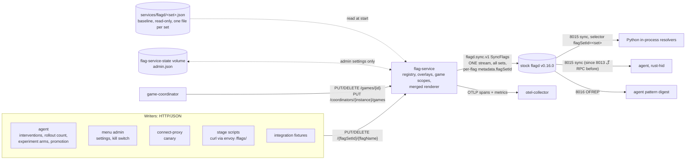

# Flag service: in-memory runtime flags as a gRPC sync source for flagd

> **Historical / decision record (status: implemented, #1417).** Sections 1 and 3 ("Today") describe the pre-#1417 world, where every writer edited the flagd JSON files in place; that file-writer design no longer exists. Kept in place because specs and test cases cite its decisions. Normative content now lives in [services.md §7](../specs/services.md#7-flag-service-epic-1407), [flags.md §13](../specs/flags.md#13-mutable-flag-registry) and [telemetry.md §10](../specs/telemetry.md#10-flag-service-epic-1407).

> Architecture note. Status: **implemented** (epic #1407, delivered in one PR, #1417; see §12.1). Written 2026-10-16 against `main`; revised the same day
> with the maintainer's decisions on the review of PR #1417 (§1, decisions D3, D4, D10 to D13), and again with
> the decisions on the re-review (N1 to N6: sync fan-out §5.4, event-list reader §6, persistence on request D10
> and §10.1, read-only mounts at the checkpoint §12). Implementation starts in the same PR (#1408 to #1410).
> Spec rows: [UC-053](../use_cases/UC-053.md), FR-130 to FR-139, NFR-050 to NFR-053, C-030 to C-033
> ([requirements](../requirements.md)); [services.md §7](../specs/services.md#7-flag-service-epic-1407),
> [flags.md §13](../specs/flags.md#13-mutable-flag-registry), [telemetry.md §10](../specs/telemetry.md#10-flag-service-epic-1407),
> entities MUTABLE_FLAG_POLICY, GAME_SCOPE, FLAG_OVERLAY in the [entity model](../entity_model.md).

## 1. Summary

Today every runtime flag change is a read-modify-write of a JSON file in `services/flagd/` that flagd
picks up by polling the file's mtime (about 1 s). Seven production writers and a dozen test helpers
edit the same nine files in place, without a cross-process lock, and per-game and per-player state is
encoded as targeting ladders that nobody prunes. That design produced a run of safety bugs: game
scoping (#1269), replayed edge interventions (#1299 / PR #1306), `end_game` ending the wrong game
(#1310), re-granted shields (#1313, both fixed in PR #1315), and unbounded flag-file growth (#1323).

The maintainer's idea, in their words:

> "a flag mgmt service (without a db, just inmemory) ... we could send a game information to it, and
> the player, and the flag mgmt service could store the configuration in memory, and create the flagd
> configuration. it could be a grpc sync source for flagd. instead of writing to a file, we would be
> writing to the flag mgmt service (maybe it is just one binary with flagd included). at startup, it
> could load the files from the files, but never persist any thing into the files. this would also
> allow us to be more decisive with which flags are changable"

and, on the review of the first draft:

> "we can have multiple paths for listening for flagd, but one service which accepts the changes on one
> endpoints per flag file, with a flag name and other properties which need to be used. - admin settings
> can be persisted. this is a local game we do not care about the roles or possible violations"

> "flagd also has flagset ids - which we can use to store all flags in one file, it just gets messier to
> read. but we should also utilize flagset ids"

> "the endpoint can also look like /flagsetId/flagname"

The **flag service** (`services/flag-service/`, Go) holds the runtime flag state, merges every flag set
into one flagd configuration in which each flag carries its `metadata.flagSetId`, and serves it to a
stock flagd through flagd's gRPC sync source. Writers call one resource-style HTTP endpoint,
`PUT /{flagSetId}/{flagName}`, with the value and the scope properties (game, serial, experiment, arm,
game kind); the service generates the targeting. A mutable-flag registry decides which flag may change
and within which bounds. The game coordinator tells the service when a game starts and ends, and
game-scoped state dies with its game.

### Decisions

| # | Decision | Status |
|---|---|---|
| D1 | No database. At start the service loads the baseline flag files (`services/flagd/<set>.json`, or `ci/<set>.json`) and **never writes them**. Runtime state is in memory, except admin settings (D10). A restart returns to the baseline plus the persisted admin settings (C-030). | decided by the maintainer |
| D2 | The service is a **gRPC sync source** (`flagd.sync.v1.FlagSyncService`). Every OpenFeature client keeps evaluating on **stock flagd** (C-031). | decided by the maintainer |
| D3 | **flagSetIds partition the flags; flagd gets ONE gRPC sync source.** The service merges the per-set files at load time into one configuration whose flags each carry `metadata.flagSetId`; flagd's full replace per source then covers every set at once. Clients keep their `flagSetId=<set>` selectors. Verified against flagd v0.16.0 / core v0.15.6 (§5.2). Separate per-set sync paths are the documented fallback, not used (§5.3). | decided by the maintainer; verified |
| D4 | **One write endpoint per flag set, addressed by path**: `PUT` / `DELETE` / `GET /{flagSetId}/{flagName}`, `GET /{flagSetId}`, and the game lifecycle as `PUT` / `DELETE /games/{gameId}`. Served as **plain HTTP/JSON** (§9). | decided by the maintainer; HTTP/JSON recommended |
| D5 | **Separate containers**: stock flagd plus the flag service. Embedding flagd is rejected for now (§7.1). | recommendation |
| D6 | The **game coordinator** reports the game lifecycle, not the agent; each coordinator instance reconciles only its own games (§8). | recommendation |
| D7 | **One-shot interventions stay flags**, as a per-game **event list** object (`{"epoch","seq","events"}`), rendered on `gameId` only with the serial in the payload (§6). | decided by default (maintainer did not object) |
| D8 | A **mutable-flag registry** declares every runtime-mutable flag and its bounds; every other flag is read-only baseline ([flags.md §13](../specs/flags.md#13-mutable-flag-registry)). | decided by the maintainer |
| D9 | Every write is an OTel span and a metric ([telemetry.md §10](../specs/telemetry.md#10-flag-service-epic-1407)). | decided by the maintainer |
| D10 | **Admin settings are persisted on request** to a service-owned state file (`FLAG_SERVICE_STATE_FILE`, default `/var/lib/flag-service/admin.json` on the stack's own `flag-service-state` volume), never to `services/flagd/*.json`. A write persists only when it says so (`"persist": true`) and the registry allows it for that flag; the menu admin asks for it, stage scripts, the harness and tests do not. Persisted values survive restarts (FR-018 stays). Details §10.1. | decided by the maintainer (persistence on request: re-review N4) |
| D11 | **No roles, no tokens, no authorization.** This is a local party game: a write is validated only against the registry (mutable? in bounds?), the game scope (is the game registered?) and the sync stream (is flagd connected?). The `writer` field is an informational label for the trace. Authorization is out of scope by decision. | decided by the maintainer |
| D12 | **Full migration before the talk**, then delete the file-write paths, nonce baselines and prune logic. No file-based fallback. A readiness checkpoint at T−14 days is a stabilisation gate (§12). | decided by the maintainer |
| D13 | **Overlays substitute `defaultVariant`**, so baseline targeting (for example the Werewolf rule on `sensitivity`) still wins, as it does today (§10). | decided by default |

## 2. Target architecture



Nothing changes on the read side: flagd keeps its ports 8013 / 8014 / 8015 / 8016, the Python
services keep the in-process resolver against `flagd:8015` with `flagSetId=<set>` selectors, the agent
and rust-hid keep the RPC resolver on 8013 (no selector; keys are unique across sets, §5.2), and the
agent's pattern digest keeps OFREP on 8016 with `Flagd-Selector: flagSetId=<set>`. (Since #1713 the agent and rust-hid also use the in-process resolver on 8015 with `flagSetId` selectors; [flags.md §1.1](../specs/flags.md#11-clients).)

The flag service mounts the flag directory **read-only** from the start. In the end state the menu, the
agent and the connect-proxy lose their writable `./services/flagd` mounts (today nothing else is mounted `:ro`,
and the `:ro` claims in `services/agent/experiment/*.go` comments are stale), and the `flag-dir-init` busybox
containers that make the directory group-writable are removed, so C-033 is enforced by the filesystem. That
removal waits for the **last** file writer to move: it is an item of the readiness checkpoint #1414, done after
every set is cut over, not part of any one set's cutover (re-review N3).

## 3. Today: the writer and reader inventory

Every writer below does a read-modify-write **in place** (truncate and write; temp+rename fails with
EBUSY on the bind mount). Locks are per process or per writer instance; there is no cross-process lock.

| # | Writer | Code | File | Flags | Mechanism | Trigger | Game-scoped? |
|---|---|---|---|---|---|---|---|
| W1 | Agent intervention sink | `services/agent/actions/writer.go` (`Apply` :249, `edit` :292, `writeInPlace` :745), `nonce.go`, `heal.go`, `gated.go` | `interventions.json` | edge: `eliminate_player`, `revive_player`, `audio_cue`, `controller_effect`, `end_game` (`<nonce>:<payload>` in variant `active`); state: `music_tempo_override`, `volume_override`, `global_sensitivity_override`, `global_difficulty_factor`, `pacing_profile`, `tempo_ramp`, `auto_rubberband`; level: `player_sensitivity_factor`, `player_handicap_factor` (`agent_<serial>` + if-ladder on `targetingKey`); grant: `shield_seconds`, `toughness_boost_seconds`, `soft_penalty_action` (`agent_<serial>#<nonce>`) | in place, re-parse after write, restore last good bytes; startup self-heal writes the embedded neutral file | each decision, gated by `interventions_enabled` | only `end_game` (payload); the rest per serial or global (#1269) |
| W2 | Agent rollout writer | `services/agent/actions/rollout_writer.go` (`SetControllerCount` :97) | `rollout.json` | `current_controller_count` | in place, own mutex | infra loop, gated by `rollout_enabled` | no |
| W3 | Agent experiment writer | `services/agent/experiment/writer.go` (`Apply` :70, `Strip` :91), `targeting.go`, `gate.go` | `game.json` | variant `agent_experiment__<id>` plus a chained if on `experiment_id`/`arm`; the proposer path writes the legacy unscoped `agent_experiment` with `game_kind != "real"`, which nothing strips | in place, `O_NOFOLLOW`; **two Writer instances on one file** (`experiment_loop.go:280`, `main.go:801`) | experiment start / teardown / proposer | by experiment, never by game |
| W4 | Dynamic declarer | `services/agent/dynamic_declarer.go` | none | none ("performs NO writes", :189); it feeds W3 | n/a | experiment tick | n/a |
| W5 | Autonomous promotion | `services/agent/promote/realdefault.go` (`SetRealDefault` :157, `RevertRealDefault` :285) | any file `AGENT_REAL_DEFAULT_FLAG_PATH` names (unchecked, #1293) | the real `defaultVariant` (or a new `promoted` variant); prior state snapshotted in `real_default_snapshots.json`; revert error cooldown from #1065 | in place, `O_NOFOLLOW` | promote verdict, gated by env (off in the stock stack) | no |
| W6 | Menu admin | `lib/flag_config_writer.py` (`update_default_variant` :35, `cycle_variant` :215), `services/menu/menu_setup.py:build_menu`, `handlers/admin.py` | `user.json`, `game.json`, `agent.json` | `current_game`, `game_instructions`; `sensitivity`, `num_teams`, `force_all_start`; `interventions_allowed` | in place, no lock | host in admin mode, game selection | no |
| W7 | connect-proxy | `canary.go` (`setCanaryRouting` :103) | `controller.json` | `bluetooth_backend` (`defaultVariant` or `fractional`) | typed remarshal (drops unknown keys), `os.WriteFile`; in CI it writes the base dir while flagd serves `ci/` | operator HTTP POST | no |
| W8 | Stage and operator scripts | `scripts/talk-stage.sh` (`set`, `reset`, `permissions`), `scripts/agent-backend.sh`, `scripts/agent-dryrun-enable.sh`, `scripts/agent-killswitch.sh` | `ci/agent.json` (default), `talk-stage.sh reset` also `interventions.json` | `decision.*`, `enabled`, `experiments_enabled`, `experiment_seed` (`agent-dryrun-enable.sh`, #1907), `interventions_allowed`, the stage baseline (`scripts/talk-baseline.json`) | Python heredoc, in place | presenter / operator | no |
| W9 | Demo validation harness | removed in #1322 (`tools/demo/validation_harness.py` deleted; nothing ran it) | none | none | n/a | n/a | n/a |
| W10 | Integration fixtures | `tests/integration/helpers.py` (`intervention_env`, `set_interventions_allowed`), `test_parallel_intervention_flow.py` (`_branches` side registry, uuid5 variant names, `_FILE_LOCK`), `test_intervention_smoke.py`, `test_gameid_intervention_isolation.py`, `tests/service/test_experiment_shadow_isolation.py`, `tests/service/agent_flow.py` (agent journeys, #1600), `tests/service/test_tc005_admin_journey.py`, `tests/service/test_tc020_host_and_stage_flags.py`, `tests/service/test_rollout_plumbing.py`, `helpers.py` (`wait_flag_file_restored`) | `services/flagd/ci/*.json` | every intervention, `policy.*` budgets, agent switches, `game.json`, `user.json`, `rollout.json` | in place; snapshot and byte-for-byte restore | per test | `_branches` ladders (tests only) |
| W11 | Script tests | `scripts/tests/test-talk-stage.sh`, `test-talk-preflight.sh`, `test-agent-backend.sh` | copies of `ci/agent.json`, `ci/interventions.json` in a temp dir | the flags W8 writes | file fixtures | CI "Script Tests" job | no |
| W12 | `flag-dir-init` | busybox one-shot in `docker-compose.yml:65`, `docker-compose.ci.yml:75`, `docker-compose.lite.yml:40` | the flag directory | none: `chgrp 65532` + `g+w` so the nonroot menu can write | permissions only | stack start | n/a |

**Direct file readers** (they bypass flagd and must move too):

| # | Reader | Reads | After | Owner |
|---|---|---|---|---|
| R1 | `services/agent/actions/remediation_reader.go:76` | `remediation_allowed` from `rollout.json` (defaultVariant only) | evaluate through flagd | #1411 |
| R2 | `services/agent/dynamic_declarer.go:328` | `game.json` flag keys and variants | `GET /game` | #1415 |
| R3 | `services/agent/main.go:1123` `gameFlagVocab` | `game.json` keys (proposer vocabulary) | `GET /game` | #1415 |
| R4 | `services/agent/experiment/gate.go:170` | `game.json` before the write (invariant gate) | the service renders the shadow condition; the gate checks `GET /game/{flag}` | #1415 |
| R5 | menu `FlagConfigWriter.cycle_variant` / `get_variant_names` (`lib/flag_config_writer.py:213`) | the variant list and current default of admin flags | `GET /{flagSetId}/{flagName}` | #1415 |
| R6 | `scripts/talk-preflight.sh` (12 `json.load` / `open` reads: `agent.json`, `controller.json`, `interventions.json`, the stage baseline) | stage baseline, controller backend, neutral interventions | `GET /agent`, `GET /controller`, `GET /state` | #1412 |

Non-writers (checked): the game coordinator (it keeps the in-memory nonce baselines,
`InterventionManager.forget_session` / `_prune_stale_buckets`), `lib/` apart from
`flag_config_writer.py`, the dashboard (no flagd client), rust-hid.

## 4. After: the same writers through the service

| # | Writer / reader | After | Sub-issue |
|---|---|---|---|
| W1 | Agent intervention sink | `PUT /interventions/{flag}` with `scope.game_id` (and `scope.serial` for levels and grants); `POST /interventions/{flag}` appends a one-shot event; `nonce.go`, `heal.go` and `writeInPlace` are deleted in #1416 | #1411 |
| W2, R1 | Agent rollout writer, remediation reader | `PUT /rollout/current_controller_count`; `remediation_allowed` through flagd | #1411 |
| W3, W4, R2 to R4 | Experiment writer, declarer, vocabulary, gate | `PUT /game/{flag}` with `scope.experiment_id` + `scope.arm` (the service adds `game_kind != "real"`); `DELETE /game/{flag}?experiment_id=` at teardown; the proposer path must carry an experiment id; readers use `GET /game` | #1415 |
| W5 | Autonomous promotion | `PUT /game/{flag}` with `scope.game_kind=real` and `writer=promotion`: an in-memory overlay; the durable path is the promotion PR (FR-064, C-007). The snapshot store is not needed (a restart reverts), but the **revert error cooldown of #1065 is lost** with `RevertRealDefault` unless #1415 re-implements it around `DELETE` | #1415 |
| W6, R5 | Menu admin | `PUT /game/sensitivity`, `/game/num_teams`, `/game/force_all_start`, `/user/current_game`, `/user/game_instructions` (persisted, D10) and `PUT /agent/interventions_allowed` (persisted; #1412); `cycle_variant` reads `GET`; `FlagConfigWriter` deleted in #1416 | #1412 (`interventions_allowed`), #1415 (rest) |
| W7 | connect-proxy | `PUT /controller/bluetooth_backend` with `fraction_percent` (the `chaos_fault_type` writer was removed in #1322); the CI mount gap disappears | #1420 |
| W8, W11, R6 | Stage scripts, their tests, pre-flight | `curl -X PUT http://localhost/flags/agent/decision.backend -d '{"variant":"jev"}'` through envoy; `talk-stage.sh reset` becomes `DELETE /agent?writer=stage` (clears stage overlays); the script tests stub the HTTP endpoint instead of copying files | #1412 |
| W9 | Validation harness | none (removed in #1322) | #1412 |
| W10 | Integration fixtures | a `flag_service` fixture over HTTP; overlays cleared with `DELETE` between tests; no snapshots, no `_branches`, no `_reload_marker`, no `wait_flag_file_restored` | with the cutover of the set they write (#1411, #1412, #1415, #1420); shared fixture in #1413 |
| W12 | `flag-dir-init` | removed; flag mounts read-only, on the flag service only, once every set is cut over | #1414 checklist |

## 5. flagd integration

### 5.1 One gRPC sync source

flagd gets **one** gRPC sync source instead of nine `--uri file:` sources:

```text
--sources='[{"uri":"flag-service:50064","provider":"grpc"}]'
```

(in `--sources` the `uri` is a bare `host:port`; the `--uri grpc://flag-service:50064` shorthand is
equivalent). The service sends one `flag_configuration` holding **every** flag of every served set, each
flag with `metadata.flagSetId`. flagd treats each message as a full replace **for that source**
([store.go](https://github.com/open-feature/flagd/blob/main/core/pkg/store/store.go)), so one source
carrying all sets is the configuration in which a full replace cannot wipe another set (review C1: with
several sources on one shared URI, each replace would delete the other sets' flags). The service sends
no `selector` filter of its own; it answers an empty selector with everything and a `flagSetId=<set>`
selector (from the body or the `flagd-selector` header) with that set only.

The source files stay **one per flag set** for readability; the merged, "messier" configuration exists
only in memory and on the wire.

### 5.2 Verification: per-flag flagSetId in one payload (flagd v0.16.0, core v0.15.6)

Read from the release tarballs `flagd/v0.16.0` (whose `flagd/go.mod` requires
`github.com/open-feature/flagd/core v0.15.6`) and `core/v0.15.6`:

- `core/pkg/store/store.go` `Store.Update`: each flag's metadata is `patchMetadata(setMetadata,
  flagMetadata)` (flag keys win), then `flagSetId` is taken from the patched metadata, and the flag is
  stored under the identifier `(flagSetId, key)`. A per-flag `metadata.flagSetId` therefore overrides the
  payload's top-level one, and flags of different sets coexist in one payload.
- `Store.Get` with a non-empty selector queries the `flagSetId` index with the key; without a selector it
  returns the highest-priority flag with that key across all sets. `core/pkg/model/flag.go` declares
  `Metadata` on every flag (`json:"metadata,omitempty"`).
- `flagd/pkg/service/flag-sync/handler.go` (`SyncFlags`): the selector comes from the `Flagd-Selector`
  header, else the body; the stream watches `store.Watch(ctx, &selector, ...)` and sends only the flags
  that match. So the in-process resolvers on 8015 with `flagSetId=<set>` receive exactly their set, and
  RPC evaluation with a `flagd-selector` header resolves within the set.
- **Duplicate keys.** One payload is a JSON object keyed by flag key, so a key can appear only once
  across all merged sets. Today there is one duplicate, `bluetooth_backend` in
  `services/flagd/controller.ci-rust.json`, a file that nothing loads (flags.md §11); `services/flagd/ci/`
  has none. The service loads an explicit list of nine files (not a glob) and refuses to start on a
  duplicate key. A future duplicate across sets would need per-set sync paths (§5.3).
- Clients without a selector (agent RPC, rust-hid) keep working because keys are unique.

#1408's exit test makes this executable: **every flag of every set resolves through its
`flagSetId=<set>` selector with a reason other than `DEFAULT` and `ERROR`** (untargeted flags resolve
`STATIC`; a flag whose baseline targeting falls through is probed with a context that matches a rule),
on the in-process resolver (8015) and on RPC (8013).

### 5.3 Fallback: one sync path per set (not used)

If a future flagd stopped honouring per-flag `flagSetId`, flagd would read each set through **its own
source address** on the same service (one network alias per set, e.g. `flagset-agent:50064`, or one
port per set), because flagd keys the full replace by source URI. Not needed today (§5.2).

The same per-set source addresses are the **fallback if the sync fan-out is too costly** (§5.4): with one
source, every write re-inserts every flag, so flagd wakes every set's watcher. If #1413 measures the fan-out
beyond NFR-050 with flagd at `cpus: 0.25`, flagd gets one source per set (`flagset-<set>:50064` aliases) and a
write wakes only its own set.

### 5.4 Proto, keepalive, start-up, outage

- **Proto.** `flagd.sync.v1` ([sync.proto](https://github.com/open-feature/flagd-schemas/blob/main/protobuf/flagd/sync/v1/sync.proto),
  `buf.build/open-feature/flagd`): `SyncFlags(SyncFlagsRequest{provider_id, selector}) returns (stream
  SyncFlagsResponse{flag_configuration, sync_context})`, `FetchAllFlags`, deprecated `GetMetadata`. The
  legacy `sync.v1` package with its `ALL/ADD/UPDATE/DELETE/PING` enum is not implemented.
- **Keepalive.** flagd v0.16.0's outbound sync client sets no keepalive, so the **service sends
  server-side keepalive pings** (`keepalive.ServerParameters{Time: 30s, Timeout: 10s}`) to detect a dead
  flagd, and allows client pings (`EnforcementPolicy{MinTime: 10s, PermitWithoutStream: true}`) for the
  in-process SDK clients that ping every 30 s
  ([ADR: sync server keepalive](https://github.com/open-feature/flagd/blob/main/docs/architecture-decisions/sync-server-keepalive-enforcement.md)).
- **Selector header.** The selector header name is configurable in flagd; the service reads
  `flagd-selector` (case-insensitive) and the body. An unknown selector key is `INVALID_ARGUMENT`,
  counted in `flagservice_sync_rejected_total{reason="unknown_selector"}` and alerted on: it means a
  client or flagd is misconfigured.
- **Start-up order.** flagd **exits** when a gRPC source is unreachable at its start (the first
  `SyncFlags` is not retried; `start.go` calls `Fatal`), so compose starts flagd with
  `depends_on: flag-service: condition: service_healthy` and `restart: unless-stopped`
  ([runtime.go](https://github.com/open-feature/flagd/blob/main/flagd/pkg/runtime/runtime.go),
  [start.go](https://github.com/open-feature/flagd/blob/main/flagd/cmd/start.go)). **No flagd `readyz`
  health check**: in v0.16.0 `readyz` never turns true with more than one gRPC sync source (flagd #1985);
  services that depend on flagd keep `condition: service_started`.
- **Outage and restart.** When the stream drops, flagd keeps serving its last snapshot and retries
  after 4 s, 16 s, 64 s, then every 60 s; the first message after a reconnect is a full replace.
  - A flag-service outage is invisible to readers; writes fail closed at the writer (500 ms deadline).
  - While flagd has **no open sync stream**, the service rejects flag writes with
    `503 no_sync_stream` (review Important 3): a write flagd cannot see must not look accepted. The game
    lifecycle calls (`PUT` / `DELETE /games/{gameId}`, `PUT /coordinators/{instance}/games`) are **exempt**:
    they change no flag value flagd must see first, and a coordinator must be able to register its games
    while flagd reconnects (re-review N6).
  - An **unplanned** restart leaves flagd on the old snapshot until it reconnects (at most about 64 s
    after the service is healthy again); `flagservice_sync_streams` makes it visible.
  - A **planned** restart restarts flagd too (compose `depends_on ... restart: true` and
    `scripts/flags.sh restart`, owned by #1408), so flagd serves the baseline within 5 s.
- **Latency.** No published numbers; flagd's path from `Recv` to `SetState` to the event and sync
  streams has no debounce, only channel hops and a JSON parse of the snapshot. The whole merged
  configuration (every flag; `make specs-counts` prints the number) is re-sent per write; NFR-051 bounds its size. NFR-050 sets the target,
  #1413 measures it.
- **Fan-out (re-review N1).** flagd's `Store.Update` re-inserts every flag of the source on each update, so
  with one source every write wakes the watcher of **every** set: each Python in-process domain provider then
  fires `PROVIDER_CONFIGURATION_CHANGED`, and OpenFeature's API-level handlers run once per domain. The
  decision is to keep the one source and absorb the fan-out in the readers:
  - the game coordinator's `evaluate_all` is **single-flight**: a change event that arrives while a pass runs
    marks the pass dirty and the running pass loops once more, so N overlapping events cost at most two passes;
  - the pass advances the last-applied `(epoch, seq)` of an event list, and the last-applied variant of a grant,
    **under the lock before** it dispatches, so a second pass can never apply the same event or grant again;
  - #1413 measures the fan-out against NFR-050 with flagd at `cpus: 0.25` (its compose limit); if it is too
    costly, flagd moves to the per-set source addresses of §5.3.
- **Single stream.** flagd opens one `SyncFlags` stream that carries every served set; the stream count, the
  `503 no_sync_stream` check and the `flagservice_sync_streams` gauge are about that one stream, not per set.
- **Version.** flagd v0.16.0 stays pinned; v0.17.0 and v0.18.0 (CBOR fractional hashing) are separate
  upgrades.

## 6. One-shot interventions: flags or commands

`end_game`, `eliminate_player`, `revive_player`, `audio_cue` and `controller_effect` are events, not
states.

| | Keep them as flags | Explicit commands (coordinator RPC) |
|---|---|---|
| Talk theme ("Two Standards": OTel + OpenFeature) | every agent effect is an OpenFeature flag change | a second control channel; contradicts C-002 and C-005 |
| Replay into the next game (#1299) | gone: a game's event list starts empty | gone |
| Wrong game (#1310) | gone: rendered on `gameId` | gone |
| Lost events | none: the event list holds the last K events (below) | none |

**Decision (by default, the maintainer did not object): keep them as flags, as a per-game event list.**

- Each one-shot flag becomes an **object** flag (object flags resolve over every resolver; array flags do
  not, #1221). Its value in a game is
  `{"epoch":"<service boot id>","seq":<last seq>,"events":[{"seq":n,"payload":{...}}, ...]}` holding the
  last K = 16 events. The baseline value is `{"epoch":"","seq":0,"events":[]}`.
- It is rendered on **`gameId` only**; a player-targeted event carries the serial in its payload
  (`{"serial":"MOCK0003"}`, `{"serial":"...","effect":"rumble"}`), so one game's events are one value and
  a burst of events for different players never collapses (review Important 1 and C2).
- `POST /interventions/{flag}` with `scope.game_id` appends an event and returns its `seq`.
- **Coordinator changes** (#1410 lands the reader behind a switch, `INTERVENTION_EVENT_LIST_READER`,
  default off; #1411 switches the flags and turns it on): per (game, flag) it keeps the last `(epoch, seq)` it applied, starting at `("", 0)` when
  the game registers; on each configuration change it evaluates the flag with `{gameId}` and applies, in
  order, every event with `seq` above the last one. The nonce parsing, `_UnknownNonce` and the per-game nonce
  baseline go away (#1416). Today's change detection is replaced, not kept. The reader **never replays**
  (re-review N2):
  - a **failed read** (an `error_code` is set or the reason is `ERROR`) does nothing: it neither applies nor
    moves the last-applied `(epoch, seq)`. The OpenFeature default `{"epoch":"","seq":0,"events":[]}` is never
    mistaken for a new epoch;
  - only a **non-empty, different epoch** resets the last seq to 0 (a service restart; a new epoch starts with
    an empty list). An empty epoch is the baseline value: nothing to apply, nothing reset;
  - a value whose `seq` is below the last applied one within the same epoch is ignored;
  - when the oldest event in the list is newer than `last + 1` (more than K = 16 events arrived between two
    reads), the reader applies what it has, logs the gap and counts it in
    `game_intervention_event_gaps_total{flag}`;
  - the last-applied `(epoch, seq)` advances under the manager's lock **before** the events are dispatched,
    and `evaluate_all` is single-flight (§5.4), so overlapping passes cannot apply an event twice.
- Grants (`shield_seconds`, `toughness_boost_seconds`, `soft_penalty_action`) stay per-player state flags
  rendered on `gameId` + `targetingKey`, with a fresh opaque variant per grant (`r<epoch>_<n>`). The
  coordinator fires a grant when a player's variant changes during the game; the first value it sees
  after registration counts as a change, because a fresh game scope resolves the neutral default.

## 7. Alternatives considered

### 7.1 One binary with flagd embedded (rejected for now)

- `github.com/open-feature/flagd/core` is a v0 module; its semver ADR puts the Sync, Evaluation and
  OFREP APIs outside semver ([pkg.go.dev](https://pkg.go.dev/github.com/open-feature/flagd/core),
  [semantic versioning ADR](https://github.com/open-feature/flagd/blob/main/docs/architecture-decisions/semantic-versioning-policy.md)).
- The daemon has no plugin hook for custom syncs; appending an `ISync` to the exported `Runtime.Syncs`
  relies on undocumented internals, and we would own the evaluation, sync and OFREP servers.
- The talk is about **stock** OpenFeature and OTel.
- Embedding would avoid the reconnect backoff and one container; §5.4 covers both. Revisit when
  flagd-core is versioned independently.

### 7.2 Keep the files, fix the writers

Each fix so far (#1306, #1315) added state to the coordinator, and #1323 lists the next ones. PR #1418
(interim pruning of retired games' per-player entries, #1323 / #1317) still merges as the interim fix;
#1416 deletes that pruning with the file paths. Rejected as the end state.

### 7.3 flagd's HTTP sync (polling)

`provider: http` polls every `interval` (default 5 s); it adds up to one interval to every write, which
defeats NFR-050. Rejected.

### 7.4 One sync source per set

Needed only if per-flag `flagSetId` were not honoured (§5.3). Rejected in favour of D3: more sources,
more streams, no benefit.

### 7.5 In-process clients straight to the flag service

Rejected: it would split evaluation between flagd and the service (C-031).

### 7.6 Typed RPC per intervention (first draft)

Replaced by the generic per-set endpoint (D4) at the maintainer's request: the registry's `kind` and
bounds carry the per-flag knowledge, and new mutable flags need a registry row, not a new RPC.

## 8. Game lifecycle: who reports it

**Recommendation: the game coordinator.**

- It admits and retires **every** game, real and shadow; it knows the id, kind, serials, experiment and
  arm before the game loop evaluates any flag; the agent learns of a game from OTel after the batch delay.
- It has an existing retire hook on the coordinator side: `InterventionManager.forget_session` (`services/game_coordinator/interventions.py`); `prime_session` no longer exists.
- **Instance scoping (review C3).** `PUT /games/{gameId}` carries `coordinator_instance` (`FLAG_SERVICE_INSTANCE`, set per
  coordinator in compose and stable across a restart or recreate; the boot id is only logged). `PUT /coordinators/{instance}/games` (the reconcile call, at coordinator start and when its
  connection to the service recovers) drops only that instance's other games:
  a second coordinator (a separate compose service with its own instance id) must never drop the
  other's games.
- **Registration race (review Important 7).** The coordinator awaits `PUT /games/{id}` for at most
  200 ms **before the game is RUNNING**, outside `_sessions_lock` (no network call under the lock). On
  timeout or error the game still starts (C-004), the coordinator retries in the background, and agent
  writes for that game get `409 game_not_live` until it succeeds. The agent retries a `game_not_live`
  write once after 250 ms.
- A write for a game no coordinator registered is rejected, which closes the fallback-partition
  `session-N` case of #1323 by construction. A scope older than 1 h expires.

## 9. The write API: HTTP/JSON, addressed by path

**Recommendation: plain HTTP/JSON** (Go `net/http`, port 8070), not gRPC with `google.api.http`
annotations and not Connect:

- The stage and operator scripts are shell; `curl -X PUT .../flags/agent/decision.backend -d '{...}'`
  is the whole client. A Connect or annotated gRPC API would need generated stubs or a gateway to get the
  same paths.
- The other writers already speak HTTP (Go `net/http` in the agent and connect-proxy; Python `httpx` /
  `urllib` in the menu and the tests).
- The only gRPC the service needs is `flagd.sync.v1` for flagd, which stays as is on 50064.
- The paths follow the maintainer's `/flagsetId/flagname`; the flag set is part of the path, so there is
  one endpoint per flag set. `games`, `coordinators`, `state` and `healthz` are reserved and cannot be
  flag-set ids.

Envoy routes `/flags/` to `flag-service:8070` (prefix stripped), so scripts on the host use
`http://localhost/flags/...` and C-015 holds (no new host port). The endpoint is unauthenticated on the
LAN **by decision** (D11).

Request and response shapes, status codes and the registry kinds: [services.md §7](../specs/services.md#7-flag-service-epic-1407).

## 10. Rendering

Per flag the service keeps the baseline (parsed once), the persisted admin value (D10), stack overlays
(stage, operator, promotion; optional TTL), experiment arms, and game-scoped values. On each accepted
write it re-renders the merged configuration and pushes it to every open stream.

- **Stack overlays substitute `defaultVariant`** (D13): if the value is a declared variant the
  `defaultVariant` points at it; otherwise the service adds an opaque variant `o<epoch>_<n>` and points
  at that. Baseline targeting is kept unchanged, so a baseline rule (the Werewolf rule on `sensitivity`)
  still wins over an admin or stage overlay, exactly as today's `defaultVariant` writes behave
  (review Important 6).
- **Game and experiment values are prepended as targeting rungs**, the baseline targeting staying the
  final `else`: game + serial, then game, then experiment + arm (with `game_kind != "real"`), then the
  baseline rule or `null` (= `defaultVariant`).
- Variant names are opaque and carry the boot epoch (`r<epoch>_<n>`), so a name from before a restart
  is never reused (review Important 2); `GET /state` exposes the epoch.

```json
"shield_seconds": {
  "state": "ENABLED",
  "defaultVariant": "none",
  "metadata": {"flagSetId": "interventions"},
  "variants": {"none": 0, "short": 3, "default": 5, "long": 10, "r7f3a_17": 5, "r7f3a_18": 3},
  "targeting": {"if": [
    {"and": [{"==": [{"var": "gameId"}, "game_0a1b2c3d4e5f"]}, {"==": [{"var": "targetingKey"}, "MOCK0001"]}]}, "r7f3a_17",
    {"and": [{"==": [{"var": "gameId"}, "game_9f8e7d6c5b4a"]}, {"==": [{"var": "targetingKey"}, "MOCK0007"]}]}, "r7f3a_18",
    null
  ]}
}
```

### 10.1 Admin persistence (re-review N4)

- **On request only.** A `PUT` persists only with `"persist": true` in the body, and only for a flag whose
  registry row allows it (`persist: yes`, a stack overlay); otherwise `400 malformed`. The menu admin sends
  `"persist": true`; the stage scripts, the validation harness and the tests never do, so their overlays stay
  in memory and die with a restart. `ttl_seconds` together with `"persist": true` is `400 malformed`.
- **One state file per stack.** `FLAG_SERVICE_STATE_FILE` names it; each compose stack that runs the service
  gets its own named volume (`flag-service-state`, project-scoped by compose), so the CI and dry-run
  stacks never read the production stack's admin settings.
- **Atomic write.** The service writes a temporary file in the same directory and renames it over the state
  file (the state file is on a named volume, not a single-file bind mount, so rename is safe). A failed write
  is logged and counted in `flagservice_admin_persist_errors_total`, and the persisted `PUT` or `DELETE ?persist=true` that caused it is rolled back and answered `500 persist_failed`, so memory never differs from the file (a cleared value would otherwise return after a restart; #2368). A persisted kill switch (the set in flags.md §13, today `interventions_allowed`) is the exception: it applies in memory and answers `persisted: false` or `X-Flag-Persisted: false`, because a safety stop must work now. Persistence switched off (`off`) never fails: the write applies in memory and reports `persisted: false`.
- **Corrupt file.** A state file that does not parse is moved aside to `admin.json.corrupt-<unix ts>`; the
  service logs it, counts it in `flagservice_admin_state_corrupt_total`, starts from the baseline and **never
  refuses to start** because of it.
- **Stale entries.** At load, an entry for a flag that is unknown, no longer persistable, or whose variant is
  no longer declared (or value no longer in bounds) is dropped with a warning; the rest load.
- **`DELETE` of a persisted value** removes it from the state file. Fixtures `DELETE` every value they set.

Size is bounded by live games × players × mutable flags (NFR-051), not by history. Readers that
evaluate an intervention flag without `gameId` resolve the baseline, never a game's value. #1410 found
two, both display-only:

| Reader | Reads | Effect of per-game rendering |
|---|---|---|
| menu admin feedback on the controller (formerly `services/menu/handlers/admin.py`, `_state_manager.interventions_client`) | `global_sensitivity_override` without context | could only ever show the baseline, so the branch was removed (PR #1417 review B); the admin feedback shows the admin setting |
| agent pattern digest (`services/agent/patterngame/digest.go`, OFREP, `interventions: {"*"}`) | every `interventions` key without `gameId` | digests the baseline; a game's interventions are not part of the replay digest, which is the intent (UC-046) |

## 11. Risks

| Risk | Mitigation |
|---|---|
| flagd's 4–64 s reconnect after an unplanned restart serves a stale snapshot | joint restart for planned restarts; writes rejected with `503 no_sync_stream` meanwhile; `flagservice_sync_streams` metric, pre-flight check and alert |
| flagd exits if the service is down at its start; `readyz` broken with several gRPC sources (#1985) | `depends_on: service_healthy` on the service, `restart: unless-stopped`; no flagd `readyz` check |
| A duplicate flag key across sets would collide in the merged payload | explicit file list, refuse to start on a duplicate; fallback §5.3 |
| Whole configuration re-sent per write | every flag (`make specs-counts` prints the number); NFR-051 bounds the snapshot at 1 MiB; measured in #1413 |
| One source: every write wakes every set's watcher and every Python domain provider (fan-out) | single-flight `evaluate_all` in the coordinator, last-applied state advanced before dispatch; #1413 measures against NFR-050 with flagd at `cpus: 0.25`; fallback: per-set source addresses (§5.3) |
| Anyone on the LAN can change flags | accepted by decision (D11): local party game |
| A promoted default disappears on restart; the #1065 revert cooldown is lost | intended for the default (the PR route persists it); #1415 re-implements the cooldown |
| One more container on the Pi (NFR-020) | Go binary, memory limit 64 MiB (NFR-051); also in `docker-compose.lite.yml` |
| Coordinator registration failure or slow registration | bounded 200 ms await before RUNNING, background retry, agent retries `game_not_live` once |
| Conflicting edits with PR #1381 (NFR-014, the flags.md header rows, the entity-model ER diagram) | whichever merges second rebases; additive rows only here |

## 12. Migration plan

The maintainer decided on 2026-10-16: the talk is "later in November 2026" (**T**, not pinned yet), so
**every writer migrates before the talk and the old mechanisms are deleted**. There is no file-based
fallback.

**Cutover per flag set.** flagd takes the `file:` sources of the sets not yet migrated and the one gRPC
source side by side; the service includes a set in its payload only once it is listed in
`FLAG_SERVICE_SETS`. A set moves in the same PR that moves **all** of its writers and readers (code,
scripts, fixtures), so the suite stays green after every step. Until a set is cut over, the pre-flight
(`scripts/talk-preflight.sh`) keeps reading that set's file; it switches to `GET /{set}` set by set.

| Set | Writers and readers that move with it | Sub-issue |
|---|---|---|
| `system`, `observability` | none at runtime (proves the plumbing) | #1408 |
| `interventions`, `rollout` | W1, W2, R1; fixtures in `tests/integration/helpers.py` (`intervention_env`), `test_parallel_intervention_flow.py`, `test_intervention_smoke.py`, `test_gameid_intervention_isolation.py`, `tests/service/test_rollout_plumbing.py` | #1411 |
| `agent` | W8, W11, R6, the menu's `interventions_allowed`; agent-set fixtures | #1412 |
| `game`, `user` | W3, W4, W5, the rest of W6, R2 to R5; `tests/service/test_tc005_admin_journey.py`, `tests/service/test_tc020_host_and_stage_flags.py`, `tests/service/test_experiment_shadow_isolation.py`, the game part of `test_intervention_smoke.py` | #1415 |
| `controller` | W7 | #1420 |
| (after every cutover) | W12 removed; the writable flag mounts of menu, agent and connect-proxy removed; every flag mount read-only | #1414 checklist |

| Order | Sub-issue | Scope | Depends on |
|---|---|---|---|
| 1 | #1408 | Service skeleton (Go), baseline load and merge, `flagd.sync.v1` server (one stream, per-flag `flagSetId`, keepalive), flagd wiring in every compose file, health check, start order, `scripts/flags.sh restart`; serves `system`, `observability`; exit test of §5.2 | |
| 2 | #1409 | Mutable-flag registry (kind, scope, bounds, persist), write validation, admin persistence to the state volume, `GET` endpoints and `/state`, write spans and metrics | #1408 |
| 3 | #1410 | Write endpoint (`PUT` / `POST` / `DELETE /{flagSetId}/{flagName}`), game lifecycle (`/games`, `/coordinators/{instance}/games`, expiry), renderer (rungs, defaultVariant substitution, event lists, epoch); coordinator registers games (bounded await) and gains the event-list reader | #1409 |
| 4 | #1411 | Agent writer and remediation reader; cut over `interventions`, `rollout`; edge flags become object event lists; coordinator switches to the event lists and the variant-change grants | #1410 |
| 5 | #1412 | Stage scripts, script tests, pre-flight, harness, menu kill switch; envoy `/flags/` route; cut over `agent` | #1410 |
| 6 | #1413 | Integration tests for UC-053, shared `flag_service` fixture, NFR measurements, alerts | #1411 |
| 7 | #1414 | **Readiness checkpoint at T−14 days**: every set on the service; then remove `flag-dir-init` and the writable flag mounts (every mount read-only); the full suite green; a talk rehearsal on the Raspberry Pi 5 with real controllers | #1408 to #1413, #1415, #1420 |
| 8a | #1415 | `game`, `user`: experiments, declarer, gate, vocabulary, promotion (+ #1065 cooldown), menu admin with persistence, their fixtures | #1410 |
| 8b | #1420 | `controller`: connect-proxy canary (chaos writer removed in #1486 / #1322) | #1410 |
| 9 | #1416 | Delete the file-write paths, nonce and grant baselines, `_prune_stale_buckets`, the interim pruning of #1418, `_branches` / `_reload_marker`, direct file reads | #1414 passed |

The list order is the issue order; #1415 and #1420 run in parallel with #1411 to #1413 (they touch other
flag sets) and must be merged before the checkpoint. #1415 keeps menu and promotion together with the
experiments because all three write `game.json` (and the menu `user.json`): a set can only cut over when
every one of its writers moves.

### 12.1 Delivery (2026-10-17)

The maintainer widened the scope while the spec was under review ("do a full change, also remove the old
files"): the whole epic shipped in **one PR, #1417**, one commit (or two) per sub-issue, in the order of the
table above, with #1414 run as a verification step before the merge instead of a separate checkpoint at
T−14 days. Every set is served by the flag service, flagd has no `file:` source and no flag mount, and the
deletions of #1416 are in the same PR. Deviations from the plan, all reflected in the specs:

- **Experiment catalog.** The registry (flags.md §13.3) lists the gameplay calibration flags an experiment may
  change, each with scopes `experiment+arm` and `real` and a numeric range (or the new `shape` bound for the
  object flag `windows`); capacity, lobby, team-structure and presentation flags are not experimentable. A
  proposer proposal is declared as a registry experiment (`exp_<hex>`, PR #1417 review B2); the unscoped "every shadow game" rule is gone.
- **Promotion** is a `real` overlay with writer `promotion`; the revert is `DELETE ?game_kind=real` and is refused
  when no overlay is present. The agent keeps only the post-revert cooldown stamps (no value snapshots).
- **Alerts.** Prometheus alerting was removed on `main` (#1425) while this PR was open, so the two planned alert
  rules were not added; the Grafana **Flags / OpenFeature** dashboard (uid `feature-flags`) has a "Flag service" row instead.
- **connect-proxy.** A fractional canary sets the stable counterpart as the default and the canary backend as a
  fraction overlay, which also fixes #1386 (the rest of the serials no longer resolve an undeclared variant).
- **`set_not_served`** (409) stays for a set a stack does not list in `FLAG_SERVICE_SETS`; every stack lists all
  nine. `experiment_unknown` is reserved and not returned.

## 13. Issues

Superseded (closed when the migration is done):

| Issue | How |
|---|---|
| #1269 game scoping (FR-069) | every intervention is rendered on `gameId` (FR-136) |
| #1323 flag-file growth, unprimed grant serial, collapse within one poll, `end_game` from the fallback partition | scopes dropped at game end; event lists; push instead of a 1 s poll; unregistered games rejected |
| #920 per-game targeting design | the renderer generates the rungs from live scopes only |
| #1293 unchecked `AGENT_REAL_DEFAULT_FLAG_PATH` | promotion writes `PUT /game/{flag}`, limited by the registry |
| nonce and baseline mechanisms of #1299 (PR #1306) and #1310 / #1313 (PR #1315) | already closed; their code is deleted in #1416 |

PR #1418 (interim pruning for #1323 / #1317) still merges; #1416 deletes its pruning.

Related but not superseded: #1329 (coordinator evaluates before its provider is ready), #1092 (agent-tunable
flag catalog: an input to the registry bounds), #1194, #1277, #1221, the flagd v0.17 / v0.18 upgrades.

## 14. Sources

- flagd sync configuration: https://flagd.dev/reference/sync-configuration/ and https://flagd.dev/concepts/syncs/
- flagd selector syntax: https://flagd.dev/reference/selector-syntax/
- flagd provider specification: https://flagd.dev/reference/specifications/providers/
- `flagd.sync.v1` proto: https://github.com/open-feature/flagd-schemas/blob/main/protobuf/flagd/sync/v1/sync.proto
- flagd v0.16.0 and core v0.15.6 source (verified 2026-10-16 from the release tarballs):
  https://github.com/open-feature/flagd/tree/flagd/v0.16.0/flagd/pkg/service/flag-sync,
  https://github.com/open-feature/flagd/blob/core/v0.15.6/core/pkg/store/store.go,
  https://github.com/open-feature/flagd/blob/core/v0.15.6/core/pkg/model/flag.go
- flagd gRPC sync client, runtime and start-up: https://github.com/open-feature/flagd/blob/main/core/pkg/sync/grpc/grpc_sync.go,
  https://github.com/open-feature/flagd/blob/main/flagd/pkg/runtime/runtime.go, https://github.com/open-feature/flagd/blob/main/flagd/cmd/start.go
- ADRs: https://github.com/open-feature/flagd/blob/main/docs/architecture-decisions/decouple-flag-source-and-set.md,
  https://github.com/open-feature/flagd/blob/main/docs/architecture-decisions/sync-server-keepalive-enforcement.md,
  https://github.com/open-feature/flagd/blob/main/docs/architecture-decisions/semantic-versioning-policy.md
- flagd changelog and releases: https://github.com/open-feature/flagd/blob/main/flagd/CHANGELOG.md, https://github.com/open-feature/flagd/releases
- flagd core as a Go module: https://pkg.go.dev/github.com/open-feature/flagd/core
