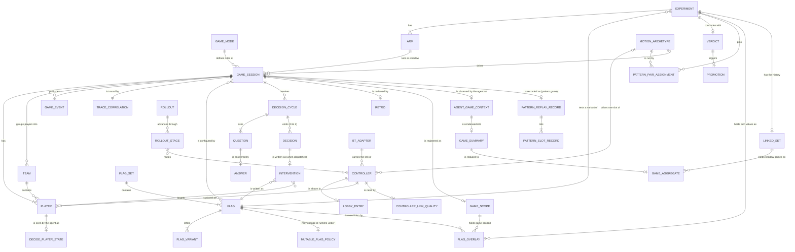

# Entity Model

> AIUP stage 3 of 5: [vision](vision.md) → [requirements](requirements.md) → **entity model** →
> [use cases](use_cases.puml) → [technical specs](specs/). Index: [README.md](README.md).
>
> JoustMania has no database: these entities live in protobuf messages, in-memory service state, flag
> files and the agent's experiment journal. "Primary Key" therefore means the natural identifier.
> Source of each entity is given in its description. Entities and attributes that exist only in service memory
> say so ("In-memory, lost on restart"); everything else is a protobuf message, a flag value or a journal
> record. State: `main` @ a74d0d77 (agent-cluster `/spec-review` of 2026-10-20, #1679; flag service delivered by #1417).

## Entity Relationship Diagram

### CONTROLLER

A physical or mock PS Move controller tracked by the controller manager (`proto/controller_manager.proto` `ControllerState`, `proto/controller_manager_mock.proto` `MockControllerInfo`, `services/controller_manager/name_manager.py`). `adapter` is internal controller-manager state, not a proto field.

| Attribute | Description | Data Type | Length/Precision | Validation Rules |
|---|---|---|---|---|
| serial | Bluetooth MAC address, or `MOCK0000`-style id for mock controllers | String | 17 | Primary Key, Format: MAC or MOCK%04d |
| name | Human-readable name, deterministic default (adjective + noun) or user-assigned | String | 50 | Not Null |
| move_num | Index of the controller in the controller manager's list | Integer | 3 | Not Null, Min: 0 |
| team | Proto team field; the controller manager sets it to 0 at discovery and nothing updates it (team membership lives on PLAYER) | Integer | 2 | Not Null, Min: 0, Max: 0 |
| battery | Battery level in percent (raw 0..5 mapped ×20; charging = 100; unknown = 50) | Integer | 3 | Not Null, Min: 0, Max: 100 |
| accel | Last acceleration vector in g (x, y, z) | Decimal | 6,3 | Not Null |
| gyro | Last gyroscope vector | Decimal | 6,3 | Not Null |
| color | Current LED colour (r, g, b) | Integer | 3 | Not Null, Min: 0, Max: 255 |
| buttons | Pressed state of trigger, move, cross, circle, square, triangle, ps, select and start (one boolean field each in the proto) | Boolean | 1 | Not Null |
| rssi | Signal strength in dBm (controller manager always reports 0; RSSI comes from the pairing daemon metric) | Integer | 4 | Optional, Min: -100, Max: 0 |
| adapter | I/O adapter currently routing this controller | String | 10 | Not Null, Values: python, rust, mock, unstable |
| reserved | Mock controller reserved for a shadow game (hidden from the lobby roster) | Boolean | 1 | Not Null |
| tag | Owner tag of a mock controller (e.g. `agent:` prefix); the agent's orphan sweep removes reserved controllers whose tag has its prefix and no live game references them (`services/agent/gamerunner/sweep.go` `SweepOrphans`) | String | 60 | Optional, mock controllers only |
| pattern_archetype | Archetype installed on this mock controller | String | 40 | Optional, Foreign Key (MOTION_ARCHETYPE.archetype_id) |
| pattern_slot | Slot of the installed archetype this controller plays (its index in the reservation order) | Integer | 1 | Optional, Min: 0, Max: 7 |

### LOBBY_ENTRY

A controller's state in the menu lobby (`services/menu/handlers/base.py:68-75`, `services/menu/state_manager.py`).

| Attribute | Description | Data Type | Length/Precision | Validation Rules |
|---|---|---|---|---|
| serial | Controller in the lobby | String | 17 | Primary Key, Foreign Key (CONTROLLER.serial) |
| state | Lobby state; a disconnected controller is removed, not stored | String | 10 | Not Null, Values: CONNECTED, READY, ADMIN, IDLE |
| is_sentinel | Breathing LED while the lobby is idle | Boolean | 1 | Not Null |

**Constraints:** auto start when ready count ≥ 2 and ready count = connected count (IDLE and ADMIN count as connected, not ready). Exactly one controller can be in ADMIN.

### GAME_MODE

A playable game type (`lib/types.py:23-35` `Games`, registry `services/game_coordinator/game_factory.py:56-67`).

| Attribute | Description | Data Type | Length/Precision | Validation Rules |
|---|---|---|---|---|
| name | Enum name | String | 20 | Primary Key, Values: JoustFFA, JoustTeams, JoustRandomTeams, Traitor, Werewolf, Zombies, Swapper, FightClub, Tournament, NonStop |
| id | Enum integer | Integer | 2 | Not Null, Unique, Min: 0, Max: 12 |
| pretty_name | Display name, also the name of the game's root span | String | 30 | Not Null |
| minimum_players | Minimum players to start the mode (UC-010 BR-001; enforced by the menu and the coordinator, #1862) | Integer | 2 | Not Null, Min: 2, Max: 4 |
| config_message | Typed proto config for the mode | String | 30 | Optional, Values: FFAConfig, TeamsConfig, RandomTeamsConfig, NonstopConfig, TournamentConfig, FightClubConfig, WerewolfConfig, ZombieConfig, SwapperConfig, TraitorConfig |

**Constraints:** `Commander`, `Ninja` and `Random` exist in the enum (ids 6, 11, 12) but have no implementation; the menu hides them. A direct start below the mode's minimum is refused by the coordinator (for example `Commander needs at least 4 players`), and a start at or above it ends with `game_error` (no game class).

### GAME_SESSION

One running or finished game in the game coordinator (`services/game_coordinator/game_session.py`, `proto/game_coordinator.proto` `StartGameConfig`, `GameInfo`).

| Attribute | Description | Data Type | Length/Precision | Validation Rules |
|---|---|---|---|---|
| game_id | Unique id | String | 17 | Primary Key, Format: game_ + 12 hex chars |
| game_mode | Mode played | String | 20 | Not Null, Foreign Key (GAME_MODE.name) |
| origin | Who asked for the start | String | 30 | Not Null, Values: GAME_ORIGIN_UNSPECIFIED, GAME_ORIGIN_MENU, GAME_ORIGIN_AGENT |
| game_kind_telemetry | Kind as emitted on coordinator spans and metrics (`game.kind`, `game_kind`) | String | 7 | Not Null, Values: primary, shadow |
| game_kind_flags | Kind in the flag evaluation context and on agent spans. The coordinator itself only produces `real` or `shadow` (`_eval_game_kind`); the flag service stores an unspecified kind as is and the agent keeps an empty or unknown kind as is. Such a kind is **never** real (fail closed, FR-041) | String | 10 | Not Null, Values: real, shadow, or empty / unknown (never real) |
| state | Session state (proto `GameState`); a session is created in STARTING; IDLE is only what the servicer reports when no session exists. ENDING is a defined proto value that no session-level code sets (see Constraints) | String | 8 | Not Null, Values: STARTING, RUNNING, ENDED (proto also IDLE, ENDING) |
| sensitivity | Baseline sensitivity index | Integer | 1 | Not Null, Min: 0, Max: 4 |
| experiment_id | Experiment the shadow game belongs to | String | 50 | Optional, Foreign Key (EXPERIMENT.experiment_id) |
| arm | Arm of the experiment | String | 12 | Optional, Values: experimental, control |
| rng_seed | Shared seed for paired (CRN) shadow games; 0 = entropy | Long | 19 | Optional, Min: 0 |
| pattern_archetype | Archetype that drives the game's controllers (pattern game) | String | 40 | Optional, Foreign Key (MOTION_ARCHETYPE.archetype_id) |
| pattern_outcome | How the pattern game ended (UC-046 A3, A9, A14, BR-013); `agent_ended` = the agent's own `end_game` ended it | String | 11 | Optional, Values: winner, tie, timeout, agent_ended, aborted, error |
| replay_exact | Whether the pattern game qualifies for replay comparison (UC-046 BR-008) | Boolean | 1 | Optional |
| non_exact_reasons | Why a pattern game is not exact | String | 120 | Optional, Values: remote_backend, frame_overrun, concurrent_game, kill_switch, unseeded_draws, flag_digest_unavailable |
| flag_digest | SHA-256 of the canonical resolved values of the flags that shape a pattern game, read when the agent spawned it (UC-046 BR-011), or `unavailable` | String | 64 | Optional |
| censored | Whether the pattern game's length is right-censored: at the safety cap (outcome `timeout`) or by the agent's own `end_game` (outcome `agent_ended`) (UC-046 BR-013, A14) | Boolean | 1 | Optional, true exactly for outcomes timeout and agent_ended |
| outcome | How the game ended (UC-020 BR-003): `winner`, `tie`, `force_ended`, or `completed` (a failed run publishes `game_error`, no `game_ended`; `error` is a game root-span value and a fifth `games_completed_total{outcome}` label value, never a `game_ended.outcome` value); the `outcome` of `game_ended` and the label of `games_completed_total`. Latched once, when the win is decided, so a later force-end keeps it. In-memory on the game mode | String | 11 | Optional, Values: winner, tie, force_ended, completed |
| force_end_reason | Reason a force end named (`game.end_reason`, every mode publishes it as `reason` on `game_ended`; e.g. `shadow_game_timeout`, `pattern_kill_switch`, `preempted_by_real_game`, `unspecified`); absent for a natural end. In-memory on the game mode, lost with the session | String | 40 | Optional |
| start_time | Start timestamp (ms) | DateTime | - | Not Null |

**Constraints:**
- The agent's own record of why it considers a game over (`zero`, `root_span`, `stale`) is not a session attribute; it is `AGENT_GAME_CONTEXT.end_reason`.
- Two `game_kind` vocabularies exist (see #1249). The coordinator emits `primary` for the menu-started real game and `shadow` otherwise; the flag context and the agent use `real` / `shadow`. The coordinator bridges `primary → real` for flag evaluation (`game_session.py` `_eval_game_kind`) and the agent normalises at ingest (`services/agent/gamecontext/gamekind.go`). An empty or unknown kind is **not** real.
- Only `GAME_ORIGIN_MENU` may claim the primary slot; at most one primary session; at most `max_concurrent_games` sessions and `max_shadow_games` shadows; `experiment_id`, `arm` and `rng_seed` are honoured only for shadow sessions.
- Session state transitions (`services/game_coordinator/game_session.py`): created as `STARTING` → `RUNNING` on `game_started` (which base modes publish before the countdown, D-G4) → `ENDED` on any game-ending event, a force end or an error. A `STARTING` session can go straight to `ENDED`; a start that fails or is cancelled after admission ends it this way and retires it at once, without a `game_ended` event (UC-010 A7, #1791). The proto values `IDLE` and `ENDING` are never set on a session (`game_session.py` assigns only `STARTING`, `RUNNING` and `ENDED`): `IDLE` is the servicer's answer when no (primary) session exists (`services/game_coordinator/servicer.py` `game_state`, `GetGameState`), and `ENDING` is a defined value that no producer sets at session level. Consumers are written to tolerate it: the dashboard treats a primary game in `ENDING` as still on stage (`services/dashboard/src/follow.ts` `REAL_LIVE_STATES`), the pairing daemon counts it as busy (`bluez_reload.py` `BUSY_GAME_STATES`), and a shadow game in `ENDING` is not followed. The mode-level `ending` phase (next bullet) is what the `game.state` span attribute reports.
- Each game mode also has its own lifecycle, `GameState` in `services/game_coordinator/games/base.py` (`idle` → `starting` → `running` → `ending` → `ended`); `ending` is set by the modes' `_end_game_impl` (FFA, Teams, Traitor, Werewolf, Zombies, Swapper, Tournament, Fight Club, NonStop) and is reported on the `game.state` span attribute. Tournament (`TournamentState`: waiting, fighting, champion, eliminated; bye winners enter round 2 as waiting (#1990)) and Fight Club (`FightState`: in_line, defender, fighter, face_off) add per-player sub-states.

### PLAYER

A controller's participation in one game (`proto/game_coordinator.proto` `Player`, `PlayerInfo`; `services/game_coordinator/games/base.py`).

| Attribute | Description | Data Type | Length/Precision | Validation Rules |
|---|---|---|---|---|
| serial | Controller played | String | 17 | Primary Key, Foreign Key (CONTROLLER.serial) |
| game_id | Game | String | 17 | Primary Key, Foreign Key (GAME_SESSION.game_id) |
| name | Display name copied from the controller (`player.name` on spans); empty until the controller reported one | String | 50 | Optional |
| color | Current player colour (r, g, b): team colour in team modes, white by default | Integer | 3 | Not Null, Min: 0, Max: 255 |
| team | Team index; 0 in modes without teams, -1 only in Tournament (the proto comment "-1 if no teams" on `PlayerInfo.team` is stale) | Integer | 2 | Not Null, Min: -1, Max: 7 |
| alive | Still in the game (zombies stay alive when converted) | Boolean | 1 | Not Null |
| score | Mode score; NonStop computes max(0, base − deaths × penalty) only at game end, so it is 0 during play; `ListGames` always reports 0 | Integer | 5 | Optional, Min: 0 |
| sensitivity_factor | Agent per-player factor (divides thresholds) | Decimal | 4,2 | Not Null, Min: 0.5, Max: 2.0 |
| handicap_factor | Agent handicap (multiplies thresholds) | Decimal | 4,2 | Not Null, Min: 0.5, Max: 2.0 |
| grace_until | No-death deadline from respawn, conversion or agent shield | DateTime | - | Optional |
| invincible_until | No-death deadline from match / round start (Tournament, Fight Club) | DateTime | - | Optional |
| shield_charge_seconds | Seconds of a held shield charge, the shield the player gets on activation (#1837, UC-040 A30, UC-030 A6); 0 = no charge, at most one charge | Decimal | 5,2 | Not Null, Min: 0 |
| shield_charge_expires_at | When a held charge expires, fixed at grant time from `shield.charge_expiry_seconds` (UC-040 BR-020) | DateTime | - | Optional (none = never) |
| hold_energy | Stored shield energy in seconds of a hold game (#2096, UC-040 BR-024), materialised at an activation, a grant or the game-loop start; the current value adds the recharge since `hold_energy_at` and is clamped to `min(cap, budget remaining)` | Decimal | 5,2 | Not Null, Min: 0, Max: 10 |
| hold_energy_at | When `hold_energy` was materialised (0 before the game loop starts: no recharge yet) | DateTime | - | Optional |
| hold_budget_used | Active shield time used in this game, summed over every ended activation (UC-040 BR-024) | Decimal | 5,2 | Not Null, Min: 0, Max: 30 |
| hold_started_at | Start of the running hold activation (UC-030 A7); 0 = none | DateTime | - | Optional |
| hold_until | Protection deadline of the running activation: the energy's end while held, start + cost after a release; part of the effective grace (UC-030 BR-008) | DateTime | - | Optional |
| winner | Whether the player's side won the game (`winner` on the player span; false after a force-end that declared no winner, UC-020 BR-003). Champion of a Tournament / Fight Club game is the winner | Boolean | 1 | Optional |
| smoothed_accel | EMA of acceleration magnitude in g | Decimal | 6,3 | Not Null, Min: 0 |

**Constraints:** the player cannot die while `now < max(grace_until, invincible_until, hold_until)` (`hold_until` only in a hold game, #2096). In the base path (`games/base.py` `_compute_effective_thresholds`), effective thresholds are divided by `clamp(sensitivity_factor × global_difficulty_factor, 0.5, 2.0)` and multiplied by `clamp(min(max(handicap_factor, active toughness boost, rubberband_boost), soft_penalty_factor), 0.5, 2.0)`. Exception: Werewolf werewolves and Zombies zombies use a fixed role threshold table per sensitivity (`game.werewolf.thresholds`, `game.zombie.thresholds`; `werewolf.py` / `zombie.py` `_compute_effective_thresholds`), so tempo and the per-player and global factors do not apply to them. Fight Club runs its own death detection (D-G9, #1347).

### DECIDE_PLAYER_STATE

A player as the decision backends see it (`decide.PlayerState`, `services/agent/decide/decide.go`, signals from `services/agent/decide/danger.go`, PR #1265).

| Attribute | Description | Data Type | Length/Precision | Validation Rules |
|---|---|---|---|---|
| serial | Player | String | 17 | Primary Key, Foreign Key (PLAYER.serial) |
| alive | Player is active | Boolean | 1 | Not Null |
| intensity | Smoothed movement intensity in g (absent when never observed) | Decimal | 6,3 | Optional, Min: 0 |
| variance | Movement variance | Decimal | 6,3 | Optional |
| skill | Skill level (from `game_player_skill_level`, else playstyle / 3) | Decimal | 4,3 | Optional |
| battery_pct | Battery in percent | Decimal | 5,2 | Optional, Min: 0, Max: 100 |
| elimination_order | 1-based elimination order | Integer | 3 | Optional, Min: 1 |
| intensity_rank | 1 = highest intensity among alive players with an observed intensity; 0 unranked | Integer | 3 | Not Null, Min: 0 |
| threshold_margin | Session death threshold − intensity (g, 2 decimals); negative when over | Decimal | 4,2 | Optional |
| danger | Intensity / session death threshold: `safe` < 0.60 ≤ `elevated` < 0.85 ≤ `near_threshold`; empty when unknown | String | 14 | Optional, Values: safe, elevated, near_threshold |
| shielded | A grant_shield / toughness_boost was dispatched to the player in the last 10 s; a grant_shield to a shield_charged player does not count; in a hold game `shield_active` or a toughness_boost (a grant_shield there is energy, #2096) | Boolean | 1 | Not Null |
| shield_charged | Alive player with a live entry in the agent's shield-charge ledger when the state is built (trigger mode, UC-040 A31): holds an agent charge or has just used it; never set in a hold game | Boolean | 1 | Not Null |
| shield_limited | Alive player the agent would refuse another grant_shield for a reason other than already_charged when the state is built (#2066, UC-040 A33, A37): the per-game cap, the cooldown, or in a hold game a full pool or a used-up budget; never set together with shield_charged | Boolean | 1 | Not Null |
| sensitivity_factor | The per-player sensitivity factor the agent last wrote to this game (`adjust_player_sensitivity`, applied-value ledger, UC-040 A35; #2066), only when not the neutral 1.0 | Decimal | 4,2 | Optional, Min: 0.7, Max: 1.5 |
| handicap_factor | The per-player handicap factor the agent last wrote to this game (`set_player_handicap`, applied-value ledger; #2066), only when not the neutral 1.0 | Decimal | 4,2 | Optional, Min: 0.75, Max: 1.75 |
| shield_energy_s | Hold game only (#2096, UC-040 A36): the alive player's shield energy in seconds from `game_player_shield_energy_seconds`, plus the agent's grants in flight, at most the cap | Decimal | 5,2 | Optional, Min: 0 |
| shield_budget_remaining_s | Hold game only: shield seconds the player has left this game (`game_player_shield_budget_remaining_seconds`) | Decimal | 5,2 | Optional, Min: 0 |
| shield_active | Hold game only: the player holds the trigger and is protected now (`game_player_shield_active`) | Boolean | 1 | Not Null |

**Constraints:** danger reads the **session** death threshold, so per-player factors and shields are not reflected (`shielded` flags shields separately). `shield_charged`, `shield_limited` and the two factors come from the decision loop's in-memory ledgers, not from telemetry, and are lost on an agent restart; the factors are the agent's own writes, not the coordinator's flag value. Session-level fields on the state: `most_headroom` (alive player with the strictly lowest intensity) and `struggling` (strictly highest intensity when elevated or near_threshold); ties leave them empty.

### TEAM

A colour team in team modes (`services/game_coordinator/games/teams_base.py`).

| Attribute | Description | Data Type | Length/Precision | Validation Rules |
|---|---|---|---|---|
| game_id | Game | String | 17 | Primary Key, Foreign Key (GAME_SESSION.game_id) |
| index | Team number within the game | Integer | 1 | Primary Key, Min: 0, Max: 7 |
| name | Colour name (e.g. Pink, Magenta) | String | 20 | Not Null |
| color | RGB colour | Integer | 3 | Not Null, Min: 0, Max: 255 |

**Constraints:** a team has no secret flag. Hidden roles are per player: in Traitor each player carries `is_traitor` and `secret_team`, the team index the player wins with (the visible team for loyal players, another team for traitors; `services/game_coordinator/games/traitor.py` `TraitorPlayer`); in Werewolf the role is the player's `is_werewolf`.

### GAME_EVENT

An event on a game's event stream (`proto/game_coordinator.proto` `GameEvent`; publishers listed in [UC-020](use_cases/UC-020.md) and [services.md](specs/services.md)).

| Attribute | Description | Data Type | Length/Precision | Validation Rules |
|---|---|---|---|---|
| event_type | Event name (e.g. `game_start`, `countdown_end`, `game_winner`, `team_winner`, `game_ended`, `game_force_ended`, `game_error`, `agent_intervention`) | String | 40 | Not Null |
| game_id | Game the event belongs to | String | 17 | Not Null, Foreign Key (GAME_SESSION.game_id) |
| data | Event payload, string map | String | 4000 | Optional |
| timestamp | Unix time in ms | Long | 19 | Not Null |

### FLAG_SET

One flag set: its read-only baseline file (`services/flagd/<set>.json`), served to flagd by the flag service together with its runtime overlays; see [flags.md](specs/flags.md).

| Attribute | Description | Data Type | Length/Precision | Validation Rules |
|---|---|---|---|---|
| flag_set_id | `metadata.flagSetId` | String | 20 | Primary Key, Values: agent, controller, game, interventions, observability, operator, rollout, system, user |
| file | Flag file path | String | 100 | Not Null, Unique |
| owner | Who owns the values ([OWNERSHIP_MODEL.md](OWNERSHIP_MODEL.md)) | String | 20 | Not Null, Values: human, operator, agent, operator+agent |

### FLAG

One OpenFeature flag.

| Attribute | Description | Data Type | Length/Precision | Validation Rules |
|---|---|---|---|---|
| key | Flag key, dotted namespace allowed | String | 60 | Primary Key |
| flag_set_id | Containing flag set | String | 20 | Not Null, Foreign Key (FLAG_SET.flag_set_id) |
| type | Value type | String | 6 | Not Null, Values: bool, int, float, string, object |
| default_variant | Variant served when no targeting matches | String | 40 | Not Null, Foreign Key (FLAG_VARIANT.name) |
| targeting | JSONLogic targeting rule (keys: targetingKey/serial, gameId, game_kind, game_mode, experiment_id, arm, service) | String | 4000 | Optional |
| reload | When readers see a change | String | 16 | Not Null, Values: live, event-refreshed, per-game, startup |

### FLAG_VARIANT

A named value of a flag.

| Attribute | Description | Data Type | Length/Precision | Validation Rules |
|---|---|---|---|---|
| name | Variant name | String | 40 | Primary Key |
| flag_key | Flag | String | 60 | Not Null, Foreign Key (FLAG.key) |
| value | JSON value | String | 4000 | Not Null |

**Constraints:** the agent experiment writer may add a variant named `agent_experiment__<experiment_id>` and shadow-scoped targeting, but may not change `default_variant` or an existing variant (`services/agent/experiment/gate.go`).

### MUTABLE_FLAG_POLICY

Delivered by #1417 (epic #1407, UC-053, FR-132). One row of the flag service's mutable-flag registry
(`services/flag-service/registry.yaml`, [flags.md §13](specs/flags.md#13-mutable-flag-registry)): a flag that may change at
runtime, within which bounds, and whether a write may persist it. In-memory once loaded at start, lost on restart (the
file is the source). A flag without a policy is read-only baseline. There are no writer roles (local game, architecture note D11).

| Attribute | Description | Data Type | Length/Precision | Validation Rules |
|---|---|---|---|---|
| flag_key | The flag | String | 60 | Primary Key, Foreign Key (FLAG.key) |
| flag_set_id | Its flag set | String | 20 | Not Null, Foreign Key (FLAG_SET.flag_set_id) |
| kind | How values are written and rendered | String | 8 | Not Null, Values: state, level, grant, event, overlay |
| scope | Where a write applies | String | 16 | Not Null, Values: stack, game, game+serial, experiment+arm, real, fraction |
| persist | Admin setting: a write that asks for it (`"persist": true`) is kept in the service's state file across restarts | Boolean | | Not Null, Default: false |
| allowed_variants | Declared variants a write may select | String | 400 | Optional |
| min_value | Inclusive lower bound of a numeric value | Decimal | 10,3 | Optional |
| max_value | Inclusive upper bound of a numeric value | Decimal | 10,3 | Optional, >= min_value |
| payload_schema | Format of a composite string value (e.g. `<seconds>:<factor>`), or `free string` | String | 100 | Optional |

### GAME_SCOPE

Delivered by #1417 (FR-135). The flag service's record of one live game (`services/flag-service/state/games.go`), registered by the game coordinator
at admission and dropped at the game's end, by a reconcile call of its coordinator instance, or after the
maximum game age (1 h) since it was last seen (registered or reconciled, #2217). In-memory, lost on restart.

| Attribute | Description | Data Type | Length/Precision | Validation Rules |
|---|---|---|---|---|
| game_id | Game id | String | 17 | Primary Key, Foreign Key (GAME_SESSION.game_id), Format: `game_<12 hex>` |
| game_kind | Flag vocabulary. Stored as the coordinator sent it; an unspecified or unknown kind is never real (FR-041) | String | 80 | Not Null, Values: real, shadow, or any other string (never real) |
| serials | Serials of the game's players | String | 400 | Not Null |
| experiment_id | Experiment of a shadow experiment game | String | 50 | Optional, Foreign Key (EXPERIMENT.experiment_id) |
| arm | Arm of that game | String | 12 | Optional, Values: experimental, control |
| coordinator_instance | Coordinator instance that registered it; reconcile calls drop only that instance's scopes | String | 80 | Not Null |
| registered_at | First registration time (display only) | DateTime | | Not Null |
| last_seen_at | Time of the latest registration or reconcile entry; the maximum game age counts from it (#2217) | DateTime | | Not Null |

**Constraints:** at most 64 KiB of values per scope (NFR-051); a write naming a game without a scope is rejected
(`game_not_live`). A second registration of the same game id updates the record, keeps `registered_at` and refreshes `last_seen_at`; per-player values of serials it no longer lists are dropped (UC-053 A13).

### FLAG_OVERLAY

Delivered by #1417 (FR-134, FR-136 to FR-138). One runtime value the flag service holds on top of the baseline, in memory
(C-030, lost on restart); a stack overlay written with `"persist": true` (registry `persist`) is also written to the service's
own state file and restored at the next start.

| Attribute | Description | Data Type | Length/Precision | Validation Rules |
|---|---|---|---|---|
| overlay_id | Generated id; also the opaque variant name it renders (`r<epoch>_<n>`, `o<epoch>_<n>` for a stack overlay); a stack overlay may instead select a declared baseline variant by name | String | 24 | Primary Key |
| epoch | Boot id of the flag service that holds it | String | 8 | Not Null |
| flag_key | The flag | String | 60 | Not Null, Foreign Key (MUTABLE_FLAG_POLICY.flag_key) |
| scope | Scope of this value | String | 16 | Not Null, Values: stack, game, game+serial, experiment+arm, real, fraction |
| game_id | Game for a game-scoped value | String | 17 | Optional, Foreign Key (GAME_SCOPE.game_id) |
| serial | Player for a game+serial value | String | 20 | Optional, must be in GAME_SCOPE.serials |
| experiment_id | Experiment for an arm value | String | 50 | Optional, Foreign Key (EXPERIMENT.experiment_id) |
| arm | Arm for an arm value | String | 12 | Optional |
| fraction_percent | Share of serials for a fraction value | Integer | 3 | Optional, 1 to 100 |
| value | Resolved value as JSON; for an `event` flag the game's event list `{"epoch","seq","events"}` (last 16) | String | 4000 | Not Null, within the policy's bounds |
| sequence | Last event sequence of an `event` value | Integer | 10 | Optional, > 0, strictly increasing per game and flag |
| writer | Informational label of the caller (never checked) | String | 40 | Optional |
| expires_at | End of an optional time-to-live | DateTime | | Optional |
| decision_id | Agent decision or intervention id | String | 60 | Optional |
| written_at | Write time | DateTime | | Not Null |

**Constraints:** dropped with its GAME_SCOPE, by a `DELETE` of its flag and scope, when its time-to-live ends, or by a restart (a `persist` value is restored from the state file).

### DECISION_CYCLE

One agent decision cycle for a game: one evaluation, recorded on one `agent.decide` span (`services/agent/decision/decision.go`, `decide_hook.go`; contract in [decide-contract.md](specs/decide-contract.md)). A cycle has no id of its own; its natural identifier is the span. It emits 0 to 2 DECISIONs (the rules path, UC-040 A1; a remote backend gives one answer, hence at most one decision).

| Attribute | Description | Data Type | Length/Precision | Validation Rules |
|---|---|---|---|---|
| decide_span_id | Span id of the cycle's `agent.decide` span (no agent-assigned id exists) | String | 16 | Primary Key, Format: 16 hex characters |
| game_id | Game decided for | String | 17 | Not Null, Foreign Key (GAME_SESSION.game_id) |
| backend_requested | `decision.backend` at fire time (`decide.backend.requested`); empty counts as `rules`, an unknown name is kept verbatim and decided by rules with `fallback_reason=unknown_backend` | String | 20 | Not Null, Values: rules, claude, openai, jev, or an unknown name |
| backend | Backend that actually decided | String | 10 | Not Null, Values: rules, claude, openai, jev |
| outcome | Decide outcome | String | 10 | Not Null, Values: act, held, noop, invalid, fallback, discarded |
| fallback_reason | Why rules decided instead | String | 22 | Optional, Values: unknown_backend, backend_unavailable, async_not_wired, llm_not_eligible, llm_budget_exhausted, timeout, invalid_answer, error |
| discarded_reason | Why a remote answer (valid, or under the kill switch also a failed or timed-out call) or its rules fallback was dropped | String | 16 | Optional, Values: stale_context, game_ended, target_gone, kill_switch, backend_changed, shutdown |
| confidence | Routing confidence of `ffa.intervention` | Decimal | 4,3 | Optional, Min: 0, Max: 1 |
| act_confidence_threshold | Effective threshold read at landing (the answering backend's own, else the global) | Decimal | 4,3 | Optional, Min: 0, Max: 1 |
| act_confidence_threshold_source | Flag the threshold came from | String | 6 | Optional, Values: jev, global |
| invalid_reason | Why an answer was invalid (`decide.invalid_reason`, UC-040 A8; cross-question consistency, [decide-contract §4.3](specs/decide-contract.md)); outcome `invalid` has no action and no fallback | String | 34 | Optional, Values: noop_with_target, player_intervention_without_target, session_intervention_with_target, missing_intervention_answer |
| state_digest | SHA-256 of the canonical state | String | 64 | Not Null |
| latency_ms | Decide latency | Integer | 6 | Not Null, Min: 0 |

**Constraints:**
- Cardinality: at most one evaluation per second per game on the rules path. A cycle in which the rules ranking emitted nothing records no `agent.decide` span (UC-040 A1), except a configuration fallback (`unknown_backend`, `backend_unavailable`, `async_not_wired`), which records one throttled span per reason (UC-040 A3).
- The answer fields (`outcome`, `confidence`, ...) describe the cycle. `decide.blocked` / `decide.block_reason` on the `agent.decide` span mirror the cycle's first DECISION only.

### DECISION

One decision a cycle emits, recorded on its own `agent.decision` span (`services/agent/decision/decision.go` `runDecision`). Each decision goes through the permission chain on its own; a dispatched one may get an effect sample and with it `decision.intervention_id` (`decision/effect.go`).

| Attribute | Description | Data Type | Length/Precision | Validation Rules |
|---|---|---|---|---|
| decide_span_id | Cycle that emitted the decision | String | 16 | Primary Key, Foreign Key (DECISION_CYCLE.decide_span_id) |
| rank | Position in the cycle's ranking (the first decision is 1) | Integer | 1 | Primary Key, Min: 1, Max: 2 |
| action | Intervention type decided (`decision.action`) | String | 30 | Not Null, Foreign Key (INTERVENTION.type) |
| target_serial | Player targeted (`player.serial`), player-scoped types only | String | 17 | Optional, Foreign Key (PLAYER.serial) |
| blocked | Permission chain blocked the decision (`decision.blocked`); absent when the decision never reached the permission chain | Boolean | 1 | Optional |
| block_reason | Permission block (`decision.block_reason`) | String | 18 | Optional, Values: not_allowed, battery_threshold, already_charged, shield_cap_reached, shield_cooldown, rate_limit |
| applied | The write was tried and the outcome (`decision.applied`): true written, false not written; absent when blocked or on an agent image before #2093 | Boolean | 1 | Optional |
| not_applied_reason | Why a permitted decision was not written (`decision.not_applied_reason`), set with applied=false | String | 15 | Optional, Values: write_gate_off, write_failed |
| intervention_id | `decision.intervention_id`, the same value as `intervention.id` on the `agent.intervention.effect` span that measures it: a UUID assigned when a dispatched decision's effect sample is scheduled. A blocked decision has none, and neither has a dispatched one whose sample was not scheduled (effect measurement not wired, no baseline signals this cycle, pending cap reached). A decision that lands on the remote path, also its rules fallback, gets one like a decision of the rules engine's own cycle: the landing evaluates the fitness baseline on the current context (#1699). Only a written decision is measured: a gated no-op (`interventions_enabled` off) or a failed write has none | String | 36 | Optional, Unique, Format: UUID |

**Constraints:** several decisions of one cycle can be blocked, for example when a scarce budget (`policy.max_interventions_per_minute`) blocks the first decision that does not fit and every lower-ranked one with `rate_limit` without charging it (UC-040 A20, BR-014). A repeat the budget already refused emits no new `agent.decision` span (A21).

### QUESTION

A question in a decide request (`services/agent/decide/decide.go:64-74`, FFA set `ffa.go`).

| Attribute | Description | Data Type | Length/Precision | Validation Rules |
|---|---|---|---|---|
| question_id | Id, unique within a request | String | 30 | Primary Key, Values: ffa.intervention, ffa.target, ffa.magnitude |
| kind | Question kind; `noul` (yes/no answered with P(yes)) shipped in PR #1261, supported by jev and rules only; no caller-level FFA question is a noul; the Jev backend asks the internal `jev.gate` noul every stage-1 round (decide-contract §3.1) | String | 6 | Not Null, Values: choice, score, noul |
| text | Prompt text for remote backends | String | 2000 | Not Null |
| options | Choice options | String | 1000 | Optional |
| range_min | Score lower bound | Decimal | 6,3 | Optional |
| range_max | Score upper bound | Decimal | 6,3 | Optional |

### ANSWER

A backend's answer to one question (`decide.go:77-90`, validation `validate.go`).

| Attribute | Description | Data Type | Length/Precision | Validation Rules |
|---|---|---|---|---|
| decide_span_id | Cycle whose request the answer belongs to | String | 16 | Primary Key, Foreign Key (DECISION_CYCLE.decide_span_id) |
| question_id | Answered question | String | 30 | Primary Key, Foreign Key (QUESTION.question_id) |
| choice | Chosen option (choice kind) | String | 60 | Optional |
| probabilities | Option → probability, sum 1 ± 0.001, choice is the argmax | String | 2000 | Optional |
| score | Value within the range (score kind) | Decimal | 6,3 | Optional |
| noul | Probability of "yes" (noul kind only; confidence = \|2p − 1\| for jev, 0.5 at confidence 0 for rules) | Decimal | 4,3 | Optional, Min: 0, Max: 1 |
| confidence | Confidence that acting is right | Decimal | 4,3 | Not Null, Min: 0, Max: 1 |

### INTERVENTION

A bounded in-game change written for one game to the `interventions` flag set through the flag service (`services/agent/actions/writer.go`) and applied by the game coordinator (`services/game_coordinator/interventions.py`).

| Attribute | Description | Data Type | Length/Precision | Validation Rules |
|---|---|---|---|---|
| type | Intervention type | String | 30 | Primary Key, Values: play_audio_cue, send_controller_effect, adjust_volume, adjust_music_tempo, set_pacing_profile, adjust_player_sensitivity, grant_shield, adjust_global_sensitivity, adjust_global_difficulty, eliminate_player, revive_player, end_game, set_player_handicap, ramp_tempo, toughness_boost, soft_penalty, auto_rubberband, noop |
| flag_key | Flag written; none for `noop`, which writes nothing | String | 30 | Optional, Foreign Key (FLAG.key) |
| shape | How it is written and rendered: the `kind` of the flag's MUTABLE_FLAG_POLICY (`state` = a game-scoped value, `level` = a per-player value that stays, `grant` = a per-player one-time grant, `event` = an entry appended to the game's event list); `overlay` is not used by interventions | String | 5 | Optional, Values: state, level, grant, event; = MUTABLE_FLAG_POLICY.kind of flag_key |
| weight | Rate-limit weight class | String | 6 | Not Null, Values: soft, medium, hard |
| target_serial | Player targeted (player-scoped types) | String | 17 | Optional, Foreign Key (PLAYER.serial) |
| value | Resolved magnitude or payload | String | 60 | Optional |
| blocked_by_coordinator | Coordinator block reason (`block_reason` on `game_intervention_*` metrics and the `agent_intervention` event). `game_loop_late` is recorded as a reason but is not a block: the effect had started and may still apply | String | 23 | Optional, Values: not_allowed, rate_limited, low_battery, mode_unsupported, already_charged, shield_cap_reached, shield_cooldown, shield_pool_full, shield_budget_exhausted, revive_refused, eliminate_refused, experiment_override, handler_error, game_loop_unavailable, game_loop_timeout, game_loop_late |

**Constraints:**
- The type must be in the live `interventions_allowed` list (checked by the agent and again by the coordinator); writes happen only while `interventions_enabled` is on.
- Every write is scoped to the game whose loop decided it and resolves only there (FR-069, FR-136, UC-053): `state` writes are game-scoped, `level` and `grant` writes game+serial, `event` writes append to that game's event list. The coordinator block reasons `game_loop_unavailable` (no running game loop), `game_loop_timeout` (the effect was still queued at the 5 s deadline, never applied) and `game_loop_late` (the effect started but did not finish in time, outcome unknown) come from `game_loop_dispatch.py`. `no_game` is still a constant in `interventions.py` and in the metric's label comment, but nothing produces it, so it is not listed.

### EXPERIMENT

A hypothesis about one `game.json` flag value, tested in shadow games (`services/agent/experiment/registry.go:48-66`, journal `services/agent/experiment/journal/`). Declared from the experiment seed (`experiment_seed` flag), the M7-4 proposer, retro-seeded theses or the dynamic declarer. The dossier (`/experiments`, `/experiments/<id>`, FR-059, UC-035 A1) is a read-only JSON / HTML view of EXPERIMENT, ARM, VERDICT and per-game rows from the journal (game id, arm, pair index, outcome, fitness, duration, note, trace hint); it has no entity of its own.

| Attribute | Description | Data Type | Length/Precision | Validation Rules |
|---|---|---|---|---|
| experiment_id | Id | String | 50 | Primary Key, Format: exp_<id> |
| flag_key | Flag under test | String | 60 | Not Null, Foreign Key (FLAG.key) |
| value | Candidate value | String | 4000 | Not Null |
| objective | Objective scored | String | 12 | Not Null, Values: endurance, balanced, accelerate |
| thesis | Hypothesis text | String | 500 | Optional |
| target_n | Games per arm | Integer | 4 | Not Null, Min: 1 |
| status | Lifecycle | String | 10 | Not Null, Values: proposed, running, concluded, promoting, done, discarded, aborted |

**Constraints:** the `chaos` objective is rejected. All running experiments are aborted when `enabled` or `experiments_enabled` is off. Status transitions (`services/agent/experiment/registry.go` `Status`): `proposed` → `running` → `concluded` → `promoting` → `done`, or `promoting` → `discarded`, or `concluded` → `discarded`; `proposed`, `running`, `concluded` or `promoting` → `aborted` when `enabled` or `experiments_enabled` is off (`AbortAll`), at agent shutdown, or when its start fails (`start_failed`, on every declarer path and for a `proposed` experiment restored from the journal, UC-042 A4, UC-043 A8, #1700). `done`, `discarded` and `aborted` are terminal and never overwritten: a `promoting` experiment aborted by `AbortAll` stays `aborted` when its promotion returns (#1701). Only a `concluded` experiment moves to `promoting`, and only once that decision is durable in the journal (UC-043 BR-007, #2042).
- On an agent restart (`Rehydrate`, UC-043 A15, #2042) a restored experiment is never promoted: `concluded` → `discarded` (`concluded before restart: <outcome>; not promoted`); `concluded` or `promoting` → `done` / `discarded` from a `promotion` event journaled after its last `concluded` decision; `promoting` without one → `aborted` (`promotion_interrupted`).
- `running` → `discarded` **without any verdict** (`registry_pattern.go` `pinPending`, `Rehydrate`): a pattern experiment is discarded before its first game when its archetype selection cannot be pinned, with the reason `pattern_selection_empty`, `pattern_selection_too_small` (fewer than `verdict_min_pairs` or a duplicate), `pattern_archetype_invalid`, `pattern_mode_unsupported` (UC-046 A1, A2, A4, A13), or after an agent restart when the pin cannot be restored, `pattern_pin_lost` (BR-015). An experiment on a hold flag is also discarded at its pin with `pattern_trigger_policy_missing` (UC-046 A17), `hold_not_real_default` or `hold_already_default`, and while running (`discardHoldStale`, every tick) with the latter two (UC-043 A17, #2096). No VERDICT exists for such an experiment.
- Every conclusion goes through `concluded`; the end state then depends on the verdict outcome: `promote` → `promoting` → `done` when the promotion outcome is `applied`, `reverted` or `deferred` (UC-043 A17), `promoting` → `discarded` when it is `discarded` (inert or failed, UC-043 A4, A9, #1701), `discard` and `inconclusive` → `discarded`. A final `inconclusive` is a verdict like any other: it comes from the give-up guard ([UC-043](use_cases/UC-043.md) A3, `registry.go` `shouldGiveUp`) or from exhausted pattern archetypes (UC-046 A6), and maps to `discarded`. An interim `inconclusive` verdict keeps the experiment `running`. The final verdict is journaled on the `concluded` decision event and becomes the journal summary's verdict (#2042).

### ARM

One treatment of an experiment.

| Attribute | Description | Data Type | Length/Precision | Validation Rules |
|---|---|---|---|---|
| experiment_id | Experiment | String | 50 | Primary Key, Foreign Key (EXPERIMENT.experiment_id) |
| arm | Arm name | String | 12 | Primary Key, Values: experimental, control |
| games_completed | Shadow games concluded | Integer | 4 | Not Null, Min: 0 |
| fitness_mean | Running mean fitness (Welford) | Decimal | 8,5 | Optional |
| fitness_sd | Running standard deviation | Decimal | 8,5 | Optional, Min: 0 |

### VERDICT

The conclusion of an experiment (`services/agent/experiment/verdict.go`).

| Attribute | Description | Data Type | Length/Precision | Validation Rules |
|---|---|---|---|---|
| experiment_id | Experiment | String | 50 | Primary Key, Foreign Key (EXPERIMENT.experiment_id) |
| outcome | Result | String | 12 | Not Null, Values: promote, discard, inconclusive |
| delta | Raw mean difference (experimental − control) | Decimal | 8,5 | Not Null |
| significant | Passed the effect threshold and the raw-effect floor | Boolean | 1 | Not Null |
| reason | Short explanation; the only place the standardized effect (d_z or Cohen's d) appears | String | 200 | Optional |

**Constraints:** persisted as `journal.Verdict` (`services/agent/experiment/journal/record.go`); there is no effect-size field. Paired path as soon as one seed-sharing pair has completed (always the case for the agent's paired experiments): d_z over the pair differences (`Summary.PairDiff`), conclusive only once `verdict_min_pairs` pairs completed. Unpaired fallback only when no pair completed: two-arm Cohen's d, conclusive only with `verdict_min_n` games per arm (`verdict_min_n` also raises the target N and bounds the give-up guard in `registry.go`). The standard-deviation floor and the raw-effect floor apply to both (`services/agent/experiment/verdict.go`). The recent-real baseline anchor can only downgrade `promote` to `inconclusive`.

### PROMOTION

What happens to a promote verdict (`services/agent/promote/promote.go:91-105,420-480`).

| Attribute | Description | Data Type | Length/Precision | Validation Rules |
|---|---|---|---|---|
| experiment_id | Experiment promoted | String | 50 | Primary Key, Foreign Key (EXPERIMENT.experiment_id) |
| mode | `code_improvement.mode` at promotion | String | 10 | Not Null, Values: issue, pr, autonomous |
| target | `code_improvement.target` | String | 6 | Not Null, Values: local, github |
| outcome | What the promotion achieved (`code_improvement.outcome`); a promotion that could not act is `discarded` with a reason | String | 10 | Not Null, Values: applied, discarded, reverted, deferred |
| reason | Why it was discarded or reverted (`kill_switch` for a kill-switch revert, UC-043 A1) | String | 200 | Optional |
| reference | Issue / PR URL or commit | String | 200 | Optional |

**Constraints:** the outcome, reason and reference are on the `code_improvement.promote` span and in the experiment journal as a `promotion` event (`journal.Promotion`, `services/agent/experiment/journal/record.go`, #1701); the outcome sets the experiment's end state (`applied`, `reverted`, `deferred` → `done`; `discarded` → `discarded`). `deferred` (UC-043 A17 step 3, #2096): the `real` write of a hold key waits until no real game runs; its later outcome (`applied`, `reverted` or `discarded`) is appended as another `promotion` event. A promotion event may carry `revert_pending` (`journal.Promotion.RevertPending`): a hold-key watch or re-watch revert that waits until no real game runs, journaled write-ahead so a restart re-queues it; a `deferred` write a restart lost is journaled `discarded` with reason `lost_at_restart`. A kill-switch revert of an applied autonomous promotion (#1704) after its promotion returned appends a second `promotion` event (`reverted`, reason `kill_switch`) to the ended experiment's journal and does not change the end state; a kill-switch revert during the promotion is that promotion's single event. A failed kill-switch revert appends one `promotion` event (`applied`, reason `kill_switch; revert failed: …`) per promotion; the retries add none, and the retry that succeeds appends the `reverted` event (#1753). A re-watch revert (UC-043 step 7) after the promotion returned appends a `promotion` event with reason prefixed `re-watch: `: `reverted`, or, when the revert fails, one `applied` event with the failure reason. The re-watch tries the revert once; the retry, its first failure event and the final `reverted` event belong to the kill switch (UC-043 A1). It does not change the end state (#1883).

### RETRO

A post-game retrospective (`services/agent/decision/retro_capture.go`, `services/agent/llm/retro.go`).

| Attribute | Description | Data Type | Length/Precision | Validation Rules |
|---|---|---|---|---|
| game_id | Game reviewed | String | 17 | Primary Key, Foreign Key (GAME_SESSION.game_id) |
| inference_used | Backend that answered the post-game call (span attribute `inference.used`); `none` = capture only, no call made | String | 6 | Not Null, Values: claude, none |
| fallback_reason | Why no model was called (`inference.fallback_reason`) | String | 20 | Optional, Values: no_backend_available, agent_disabled, llm_not_eligible |
| parse_ok | Whether the model reply decoded into a conclusion (`llm.retro.parse_ok`); an empty conclusion decodes fine (true). Absent for a capture-only retro | Boolean | 1 | Optional |
| system_prompt_fingerprint | Short SHA-256 of the retro system prompt (`llm.retro.system_sha256`); the full text is logged once per fingerprint (`agent.llm.system_prompt`) | String | 16 | Not Null, Format: hex |
| session_assessment | Model assessment | String | 1000 | Optional |
| suggestions | Suggested interventions (type, emphasis, reason) | String | 4000 | Optional |
| session_focus | Suggested focus | String | 200 | Optional |

**Constraints:** at most one retro per game (the agent remembers the last captured session ids). A retro that finds the shared `llm.max_requests_per_minute` budget exhausted is gated: it counts `agent_llm_gated_total{reason=llm_budget_exhausted}`, logs `agent.llm.retro_gated` and records nothing, no span and no row. A game that ended stale (`end_reason=stale`) gets no retro (UC-041 A4).

### ROLLOUT

A controller-backend rollout (`services/flagd/rollout.json`, `services/controller_manager/multiplexer/rollout_router.py`).

| Attribute | Description | Data Type | Length/Precision | Validation Rules |
|---|---|---|---|---|
| target_backend | Backend being rolled out | String | 8 | Primary Key, Values: python, rust, unstable |
| strategy | Rollout strategy | String | 11 | Not Null, Values: off, immediate, progressive |
| remediation_allowed | Agent may roll back | Boolean | 1 | Not Null |

### ROLLOUT_STAGE

A stage of a progressive rollout: how many controllers (first N by sorted serial) use the target backend.

| Attribute | Description | Data Type | Length/Precision | Validation Rules |
|---|---|---|---|---|
| current_controller_count | Controllers on the target backend | Integer | 2 | Primary Key, Values: 0, 1, 3, 6, 99 |
| entered_at | When the agent entered the stage (dwell timer) | DateTime | - | Not Null |
| fitness_passed | Last infrastructure fitness result | Boolean | 1 | Not Null |

**Constraints:** per-serial `bluetooth_backend` targeting (manual canary) wins over the rollout; mock-only controllers are not routed.

### MOTION_ARCHETYPE

A named parameter object that defines the motion function of every player of a pattern game: one object variant of the `agent.json` flag `experiment.mock_archetype`, (#1258, [UC-046](use_cases/UC-046.md) BR-002, BR-003). Player i (slot i) uses base_i = base + i·d_base, drift_i = drift + i·d_drift, amp_i = amp + i·d_amp, phase_i = frac(phase + i·d_phase).

| Attribute | Description | Data Type | Length/Precision | Validation Rules |
|---|---|---|---|---|
| archetype_id | Variant name; the value listed in `experiment.mock_archetypes` | String | 40 | Primary Key, Format: [a-z][a-z0-9_]* |
| params_digest | First 16 hex digits of the SHA-256 of the canonical parameter JSON (UC-046 BR-009) | String | 16 | Not Null |
| players | Number of players N (= slots) | Integer | 1 | Not Null, Min: 2, Max: 8 |
| stream_rate_hz | Pinned gameplay stream rate r | Integer | 2 | Not Null, Values: 15, 30, 60 |
| base | Resting intensity of slot 0, in g | Decimal | 6,3 | Not Null, Min: 0, Max: 10 |
| drift | Intensity change per second of game time of slot 0, in g/s | Decimal | 6,4 | Not Null, Min: -1, Max: 1 |
| amp | Sine amplitude of slot 0, in g | Decimal | 6,3 | Not Null, Min: 0, Max: 10 |
| period_s | Sine period in seconds of game time | Decimal | 6,3 | Not Null, Min (exclusive): 0 |
| phase | Phase of slot 0 in cycles (sine and burst) | Decimal | 4,3 | Not Null, Min: 0, Max (exclusive): 1 |
| burst_h | Height of the rectangular burst (width 0.2 s), in g; 0 = no bursts | Decimal | 6,3 | Not Null, Min: 0, Max: 10 |
| burst_period_s | Seconds of game time between bursts | Decimal | 6,3 | Not Null, Min: 0; > 0 when burst_h > 0 |
| d_base | Per-slot increment of base, in g | Decimal | 6,3 | Not Null, Min: -1, Max: 1 |
| d_drift | Per-slot increment of drift, in g/s | Decimal | 6,4 | Not Null, Min: -1, Max: 1 |
| d_amp | Per-slot increment of amp, in g | Decimal | 6,3 | Not Null, Min: -1, Max: 1 |
| d_phase | Per-slot phase offset in cycles | Decimal | 4,3 | Not Null, Min: 0, Max (exclusive): 1 |
| trigger_policy | How the slots press the trigger by themselves (UC-046 BR-018, #2096): absent or `{"kind":"none"}` = never; `{"kind":"burst"}` = during the burst windows; `{"kind":"threshold","level","reaction_frames","hold_frames"}` = intensity at or above `level` within the last `hold_frames` frames after `reaction_frames` | Object | - | Optional; kind one of none, burst, threshold; burst needs burst_h > 0; level 0..10, reaction_frames whole 0..60, hold_frames whole 2..120; left out of the canonical JSON when none |

**Constraints:** every numeric field is a finite number and no other field than `trigger_policy` is present; base_i and amp_i of every slot stay within 0..10 g; the delivered intensity is clamped to 0..10 g. No rule forces a game to end: its length emerges, bounded only by the safety cap (UC-046 BR-013). The variants are versioned by the flag file's git history (C-019).

### PATTERN_PAIR_ASSIGNMENT

The archetype an experiment's pair runs, pinned in the experiment journal (`pattern_pinned` event) by the allocation pass that precedes the experiment's first spawn: the first `AllocateAndSpawn` tick that finds a `running` experiment without a pin (#1258, `registry_pattern.go` `pinPending`). The pin itself (names, parameters, digests, cap) is journalled; the rerun counters and the skipped flag below are in-memory on the experiment entry, lost on restart, and rebuilt from the journal notes by `Rehydrate`.

| Attribute | Description | Data Type | Length/Precision | Validation Rules |
|---|---|---|---|---|
| experiment_id | Experiment | String | 50 | Primary Key, Foreign Key (EXPERIMENT.experiment_id) |
| pair_index | Pair p; runs archetype p of the pinned list | Integer | 4 | Primary Key, Min: 0 |
| archetype_id | Archetype the pair runs | String | 40 | Not Null, Foreign Key (MOTION_ARCHETYPE.archetype_id) |
| params_digest | Digest of the pinned parameters | String | 16 | Not Null |
| max_game_seconds | Pinned safety cap of the experiment (`experiment.max_game_seconds`) | Integer | 4 | Not Null, Min: 30, Max: 3600 |
| rng_seed | The pair's shared seed `pairSeed(experiment_id, pair_index)` | Long | 19 | Not Null, Min: 1 |
| rerun_count | Reruns of the pair that used up the rerun budget (an arm released without a sample for another reason: error, a force-end the agent did not request; the kill switch aborts the experiment first, so its releases find no game and count no rerun, UC-046 A12); journal note `pattern_pair_rerun`. In-memory, rebuilt from the journal | Integer | 1 | Not Null, Min: 0, Max: 3 |
| preemption_rerun_count | Reruns after a real game preempted the pair (`preempted_by_real_game`), which do not use up the rerun budget; journal note `pattern_pair_rerun_preempted`. In-memory, rebuilt from the journal | Integer | 2 | Not Null, Min: 0, Max: 10 |
| stale_rerun_count | Reruns after a stale end (UC-041 A4), which do not use up the rerun budget either; journal note `pattern_pair_rerun_stale`. In-memory, rebuilt from the journal | Integer | 2 | Not Null, Min: 0, Max: 10 |
| skipped | The pair's archetype was given up after the rerun budget was spent (journal note `pattern_archetype_skipped`); a skipped archetype counts as used. In-memory, rebuilt from the journal | Boolean | 1 | Not Null, Default: false |

**Constraints:** after the valve of 10 preemption (or 10 stale) reruns is spent, a further such release counts against `rerun_count` like any other release, so a pair runs at most 1 + 10 + 10 + 3 times (UC-046 BR-015). The pinned list holds at least `verdict_min_pairs` distinct archetypes; each appears at most once per experiment, so the experiment has at most one pair per archetype (C-020, UC-046 BR-006).

### TRACE_CORRELATION

The identifiers that tie a game's telemetry together (`services/game_coordinator/metrics.py:89-100` `game_trace_correlation`; [telemetry.md](specs/telemetry.md)).

| Attribute | Description | Data Type | Length/Precision | Validation Rules |
|---|---|---|---|---|
| game_id | Game | String | 17 | Primary Key, Foreign Key (GAME_SESSION.game_id) |
| game_trace_id | Trace id of the game's root span | String | 32 | Not Null, Format: 32 hex |
| game_trace_span_id | Span id of the game root | String | 16 | Not Null, Format: 16 hex |
| gameplay_phase_span_id | Span id of `gameplay_phase`, the first fallback parent of in-game agent spans | String | 16 | Optional, Format: 16 hex |
| game_cycle_span_id | Span id of `game_cycle`, the remote parent of in-game agent spans (UC-041 BR-004, #1325) | String | 16 | Optional, Format: 16 hex |

### AGENT_GAME_CONTEXT

The agent's view of one game, built from the OTLP metrics and spans the collector forwards (`services/agent/gamecontext/`: `model.go` `GameContext`, `multiplexer.go`; UC-041). In-memory, lost on restart: one context (partition) per `game_id`, dropped some time after the game ended (`sessionGrace`); nothing is written to disk.

| Attribute | Description | Data Type | Length/Precision | Validation Rules |
|---|---|---|---|---|
| session_id | The adopted `game_id`, or a synthetic `session-<n>` for the fallback context of signals that carry no game id (renewed on each `game_active` 0 to 1, UC-041 A5) | String | 17 | Primary Key, Foreign Key (GAME_SESSION.game_id) except a synthetic `session-<n>`, which has no GAME_SESSION |
| game_kind | Kind in the flag vocabulary, normalised at ingest (`primary` becomes `real`; empty and unknown stay as they are and never count as real) | String | 10 | Optional, Values: real, shadow, empty / unknown (never real) |
| experiment_id | Experiment attribution of a shadow game (partition enrichment, not a routing key) | String | 50 | Optional, Foreign Key (EXPERIMENT.experiment_id) |
| arm | Arm of that game | String | 12 | Optional, Values: experimental, control |
| end_reason | Which signal ended the game: the `game_active` 1 to 0 datapoint (`zero`), the game root span before any 0 (`root_span`), or `game_active` silent for 60 s (`stale`, the agent's telemetry for the game broke: experiments, retro, summary and proposer skip it). Empty while the game runs; set in the game-end snapshot (UC-041 A4, #1494) | String | 9 | Optional, Values: zero, root_span, stale |
| game_trace_id | Trace id of the coordinator's root game span, from the `game_trace_correlation` gauge (UC-041 BR-004) | String | 32 | Optional, Format: 32 hex |
| game_trace_span_id | Span id of the game root | String | 16 | Optional, Format: 16 hex |
| gameplay_phase_span_id | Span id of `gameplay_phase`, first fallback parent of the in-game agent spans | String | 16 | Optional, Format: 16 hex |
| game_cycle_span_id | Span id of `game_cycle`, preferred remote parent of the in-game agent spans | String | 16 | Optional, Format: 16 hex |
| session | Per-game signals: duration, start time, active player count, elimination sequence, per-type intervention tally (dispatched / blocked / applied / gated off, unbounded per game; see GAME_SUMMARY), game active flag, mode, music tempo, effective death and warning thresholds | String | 4000 | Not Null, structure `SessionSignals` |
| players | Per-controller signals by serial: movement intensity, variance, peak and aggregate variance, battery, skill, alive, a bounded movement history | String | 4000 | Not Null, map serial to `PlayerSignals` |
| timeline | Rolling narrative of the last 64 state deltas, eliminations and phase transitions | String | 4000 | Optional, Max entries: 64 |
| speed_track | Bounded series of (time, tempo, death threshold) samples | String | 4000 | Optional |
| updated_at | Last signal time | DateTime | - | Not Null |

**Constraints:**
- Process-wide, outside any one context: the serial-to-display-name view from `controller_info{serial,name}` (controller metrics carry no game id; used to name targeted players on decision spans) and a FIFO set of the ids of the last 512 ended games (`endedGamesCap`), so a late datapoint for an ended game id does not run its game-end chain a second time. Both are in-memory and lost on restart.
- A context belongs to one game; per-controller values in it never outlive the game (see GAME_AGGREGATE).
- Exception: the fallback context for signals without a game id is ONE shared partition (empty key), never evicted and without an ended-id latch; signals of concurrent unlabeled games mix there, and no intervention is written for it (UC-041 A5, FR-041).
- The end time per end reason: `zero` is the agent's receive time of the 0 datapoint, `stale` the receive time of the last `game_active` datapoint, `root_span` the root span's end time (UC-041 BR-005).

### GAME_SUMMARY

The compact narrative of one finished game, built once per game at game end by a pure fold over the game-end context (`services/agent/gamesummary/summary.go`, UC-042). In-memory only: it is handed to the cross-game window (reduced to a GAME_AGGREGATE) and is not written to disk (the file writer was removed in #1368, UC-042 BR-004). A game that ended `stale` gets none.

| Attribute | Description | Data Type | Length/Precision | Validation Rules |
|---|---|---|---|---|
| game_id | Finished game | String | 17 | Primary Key, Foreign Key (GAME_SESSION.game_id) |
| schema_version | Version of the summary shape | Integer | 2 | Not Null, Min: 1 |
| game_kind | Kind in the flag vocabulary, as normalised in AGENT_GAME_CONTEXT | String | 10 | Optional, Values: real, shadow, empty / unknown (never real) |
| experiment_id | Experiment of a shadow game | String | 50 | Optional, Foreign Key (EXPERIMENT.experiment_id) |
| arm | Arm of that game | String | 12 | Optional, Values: experimental, control |
| game_mode | Mode played | String | 20 | Optional, Foreign Key (GAME_MODE.name) |
| generated_at | Build time (injected clock) | DateTime | - | Not Null |
| duration_seconds | Final observed game duration | Decimal | 8,2 | Optional, Min: 0 |
| player_count | Players the game saw | Integer | 2 | Not Null, Min: 0 |
| elimination_count | Eliminated players, from the full elimination sequence | Integer | 2 | Not Null, Min: 0 |
| survivor_count | player_count minus elimination_count | Integer | 2 | Not Null, Min: 0 |
| interventions_applied | Interventions of the game the agent wrote: the decision passed the permission chain, the actuation gate `interventions_enabled` was on and the write succeeded (the same event that increments `agent_interventions_applied_total`, the `noop` probe included). Replaces `intervention_count` (dispatched plus blocked), which read "8 interventions" for a game whose 8 decisions were all refused (#1771) | Integer | 4 | Not Null, Min: 0 |
| interventions_blocked | Interventions of the game a gate refused: a decision the permission chain blocked (`decision.block_reason` `not_allowed`, `battery_threshold`, the shield ledger's `already_charged`, `shield_cap_reached` or `shield_cooldown`, or `rate_limit`, the per-game budget) plus a decision that passed it but the actuation gate `interventions_enabled` turned into a no-op (off, or flagd unreachable: fail closed). A failed write counts in neither field. The kill switch (`enabled` off) stops the game agent before it decides, so it adds nothing here. A repeat refusal the budget or the shield ledger already refused (UC-040 A21, A31, A33, `decision/budget.go` `recordRepeatRefusal`) is not added to the game tally either, so this count can be lower than the game's `agent_decisions_total` with `blocked=true`. An apply still in flight when the game ends (for example an async remote landing after the summary is built) is in neither `interventions_applied` nor `interventions_blocked`, while `agent_interventions_applied_total` still increments when it lands | Integer | 4 | Not Null, Min: 0 |
| interventions_by_type | Per-type tally of the whole game: `dispatched` (passed the permission chain), `blocked` (refused by the permission chain), `applied` (written) and `gated_off` (no-op of the actuation gate) | String | 2000 | Optional |
| player_arcs | Per-player trajectory by serial (survival, elimination offset, movement sparkline, activity, near-death) | String | 4000 | Not Null |
| elimination_spread | Ordered (time, serial) eliminations | String | 2000 | Not Null |
| engagement_trend | Down-sampled active-count and mean-intensity series | String | 2000 | Not Null |
| speed_sparkline | Game-speed series as a sparkline | String | 100 | Optional |
| dominance | Dominant-player detection: flag, serial, rule, margin | String | 200 | Not Null |
| interventions | Interventions that fired with outcome and best-effort before/after effect, with target serials | String | 4000 | Not Null |

**Constraints:** the per-controller fields (player_arcs, elimination_spread, dominance serial, intervention targets) are used only inside the one game (the retro of the game just played) and are dropped when the game is recorded in the window (UC-042 BR-004, C-009).

### GAME_AGGREGATE

One finished game as the cross-game window keeps it: game-level numbers only, no field that can hold a serial, a name or any other per-controller value (`services/agent/gamewindow/window.go` `GameAggregate`, UC-042 BR-004). In-memory in the single process-wide window store, lost on agent restart.

| Attribute | Description | Data Type | Length/Precision | Validation Rules |
|---|---|---|---|---|
| mode | Mode played | String | 20 | Optional, Foreign Key (GAME_MODE.name) |
| player_count | Players | Integer | 2 | Not Null, Min: 0 |
| duration_seconds | Game duration | Decimal | 8,2 | Optional, Min: 0 |
| outcome | Outcome type derived from the survivor count (the agent sees no end reason): one survivor `winner`, none `tie`, several `multiple_survivors` (a force-end or a team win); a force-end that leaves one survivor reads as `winner` | String | 18 | Not Null, Values: winner, tie, multiple_survivors, unknown |
| death_rate | Eliminations divided by players | Decimal | 4,3 | Optional, Min: 0, Max: 1 |
| near_death_rate | Share of players with an observed closest call who survived with a closest call of at least 0.8 times the death threshold | Decimal | 4,3 | Optional, Min: 0, Max: 1 |
| interventions | Per type: applied and blocked counts (the GAME_SUMMARY split: applied = written, blocked = refused by the permission chain plus actuation-gate no-ops; a dispatched decision that was a no-op or whose write failed is in neither) and the mean measured intensity and active-player deltas, no target. Without the whole-game tally (a summary built from the timeline only) applied reads 0, as in GAME_SUMMARY (#1778) | String | 2000 | Optional |
| arm | Arm, for a game in a linked set | String | 12 | Optional, Values: experimental, control |

**Constraints:** real games feed one real-game ring of at most 20 games, oldest evicted. A shadow game is stored only in the LINKED_SET of its experiment (UC-042 BR-005).

### LINKED_SET

The shadow history of one experiment, oldest first, visible only to games of that experiment (`gamewindow.LinkedSet`, UC-042 BR-005, BR-006). In-memory, lost on restart.

| Attribute | Description | Data Type | Length/Precision | Validation Rules |
|---|---|---|---|---|
| experiment_id | Experiment the set belongs to | String | 50 | Primary Key, Foreign Key (EXPERIMENT.experiment_id) |
| games | Shadow games of the experiment as GAME_AGGREGATE rows with their arm | String | 2000 | Optional, Max entries: 20 |
| pattern_games | Per-player rows of the experiment's pattern games, keyed by archetype name, params digest and slot (elimination place, won, survival seconds), never by serial; only from PATTERN_REPLAY_RECORD | String | 2000 | Optional, Max entries: 20 |

**Constraints:** evicted when the experiment is torn down (done, discarded or aborted); the window remembers the last 64 torn-down experiments and drops a game of one of them that ends late; at most 64 sets are held, past that the least recently created one is evicted (`MaxLinkedSets`). A shadow game with no experiment has no set and is dropped.

### PATTERN_REPLAY_RECORD

The replay record of one finished pattern game (`services/agent/patterngame/tracker.go` `Record`, UC-046 step 8, BR-008, BR-013, BR-014). Registered in the process-wide tracker when the game starts, completed by `Finish` when it ends, then journalled (`pattern_game_ended`, no serial) and reduced into the window; lost on restart.

| Attribute | Description | Data Type | Length/Precision | Validation Rules |
|---|---|---|---|---|
| game_id | Pattern game | String | 17 | Primary Key, Foreign Key (GAME_SESSION.game_id) |
| archetype_id | Archetype that drove the slots | String | 40 | Not Null, Foreign Key (MOTION_ARCHETYPE.archetype_id) |
| params_digest | Digest of the archetype parameters | String | 16 | Not Null |
| stream_rate_hz | Pinned gameplay stream rate | Integer | 2 | Not Null, Values: 15, 30, 60 |
| max_game_seconds | Safety cap of the game | Integer | 4 | Not Null, Min: 30, Max: 3600 |
| seed | Shared seed of the pair (UC-046 BR-006) | Long | 19 | Not Null, Min: 0 |
| flag_digest | Digest of the resolved flags that shape the game (UC-046 BR-011), or `unavailable` | String | 64 | Not Null |
| experiment_id | Experiment, empty for a one-shot game | String | 50 | Optional, Foreign Key (EXPERIMENT.experiment_id) |
| arm | Arm, empty for a one-shot game | String | 12 | Optional, Values: experimental, control |
| pair_index | Pair p; -1 for a one-shot game | Integer | 4 | Not Null, Min: -1 |
| outcome | How the game ended | String | 11 | Not Null, Values: winner, tie, timeout, agent_ended, aborted, error |
| censored | Right-censored at the cap or by the agent's `end_game` | Boolean | 1 | Not Null |
| order_source | Where the elimination order came from: the game's `player_death` events, or the frame counts as fallback | String | 6 | Not Null, Values: events, frames |
| elimination_order | Slots in elimination order, first out first; the winner is not listed | String | 40 | Not Null |
| winner_slot | Slot of the winner from the `game_winner` event; -1 when none | Integer | 2 | Not Null, Min: -1 |
| decisions | The game's decisions in order as `intervention:slot` (slot -1 when the target is not a player), with the backend | String | 1000 | Optional |
| non_exact_reasons | Why the game is not exact (UC-046 BR-008); empty means exact | String | 120 | Optional, Values: remote_backend, frame_overrun, concurrent_game, kill_switch, unseeded_draws, flag_digest_unavailable |

**Constraints:** lists pattern controllers only. Slots, hashes and frame counts are in PATTERN_SLOT_RECORD; the live record is held in agent memory and the serials of the mock controllers are kept only for the telemetry of that one game (UC-046 BR-006).

### PATTERN_SLOT_RECORD

One controller's replay record in a pattern game, taken when the controller is removed (`patterngame.SlotRecord`, UC-046 BR-008, BR-014). In-memory with its PATTERN_REPLAY_RECORD.

| Attribute | Description | Data Type | Length/Precision | Validation Rules |
|---|---|---|---|---|
| game_id | Pattern game | String | 17 | Primary Key, Foreign Key (PATTERN_REPLAY_RECORD.game_id) |
| slot | Slot i of the controller in the reservation order, never the serial | Integer | 1 | Primary Key, Min: 0, Max: 7 |
| serial | Mock serial of that one game; used only in that game's own telemetry, never stored across games | String | 17 | Not Null |
| frames_delivered | Frames delivered to the controller; with the stream rate it gives the survival seconds | Long | 19 | Not Null, Min: 0 |
| signal_hash | FNV-1a/64 over the delivered frames in milli-g | Long | 19 | Not Null |
| checkpoints | Hash after every second of game time; replays compare the common prefix | String | 4000 | Not Null |
| frame_overruns | Stream frame overruns of this controller; any overrun makes the game non-exact (`frame_overrun`, UC-046 BR-008) | Integer | 10 | Not Null, Min: 0 |

### CONTROLLER_LINK_QUALITY

The connection quality of one controller, classified from the gaps between consecutive fresh frames over a rolling 10 s window (`services/controller_manager/connection_quality.py`, UC-035 BR-005, FR-122). In-memory in the controller manager (gaps are measured at its poll pick-up, quantised to the 10 ms poll interval), lost on restart; the entry is dropped when the controller is forgotten.

| Attribute | Description | Data Type | Length/Precision | Validation Rules |
|---|---|---|---|---|
| serial | Controller | String | 17 | Primary Key, Foreign Key (CONTROLLER.serial) |
| p95_gap_ms | 95th percentile (nearest rank) of the fresh-frame gaps in the window; poll-loop lateness is subtracted from every gap that spans it | Decimal | 8,1 | Not Null, Min: 0 |
| longest_gap_ms | Longest gap in the window, including the still-open gap since the last fresh frame | Decimal | 8,1 | Not Null, Min: 0 |
| samples | Gaps in the window (at most 4096 kept) | Integer | 4 | Not Null, Min: 0, Max: 4096 |
| quality | Class: the worse of the p95 rating (good up to 22 ms, fair up to 30 ms, poor above) and the longest-gap rating (good up to 30 ms, fair up to 50 ms, poor above); a controller silent for the whole window after earlier frames is poor | String | 4 | Optional, Values: good, fair, poor |

**Constraints:** no row (no badge, no quality series) until the controller has delivered two fresh frames; `quality` is then absent (unknown). Thresholds are the upstream JoustMania ratings, provisional and not yet validated on Pi hardware.

### BT_ADAPTER

One local Bluetooth adapter as the pairing daemon reads it (`services/pairing_daemon/psmove_pairing/adapter_identity.py`, FR-122). In-memory: read each poll from `hciconfig`, sysfs and `hcitool`, exported as the `pairing_bluetooth_adapter_info` series, lost on restart.

| Attribute | Description | Data Type | Length/Precision | Validation Rules |
|---|---|---|---|---|
| hci_adapter | Adapter name | String | 8 | Primary Key, Format: hci<n> |
| address | Adapter BD address | String | 17 | Not Null, Format: 6 hex pairs with colons, or `unknown` |
| manufacturer | HCI manufacturer name | String | 60 | Not Null, `unknown` when not readable |
| manufacturer_id | HCI manufacturer id | String | 6 | Not Null, `unknown` when not readable |
| hci_version | HCI version | String | 6 | Not Null, `unknown` when not readable |
| bus | Bus the adapter is on (for example USB, UART) | String | 10 | Not Null, `unknown` when not readable |
| usb_id | USB vendor:product, or `unknown` | String | 9 | Not Null |
| onboard | Whether it is the board's own radio (device tree) | Boolean | 1 | Not Null |
| rx_errors | Cumulative kernel HCI RX error counter; exported as increments (the first reading is the baseline, a drop counts the new value) | Long | 19 | Optional, Min: 0 |
| tx_errors | Cumulative kernel HCI TX error counter, exported the same way | Long | 19 | Optional, Min: 0 |

**Constraints:** the role of each link on the adapter (central or peripheral) comes from `hcitool con` (`lm` field) and is reported per link, not stored on the adapter. A controller's adapter is also reported on `controller_adapter_info{serial,adapter}`.
