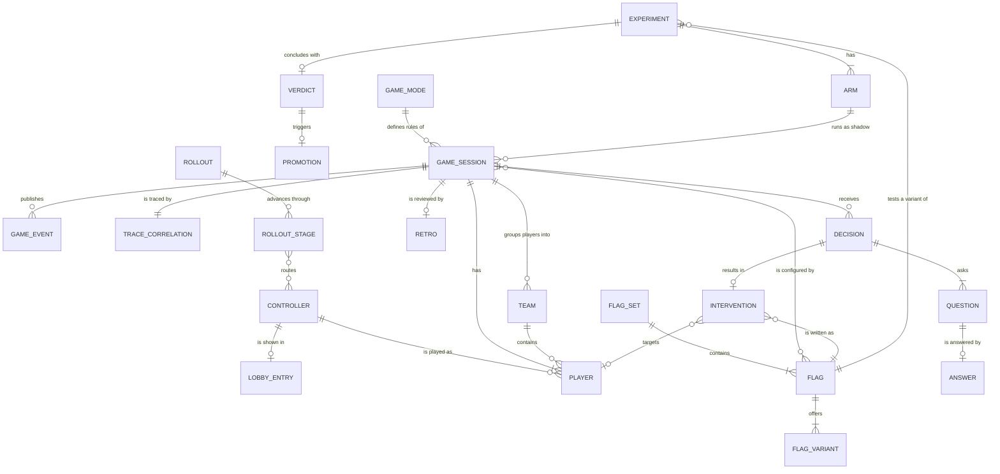

# Entity Model

> AIUP stage 3 of 5: [vision](vision.md) → [requirements](requirements.md) → **entity model** →
> [use cases](use_cases.puml) → [technical specs](specs/). Index: [README.md](README.md).
>
> JoustMania has no database: these entities live in protobuf messages, in-memory service state, flag
> files and the agent's experiment journal. "Primary Key" therefore means the natural identifier.
> Source of each entity is given in its description. State: `main` @ 2d162b33.

## Entity Relationship Diagram

### CONTROLLER

A physical or mock PS Move controller tracked by the controller manager (`proto/controller_manager.proto` `ControllerState`, `services/controller_manager/name_manager.py`).

| Attribute | Description | Data Type | Length/Precision | Validation Rules |
|---|---|---|---|---|
| serial | Bluetooth MAC address, or `MOCK0001`-style id for mock controllers | String | 17 | Primary Key, Format: MAC or MOCK%04d |
| name | Human-readable name, deterministic default (adjective + noun) or user-assigned | String | 50 | Not Null |
| battery | Battery level in percent (raw 0..5 mapped ×20; charging = 100; unknown = 50) | Integer | 3 | Not Null, Min: 0, Max: 100 |
| accel | Last acceleration vector in g (x, y, z) | Decimal | 6,3 | Not Null |
| gyro | Last gyroscope vector | Decimal | 6,3 | Not Null |
| color | Current LED colour (r, g, b) | Integer | 3 | Not Null, Min: 0, Max: 255 |
| rssi | Signal strength in dBm (controller manager always reports 0; RSSI comes from the pairing daemon metric) | Integer | 4 | Optional, Min: -100, Max: 0 |
| adapter | I/O adapter currently routing this controller | String | 10 | Not Null, Values: python, rust, mock, unstable |
| reserved | Mock controller reserved for a shadow game (hidden from the lobby roster) | Boolean | 1 | Not Null |

### LOBBY_ENTRY

A controller's state in the menu lobby (`services/menu/handlers/base.py:68-75`, `services/menu/state_manager.py`).

| Attribute | Description | Data Type | Length/Precision | Validation Rules |
|---|---|---|---|---|
| serial | Controller in the lobby | String | 17 | Primary Key, Foreign Key (CONTROLLER.serial) |
| state | Lobby state; a disconnected controller is removed, not stored | String | 10 | Not Null, Values: CONNECTED, READY, ADMIN, IDLE |
| is_sentinel | Breathing LED while the lobby is idle | Boolean | 1 | Not Null |

**Constraints:** auto start when ready count ≥ 2 and ready count = connected count (IDLE and ADMIN count as connected, not ready). Exactly one controller can be in ADMIN.

### GAME_MODE

A playable game type (`lib/types.py:23-35` `Games`, registry `services/game_coordinator/game_factory.py:56-67`).

| Attribute | Description | Data Type | Length/Precision | Validation Rules |
|---|---|---|---|---|
| name | Enum name | String | 20 | Primary Key, Values: JoustFFA, JoustTeams, JoustRandomTeams, Traitor, Werewolf, Zombies, Swapper, FightClub, Tournament, NonStop |
| id | Enum integer | Integer | 2 | Not Null, Unique, Min: 0, Max: 12 |
| pretty_name | Display name, also the name of the game's root span | String | 30 | Not Null |
| minimum_players | Declared minimum (not enforced; only ≥ 2 is, see D-G2) | Integer | 2 | Not Null, Min: 2, Max: 4 |
| config_message | Typed proto config for the mode | String | 30 | Optional, Values: FFAConfig, TeamsConfig, RandomTeamsConfig, NonstopConfig, TournamentConfig, FightClubConfig, WerewolfConfig, ZombieConfig, SwapperConfig, TraitorConfig |

**Constraints:** `Commander`, `Ninja` and `Random` exist in the enum (ids 6, 11, 12) but have no implementation; the menu hides them and a direct start ends with `game_error`.

### GAME_SESSION

One running or finished game in the game coordinator (`services/game_coordinator/game_session.py`, `proto/game_coordinator.proto` `StartGameConfig`, `GameInfo`).

| Attribute | Description | Data Type | Length/Precision | Validation Rules |
|---|---|---|---|---|
| game_id | Unique id | String | 17 | Primary Key, Format: game_ + 12 hex chars |
| game_mode | Mode played | String | 20 | Not Null, Foreign Key (GAME_MODE.name) |
| origin | Who asked for the start | String | 30 | Not Null, Values: GAME_ORIGIN_UNSPECIFIED, GAME_ORIGIN_MENU, GAME_ORIGIN_AGENT |
| game_kind_telemetry | Kind as emitted on coordinator spans and metrics (`game.kind`, `game_kind`) | String | 7 | Not Null, Values: primary, shadow |
| game_kind_flags | Kind in the flag evaluation context and on agent spans | String | 6 | Not Null, Values: real, shadow |
| state | Session state (proto `GameState`) | String | 8 | Not Null, Values: IDLE, STARTING, RUNNING, ENDING, ENDED |
| sensitivity | Baseline sensitivity index | Integer | 1 | Not Null, Min: 0, Max: 4 |
| experiment_id | Experiment the shadow game belongs to | String | 50 | Optional, Foreign Key (EXPERIMENT.experiment_id) |
| arm | Arm of the experiment | String | 12 | Optional, Values: experimental, control |
| rng_seed | Shared seed for paired (CRN) shadow games; 0 = entropy | Long | 19 | Optional, Min: 0 |
| start_time | Start timestamp (ms) | DateTime | - | Not Null |

**Constraints:**
- Two `game_kind` vocabularies exist (see #1249). The coordinator emits `primary` for the menu-started real game and `shadow` otherwise; the flag context and the agent use `real` / `shadow`. The coordinator bridges `primary → real` for flag evaluation (`game_session.py:283-292`) and the agent normalises at ingest (`services/agent/gamecontext/gamekind.go`). An empty or unknown kind is **not** real.
- Only `GAME_ORIGIN_MENU` may claim the primary slot; at most one primary session; at most `max_concurrent_games` sessions and `max_shadow_games` shadows; `experiment_id`, `arm` and `rng_seed` are honoured only for shadow sessions.
- The proto state `ENDING` is never set on a session; `RUNNING` begins at `game_started`, which base modes publish before the countdown (D-G4).

### PLAYER

A controller's participation in one game (`proto/game_coordinator.proto` `Player`, `PlayerInfo`; `services/game_coordinator/games/base.py`).

| Attribute | Description | Data Type | Length/Precision | Validation Rules |
|---|---|---|---|---|
| serial | Controller played | String | 17 | Primary Key, Foreign Key (CONTROLLER.serial) |
| game_id | Game | String | 17 | Primary Key, Foreign Key (GAME_SESSION.game_id) |
| team | Team index, -1 without teams | Integer | 2 | Not Null, Min: -1, Max: 7 |
| alive | Still in the game (zombies stay alive when converted) | Boolean | 1 | Not Null |
| score | Mode score (NonStop: 100 − 10 × deaths); `ListGames` reports 0 | Integer | 5 | Optional, Min: 0 |
| sensitivity_factor | Agent per-player factor (divides thresholds) | Decimal | 4,2 | Not Null, Min: 0.5, Max: 2.0 |
| handicap_factor | Agent handicap (multiplies thresholds) | Decimal | 4,2 | Not Null, Min: 0.5, Max: 2.0 |
| grace_until | No-death deadline from respawn, conversion or agent shield | DateTime | - | Optional |
| invincible_until | No-death deadline from match / round start (Tournament, Fight Club) | DateTime | - | Optional |
| smoothed_accel | EMA of acceleration magnitude in g | Decimal | 6,3 | Not Null, Min: 0 |

**Constraints:** the player cannot die while `now < max(grace_until, invincible_until)`. Effective thresholds are divided by `clamp(sensitivity_factor × global_difficulty_factor, 0.5, 2.0)` and multiplied by `clamp(handicap, 0.5, 2.0)`.

### TEAM

A colour team in team modes (`services/game_coordinator/games/teams_base.py`).

| Attribute | Description | Data Type | Length/Precision | Validation Rules |
|---|---|---|---|---|
| index | Team number | Integer | 1 | Primary Key, Min: 0, Max: 7 |
| game_id | Game | String | 17 | Not Null, Foreign Key (GAME_SESSION.game_id) |
| name | Colour name (e.g. Pink, Magenta) | String | 20 | Not Null |
| color | RGB colour | Integer | 3 | Not Null, Min: 0, Max: 255 |
| secret | Hidden team for traitors (Traitor mode only) | Boolean | 1 | Not Null |

### GAME_EVENT

An event on a game's event stream (`proto/game_coordinator.proto` `GameEvent`; publishers listed in [UC-020](use_cases/UC-020.md) and [services.md](specs/services.md)).

| Attribute | Description | Data Type | Length/Precision | Validation Rules |
|---|---|---|---|---|
| event_type | Event name (e.g. `game_start`, `countdown_end`, `game_winner`, `team_winner`, `game_ended`, `game_force_ended`, `game_error`, `agent_intervention`) | String | 40 | Not Null |
| game_id | Game the event belongs to | String | 17 | Not Null, Foreign Key (GAME_SESSION.game_id) |
| data | Event payload, string map | String | 4000 | Optional |
| timestamp | Unix time in ms | Long | 19 | Not Null |

### FLAG_SET

One flagd flag file (`services/flagd/*.json`); see [flags.md](specs/flags.md).

| Attribute | Description | Data Type | Length/Precision | Validation Rules |
|---|---|---|---|---|
| flag_set_id | `metadata.flagSetId` | String | 20 | Primary Key, Values: agent, controller, game, interventions, observability, rollout, system, user |
| file | Flag file path | String | 100 | Not Null, Unique |
| owner | Who owns the values ([OWNERSHIP_MODEL.md](OWNERSHIP_MODEL.md)) | String | 20 | Not Null, Values: human, operator, agent, operator+agent |

### FLAG

One OpenFeature flag.

| Attribute | Description | Data Type | Length/Precision | Validation Rules |
|---|---|---|---|---|
| key | Flag key, dotted namespace allowed | String | 60 | Primary Key |
| flag_set_id | Containing flag set | String | 20 | Not Null, Foreign Key (FLAG_SET.flag_set_id) |
| type | Value type | String | 6 | Not Null, Values: bool, int, float, string, object |
| default_variant | Variant served when no targeting matches | String | 40 | Not Null, Foreign Key (FLAG_VARIANT.name) |
| targeting | JSONLogic targeting rule (keys: targetingKey/serial, gameId, game_kind, game_mode, experiment_id, arm, service) | String | 4000 | Optional |
| reload | When readers see a change | String | 16 | Not Null, Values: live, event-refreshed, per-game, startup |

### FLAG_VARIANT

A named value of a flag.

| Attribute | Description | Data Type | Length/Precision | Validation Rules |
|---|---|---|---|---|
| name | Variant name | String | 40 | Primary Key |
| flag_key | Flag | String | 60 | Not Null, Foreign Key (FLAG.key) |
| value | JSON value | String | 4000 | Not Null |

**Constraints:** the agent experiment writer may add a variant named `agent_experiment__<experiment_id>` and shadow-scoped targeting, but may not change `default_variant` or an existing variant (`services/agent/experiment/gate.go`).

### DECISION

One agent decision cycle for a game (`services/agent/decision/decision.go`, `decide_hook.go`; contract in [decide-contract.md](specs/decide-contract.md)).

| Attribute | Description | Data Type | Length/Precision | Validation Rules |
|---|---|---|---|---|
| decision_id | Correlates decision and effect (`intervention.id`) | String | 40 | Primary Key |
| game_id | Game decided for | String | 17 | Not Null, Foreign Key (GAME_SESSION.game_id) |
| backend_requested | `decision.backend` at fire time | String | 10 | Not Null, Values: rules, claude, openai, jev |
| backend | Backend that actually decided | String | 10 | Not Null, Values: rules, claude, openai, jev |
| outcome | Decide outcome | String | 10 | Not Null, Values: act, held, noop, invalid, fallback, discarded |
| fallback_reason | Why rules decided instead | String | 22 | Optional, Values: unknown_backend, backend_unavailable, async_not_wired, llm_not_eligible, llm_budget_exhausted, timeout, invalid_answer, error |
| discarded_reason | Why a valid answer was dropped | String | 16 | Optional, Values: stale_context, game_ended, target_gone, kill_switch, backend_changed, shutdown |
| confidence | Routing confidence of `ffa.intervention` | Decimal | 4,3 | Optional, Min: 0, Max: 1 |
| act_confidence_threshold | Threshold read at landing | Decimal | 4,3 | Optional, Min: 0, Max: 1 |
| blocked | Permission chain blocked the decision | Boolean | 1 | Not Null |
| block_reason | Permission block | String | 18 | Optional, Values: not_allowed, battery_threshold, rate_limit |
| state_digest | SHA-256 of the canonical state | String | 64 | Not Null |
| latency_ms | Decide latency | Integer | 6 | Not Null, Min: 0 |

### QUESTION

A question in a decide request (`services/agent/decide/decide.go:50-60`, FFA set `ffa.go`).

| Attribute | Description | Data Type | Length/Precision | Validation Rules |
|---|---|---|---|---|
| question_id | Id, unique within a request | String | 30 | Primary Key, Values: ffa.intervention, ffa.target, ffa.magnitude |
| kind | Question kind (`noul` planned, #1229) | String | 6 | Not Null, Values: choice, score |
| text | Prompt text for remote backends | String | 2000 | Not Null |
| options | Choice options | String | 1000 | Optional |
| range_min | Score lower bound | Decimal | 6,3 | Optional |
| range_max | Score upper bound | Decimal | 6,3 | Optional |

### ANSWER

A backend's answer to one question (`decide.go:63-76`, validation `validate.go`).

| Attribute | Description | Data Type | Length/Precision | Validation Rules |
|---|---|---|---|---|
| question_id | Answered question | String | 30 | Primary Key, Foreign Key (QUESTION.question_id) |
| choice | Chosen option (choice kind) | String | 60 | Optional |
| probabilities | Option → probability, sum 1 ± 0.001, choice is the argmax | String | 2000 | Optional |
| score | Value within the range (score kind) | Decimal | 6,3 | Optional |
| confidence | Confidence that acting is right | Decimal | 4,3 | Not Null, Min: 0, Max: 1 |

### INTERVENTION

A bounded in-game change applied through `interventions.json` (`services/agent/actions/writer.go`, `services/game_coordinator/interventions.py`).

| Attribute | Description | Data Type | Length/Precision | Validation Rules |
|---|---|---|---|---|
| type | Intervention type | String | 30 | Primary Key, Values: play_audio_cue, send_controller_effect, adjust_volume, adjust_music_tempo, set_pacing_profile, adjust_player_sensitivity, grant_shield, adjust_global_sensitivity, adjust_global_difficulty, eliminate_player, revive_player, end_game, set_player_handicap, ramp_tempo, partial_shield, soft_penalty, auto_rubberband, noop |
| flag_key | Flag written | String | 30 | Not Null, Foreign Key (FLAG.key) |
| shape | How it is written | String | 10 | Not Null, Values: state, edge, per-player |
| weight | Rate-limit weight class | String | 6 | Not Null, Values: soft, medium, hard |
| target_serial | Player targeted (player-scoped types) | String | 17 | Optional, Foreign Key (PLAYER.serial) |
| value | Resolved magnitude or payload | String | 60 | Optional |
| blocked_by_coordinator | Coordinator block reason | String | 16 | Optional, Values: not_allowed, rate_limited, low_battery, mode_unsupported, no_game, handler_error |

**Constraints:** the type must be in the live `interventions_allowed` list (checked by the agent and again by the coordinator); writes happen only while `interventions_enabled` is on. Agent writes carry no `gameId` targeting today (D-A2, #920).

### EXPERIMENT

A hypothesis about one `game.json` flag value, tested in shadow games (`services/agent/experiment/registry.go:48-66`, journal `services/agent/experiment/journal/`). Declared from the env seed, the M7-4 proposer, retro-seeded theses or the dynamic declarer.

| Attribute | Description | Data Type | Length/Precision | Validation Rules |
|---|---|---|---|---|
| experiment_id | Id | String | 50 | Primary Key, Format: exp_<id> |
| flag_key | Flag under test | String | 60 | Not Null, Foreign Key (FLAG.key) |
| value | Candidate value | String | 4000 | Not Null |
| objective | Objective scored | String | 12 | Not Null, Values: endurance, balanced, accelerate |
| thesis | Hypothesis text | String | 500 | Optional |
| target_n | Games per arm | Integer | 4 | Not Null, Min: 1 |
| status | Lifecycle | String | 10 | Not Null, Values: proposed, running, concluded, promoting, done, discarded, aborted |

**Constraints:** the `chaos` objective is rejected. All running experiments are aborted when `enabled` or `experiments_enabled` is off.

### ARM

One treatment of an experiment.

| Attribute | Description | Data Type | Length/Precision | Validation Rules |
|---|---|---|---|---|
| experiment_id | Experiment | String | 50 | Primary Key, Foreign Key (EXPERIMENT.experiment_id) |
| arm | Arm name | String | 12 | Primary Key, Values: experimental, control |
| games_completed | Shadow games concluded | Integer | 4 | Not Null, Min: 0 |
| fitness_mean | Running mean fitness (Welford) | Decimal | 8,5 | Optional |
| fitness_sd | Running standard deviation | Decimal | 8,5 | Optional, Min: 0 |

### VERDICT

The conclusion of an experiment (`services/agent/experiment/verdict.go`).

| Attribute | Description | Data Type | Length/Precision | Validation Rules |
|---|---|---|---|---|
| experiment_id | Experiment | String | 50 | Primary Key, Foreign Key (EXPERIMENT.experiment_id) |
| outcome | Result | String | 12 | Not Null, Values: promote, discard, inconclusive |
| effect_size | Cohen's d (experimental vs control) | Decimal | 6,3 | Not Null |
| delta | Raw mean difference | Decimal | 8,5 | Not Null |
| significant | Passed effect threshold and raw-effect floor | Boolean | 1 | Not Null |

**Constraints:** requires `verdict_min_n` games per arm and `verdict_min_pairs` pairs; the recent-real baseline anchor can only downgrade `promote` to `inconclusive`.

### PROMOTION

What happens to a promote verdict (`services/agent/promote/promote.go:91-105,420-480`).

| Attribute | Description | Data Type | Length/Precision | Validation Rules |
|---|---|---|---|---|
| experiment_id | Experiment promoted | String | 50 | Primary Key, Foreign Key (EXPERIMENT.experiment_id) |
| mode | `code_improvement.mode` at promotion | String | 10 | Not Null, Values: issue, pr, autonomous |
| target | `code_improvement.target` | String | 6 | Not Null, Values: local, github |
| outcome | What the promotion achieved (`code_improvement.outcome`); a promotion that could not act is `discarded` with a reason | String | 10 | Not Null, Values: applied, discarded, reverted |
| reason | Why it was discarded | String | 200 | Optional |
| reference | Issue / PR URL or commit | String | 200 | Optional |

### RETRO

A post-game retrospective (`services/agent/decision/retro_capture.go`, `services/agent/llm/retro.go`).

| Attribute | Description | Data Type | Length/Precision | Validation Rules |
|---|---|---|---|---|
| game_id | Game reviewed | String | 17 | Primary Key, Foreign Key (GAME_SESSION.game_id) |
| inference_used | Whether a model answered (`stub` = capture only) | Boolean | 1 | Not Null |
| session_assessment | Model assessment | String | 1000 | Optional |
| suggestions | Suggested interventions (type, emphasis, reason) | String | 4000 | Optional |
| session_focus | Suggested focus | String | 200 | Optional |

### ROLLOUT

A controller-backend rollout (`services/flagd/rollout.json`, `services/controller_manager/multiplexer/rollout_router.py`).

| Attribute | Description | Data Type | Length/Precision | Validation Rules |
|---|---|---|---|---|
| target_backend | Backend being rolled out | String | 8 | Primary Key, Values: python, rust, unstable |
| strategy | Rollout strategy | String | 11 | Not Null, Values: off, immediate, progressive |
| remediation_allowed | Agent may roll back | Boolean | 1 | Not Null |

### ROLLOUT_STAGE

A stage of a progressive rollout: how many controllers (first N by sorted serial) use the target backend.

| Attribute | Description | Data Type | Length/Precision | Validation Rules |
|---|---|---|---|---|
| current_controller_count | Controllers on the target backend | Integer | 2 | Primary Key, Values: 0, 1, 3, 6, 99 |
| entered_at | When the agent entered the stage (dwell timer) | DateTime | - | Not Null |
| fitness_passed | Last infrastructure fitness result | Boolean | 1 | Not Null |

**Constraints:** per-serial `bluetooth_backend` targeting (manual canary) wins over the rollout; mock-only controllers are not routed.

### TRACE_CORRELATION

The identifiers that tie a game's telemetry together (`services/game_coordinator/metrics.py:81-85` `game_trace_correlation`; [telemetry.md](specs/telemetry.md)).

| Attribute | Description | Data Type | Length/Precision | Validation Rules |
|---|---|---|---|---|
| game_id | Game | String | 17 | Primary Key, Foreign Key (GAME_SESSION.game_id) |
| game_trace_id | Trace id of the game's root span | String | 32 | Not Null, Format: 32 hex |
| game_trace_span_id | Span id of the game root | String | 16 | Not Null, Format: 16 hex |
| gameplay_phase_span_id | Span id of `gameplay_phase`, the remote parent of in-game agent spans | String | 16 | Optional, Format: 16 hex |
