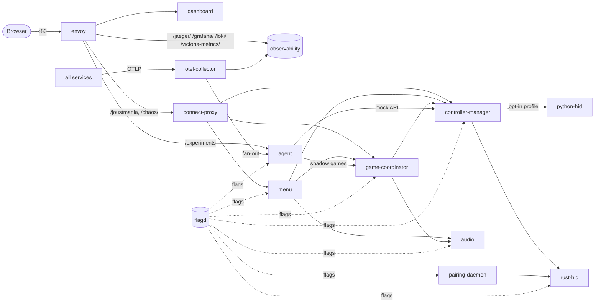

# Services

> Technical spec. Part of the [spec tree](../README.md). State: `main` @ 84c3ba15 (2026-10-16, includes PRs #1256, #1257, #1259, #1261, #1265, #1266, #1282, #1284, #1286, #1288, #1296, #1297, #1303, #1306, #1307, #1309, #1312, #1315, #1324 and #1308 (#1258 pattern games)).
> RPC tables are **generated from `proto/*.proto`**; regenerate them when a `.proto` changes (and remember the
> forwarding method in `services/connect-proxy/main.go` for browser-reachable RPCs).

## 1. Topology

Dependencies (start-up, from `depends_on` and code): audio, python-hid, rust-hid and flagd have no application
dependencies; the controller manager waits for flagd and for rust-hid and python-hid to be healthy (compose
`depends_on`) and talks to both HID adapters over gRPC; the game coordinator calls the controller manager and
audio, and the menu calls the controller manager, the game coordinator and audio (code only: in compose the
coordinator and the menu wait only for flagd, the menu also for `flag-dir-init`); the agent depends only on flagd
(and calls the game coordinator and the mock control API to run shadow games, the named exception in C-005).

## 2. Service catalog

| Service (compose name) | Language | Port(s) | Host-published | Responsibility | Source |
|---|---|---|---|---|---|
| controller-manager | Python | 50052 gRPC; 50062 mock control API (mock adapter only); 8000 prometheus_client | 50052, 50062 via `docker-compose.override.yml` | Discover controllers, route each to one HID adapter, stream buttons and motion, apply LEDs / rumble / effects, names, rollout routing, chaos | `services/controller_manager/` |
| python-hid | Python | 50059 gRPC | no | HID access via hidapi: ControllerIOService only. Opt-in: starts only under the `python-hid` compose profile (UC-002 BR-003, #1371) | `services/python_hid/` |
| rust-hid | Rust | 50058 gRPC | 50058 (for the host-networked pairing daemon) | HID access: PairingService + ControllerIOService. The default Bluetooth backend; in the full and the lite stack (UC-002 BR-003) | `services/rust-hid/` |
| pairing-daemon | Python | 8002 `/healthz`, `POST /controllers/{address}/unpair` (host network, bound to `CONTROL_BIND`) | host network | USB pairing loop, Bluetooth monitor (RSSI metrics), unpair a controller (UC-005) | `services/pairing_daemon/` |
| game-coordinator | Python | 50053 gRPC (compose also exposes 8000, but nothing listens there: metrics are pushed over OTLP) | 50053 via override | Game sessions (primary + shadow), game modes, death detection, events, interventions consumer | `services/game_coordinator/` |
| menu | Python | 50054 gRPC | 50054 via override | Lobby, ready state, mode selection, admin mode, flag writer for `game` / `user` / `agent.interventions_allowed` | `services/menu/` |
| audio | Python | 50056 gRPC | 50056 via override | Music with tempo (separate process, soxr), 8 effect channels (miniaudio), ALSA | `services/audio/` |
| agent | Go | 4317 OTLP gRPC (receiver); 13134 HTTP `/healthz`, `/experiments` | no | Observe via OTLP, decide, write interventions / rollout / experiment targeting, run experiments and promotion | `services/agent/` |
| connect-proxy | Go | 8080 HTTP | no | Connect (browser) ↔ gRPC bridge; `/canary/*`, `/chaos/*` flag-file endpoints | `services/connect-proxy/` |
| dashboard | TypeScript | 8080 HTTP (static-web-server) | no | SPA: controllers, Agent, Experiments, Metrics, Traces tabs; follows the newest live shadow game when no real game is live (`ListGames`, `GetGameState`, `StreamGameEvents(game_id)`; UC-070 BR-005) | `services/dashboard/` |
| envoy | config | 80 HTTP; 9901 admin | **80** | Single entry point / reverse proxy | `services/envoy/envoy.yaml` |
| flagd | binary v0.16.0 | 8013 RPC eval, 8014 mgmt, 8015 sync | 8015 (8013 via override) | Serve the flag files | `docker-compose.yml:79-122` |
| otel-collector | custom contrib build | 4317 / 4318 OTLP | 4317 | Receive OTLP + container logs + host metrics; export to Jaeger, VictoriaMetrics, Loki, agent (the :8889 Prometheus exporter was removed in #1449) | `services/otel-collector/config.yaml` |
| jaeger | 2.19.0 | 16686 UI, 4317 / 4318 OTLP | no | Trace store (badger, bounded TTL) | `services/jaeger/config.yaml` |
| victoria-metrics | v1.144.0 | 8428 | no | The only metric store (remote write, 7 d); serves the Prometheus query API to Grafana, the dashboard and the tools. The Prometheus container was removed in #1449 | `docker-compose.yml:516-544` |
| grafana | 13.0.2 | 3000 | no | Dashboards | `services/grafana/` |
| loki | 3.7.2 | 3100 | no | Logs | `services/loki/config.yaml` |
| flag-dir-init | busybox | none | no | One-shot: make the flag dir group-writable for the nonroot menu | `docker-compose.yml:65-76` |
| agent-game-coordinator | Python (game-coordinator image) | 50053 gRPC, 8000 (`expose` only) | no | **Test-only** (profile `agent`, #1163): a dedicated game coordinator for the agent's experiment cohort-loop soak, so the suite's per-test `coordinator_idle` quiesce never wipes the agent's shadow games. Service name `agent-game-coordinator-service`; the overlay points the agent at it with `GAME_COORDINATOR_ADDR=agent-game-coordinator:50053`; shares flagd and the controller manager | `docker-compose.agent-coordinator.yml` (layered on `docker-compose.dry-run.yml` by `tests/integration/test_experiment_cohort_loop.py`) |

Compose variants: `docker-compose.yml` (full), `.override.yml` (auto-loaded dev ports), `.lite.yml` (no
observability; still runs rust-hid and the pairing daemon, so the Pi reads real controllers, #1318), `.ci.yml` (CI flag dir, profiles), `.ci-rust.yml`, `.dev.yml` (source mounts), `.dry-run.yml`
(demo / experiment seed), `.decide-e2e.yml` (fake OpenAI server), `.agent-coordinator.yml`.

**Traceability:** C-014, C-015, FR-085, NFR-020 / UC-035 / `docker-compose*.yml`, `services/envoy/envoy.yaml` / `tests/integration/conftest.py`.

## 3. gRPC services (36 RPCs)

### `joustmania.audio.AudioService` (proto/audio.proto)

| RPC | Kind | Request → Response | Description | Line |
|---|---|---|---|---|
| `PlaySound` | unary | `PlaySoundRequest` → `PlaySoundResponse` | Play an effect (file, volume, priority LOW..CRITICAL) | `proto/audio.proto:9` |
| `PlayMusic` | unary | `PlayMusicRequest` → `PlayMusicResponse` | Start looping music matching a file pattern at a tempo | `proto/audio.proto:10` |
| `StopMusic` | unary | `StopMusicRequest` → `StopMusicResponse` | Stop music | `proto/audio.proto:11` |
| `ChangeTempo` | unary | `ChangeTempoRequest` → `ChangeTempoResponse` | Change music tempo (ratio clamped to (0.5, 2.0]) with a transition | `proto/audio.proto:12` |
| `SetVolume` | unary | `SetVolumeRequest` → `SetVolumeResponse` | Set master volume | `proto/audio.proto:13` |

### `joustmania.controller_manager.ControllerManagerService` (proto/controller_manager.proto)

| RPC | Kind | Request → Response | Description | Line |
|---|---|---|---|---|
| `StreamButtonEvents` | bidi stream | `ButtonEventStreamControl` → `ButtonEvent` | Button press / release events to the client; the client sends base LED colours and effects back | `proto/controller_manager.proto:11` |
| `StreamGameplayData` | bidi stream | `GameplayStreamControl` → `GameplayDataUpdate` | Motion data at the requested rate, with each controller's connection quality on the unfiltered (dashboard) stream (`GameplayData.connection_quality`: class and p95 / longest report gap, UC-035 BR-005; game streams leave it unset); the client changes filters, colours and effects mid-stream | `proto/controller_manager.proto:15` |
| `RenameController` | unary | `RenameControllerRequest` → `RenameControllerResponse` | Rename a controller (set custom human-readable name) | `proto/controller_manager.proto:18` |
| `GetConnectedControllers` | unary | `GetConnectedControllersRequest` → `GetConnectedControllersResponse` | Query the controller manager's authoritative live roster on demand (#1153). Unlike the event-piggybacked connected_serials (only refreshed on the next CONNECT/DISCONNECT), this returns the current connected set synchronously so a client (the menu) can reconcile ghosts after a missed disconnect. Also read by `scripts/talk-preflight.sh` through envoy to count real controllers (UC-070 BR-006). | `proto/controller_manager.proto:24` |
| `IdentifyController` | unary | `IdentifyControllerRequest` (`serial`, `duration_ms`: 0 = 3000 ms, clamped to 500..10000) → `IdentifyControllerResponse` (`success`, `outcome`: `started` / `not_connected` / `in_game` / `reserved` / `invalid`, `error`, `duration_ms`: the duration used) | Flash a controller white at 2 Hz and rumble it briefly, then restore its colour, so the operator can find it; refused for controllers that are not connected, reserved, or players of an open game gameplay stream, and cancelled when a game stream claims the controller (UC-004, FR-121) | `proto/controller_manager.proto:29` |

### `controller_manager_mock.MockControllerService` (proto/controller_manager_mock.proto)

| RPC | Kind | Request → Response | Description | Line |
|---|---|---|---|---|
| `SimulateMovement` | unary | `MovementRequest` → `MovementResponse` | Simulate controller movement: holds the acceleration vector on that controller (every poll and gameplay frame reports it) until the next call or `ResetController`; a `SimulateDeath` latch overrides it for its frames; a NaN/infinite component returns `INVALID_ARGUMENT` (UC-003 BR-002, #1279) | `proto/controller_manager_mock.proto:10` |
| `SimulateDeath` | unary | `DeathRequest` → `DeathResponse` | Simulate death (high acceleration) | `proto/controller_manager_mock.proto:13` |
| `SimulateButton` | unary | `ButtonRequest` → `ButtonResponse` | Simulate button press | `proto/controller_manager_mock.proto:16` |
| `SetColor` | unary | `ColorRequest` → `ColorResponse` | Set LED color | `proto/controller_manager_mock.proto:19` |
| `ResetController` | unary | `ResetRequest` → `ResetResponse` | Reset controller to idle: buttons released, death latch and held movement cleared, acceleration back to resting noise (UC-003 A3) | `proto/controller_manager_mock.proto:22` |
| `ListMockControllers` | unary | `ListRequest` → `ListResponse` | Get list of mock controllers | `proto/controller_manager_mock.proto:25` |
| `SetAutoGameEnd` | unary | `AutoGameEndRequest` → `AutoGameEndResponse` | Set auto game end - automatically kill players after duration to ensure game ends | `proto/controller_manager_mock.proto:28` |
| `GetColor` | unary | `GetColorRequest` → `GetColorResponse` | Get current LED color of a controller | `proto/controller_manager_mock.proto:31` |
| `StreamObservability` | server stream | `ObservabilityRequest` → `ObservabilityEvent` | Stream observable events from mock controllers (LED changes, button presses, etc.) | `proto/controller_manager_mock.proto:34` |
| `AddController` | unary | `AddControllerRequest` → `AddControllerResponse` | Add a single mock controller dynamically | `proto/controller_manager_mock.proto:37` |
| `RemoveController` | unary | `RemoveControllerRequest` → `RemoveControllerResponse` | Remove a mock controller | `proto/controller_manager_mock.proto:40` |
| `AddControllers` | unary | `AddControllersRequest` → `AddControllersResponse` | Add multiple mock controllers at once | `proto/controller_manager_mock.proto:43` |

Pattern games (#1258, [UC-046](../use_cases/UC-046.md), PR #1308). The proto change needs
`make protos` and `make protos-agent` (committed Go stubs in `services/agent/gen`); the mock proto's `go_package`
is the connect-proxy gen, so the `Build connect-proxy` CI job must compile it, but no forwarding method is needed
because connect-proxy forwards no `MockControllerService` RPC. The controller manager never reads flagd for
archetypes: the agent resolves and pins the parameters and passes them in `AddControllers`.

| Change | Kind | Fields | Behaviour | Status |
|---|---|---|---|---|
| `AddControllersRequest.archetype`, `.archetype_params` | new fields 4 (string), 5 (string, JSON object) | archetype name; its parameter object as JSON; empty = no pattern (random resting motion, only for mock controllers outside experiments) | Validates the parameters (UC-046 BR-003), requires `count` = `players`, installs slot i on the i-th returned serial, pins the gameplay stream of these controllers to `stream_rate_hz`, and refuses `SimulateMovement` / `SimulateDeath` for them | Implemented (#1258, FR-100, FR-102, FR-103, FR-104) |
| `AddControllersResponse` | new fields 4 to 6 | `archetype`, `stream_rate_hz`, `players` | Echo of the installed archetype; `success=false` with the failed rules when the parameters are invalid | Implemented (#1258) |
| `RemoveControllerResponse` | new fields 3 to 8 | `pattern_slot`, `frames_delivered` (uint64), `signal_hash` (fixed64), `frame_overruns` (uint32), `signal_checkpoints` (repeated string), `archetype` | For a pattern controller: the replay record of UC-046 step 8 (definitions in [telemetry.md §9](telemetry.md#9-pattern-games-1258)); `archetype` is empty for other controllers | Implemented (#1258, FR-108, FR-109) |

### `joustmania.game_coordinator.GameCoordinatorService` (proto/game_coordinator.proto)

| RPC | Kind | Request → Response | Description | Line |
|---|---|---|---|---|
| `ForceEndGame` | unary | `ForceEndGameRequest` → `ForceEndGameResponse` | Force end current game | `proto/game_coordinator.proto:10` |
| `StreamGameEvents` | server stream | `StreamEventsRequest` → `GameEvent` | Stream game events (deaths, scoring, etc.) If start_config is provided, starts a new game before streaming events. If start_config is empty, subscribes to current/upcoming game events. | `proto/game_coordinator.proto:15` |
| `GetGameState` | unary | `GetGameStateRequest` → `GetGameStateResponse` | Get current game state (for testing/observability) | `proto/game_coordinator.proto:18` |
| `ListGames` | unary | `ListGamesRequest` → `ListGamesResponse` | List all live game sessions (primary + shadow). Lets agents and tests enumerate concurrent games and learn their game_ids; the dashboard uses it to pick the shadow game it follows (UC-070 BR-005). | `proto/game_coordinator.proto:22` |

### `joustmania.menu.MenuService` (proto/menu.proto)

| RPC | Kind | Request → Response | Description | Line |
|---|---|---|---|---|
| `StartMenu` | unary | `StartMenuRequest` → `StartMenuResponse` | Start menu | `proto/menu.proto:10` |
| `StopMenu` | unary | `StopMenuRequest` → `StopMenuResponse` | Stop menu | `proto/menu.proto:13` |
| `StreamMenuEvents` | server stream | `StreamMenuEventsRequest` → `MenuEvent` | Stream menu events (button presses, selections) | `proto/menu.proto:16` |
| `ProcessInput` | unary | `ProcessInputRequest` → `ProcessInputResponse` | Process menu input | `proto/menu.proto:19` |

### `joustmania.psmove_hid.PairingService` (proto/psmove_hid.proto)

| RPC | Kind | Request → Response | Description | Line |
|---|---|---|---|---|
| `GetUSBControllers` | unary | `GetUSBControllersRequest` → `GetUSBControllersResponse` | List USB-attached controllers | `proto/psmove_hid.proto:8` |
| `PairController` | unary | `PairControllerRequest` → `PairControllerResponse` | Write the host adapter address into a controller | `proto/psmove_hid.proto:9` |

### `joustmania.psmove_hid.ControllerIOService` (proto/psmove_hid.proto)

| RPC | Kind | Request → Response | Description | Line |
|---|---|---|---|---|
| `Discover` | unary | `DiscoverRequest` → `DiscoverResponse` | Enumerate devices (`force`, `verify_only`, `exclude_serials`) | `proto/psmove_hid.proto:47` |
| `Open` | unary | `OpenRequest` → `OpenResponse` | Open a device handle | `proto/psmove_hid.proto:48` |
| `Close` | unary | `CloseRequest` → `CloseResponse` | Close a device handle | `proto/psmove_hid.proto:49` |
| `CloseAll` | unary | `CloseAllRequest` → `CloseAllResponse` | Close all handles | `proto/psmove_hid.proto:50` |
| `StreamIO` | bidi stream | `IOCommand` → `SensorData` | Sensor data out (≈ 1 kHz), LED / rumble commands in | `proto/psmove_hid.proto:53` |

The agent's OTLP receiver implements the standard `opentelemetry.proto.collector.{trace,metrics}.v1` Export
services (`services/agent/receiver.go`); they are not JoustMania protos.

### Browser-reachable RPCs (connect-proxy)

All five `ControllerManagerService` RPCs, all four `GameCoordinatorService` RPCs and all four `MenuService`
RPCs are forwarded under `/joustmania` (`services/connect-proxy/main.go`, the `ControllerManagerProxy`, `GameCoordinatorProxy` and `MenuProxy` methods). Audio, HID, pairing and mock
RPCs are not.

**Traceability:** C-014 / UC-002, UC-003, UC-004, UC-010, UC-027, UC-031 / `proto/*.proto`, `services/connect-proxy/main.go` / `tests/integration/`.

## 4. Key messages

| Message | Fields that matter | Source |
|---|---|---|
| `StartGameConfig` | `game_name`, `players[]`, `sensitivity` (0-4), `origin` (UNSPECIFIED / MENU / AGENT; only MENU may be primary), `experiment_id`, `arm`, `rng_seed` (shadow only), `oneof game_config` (FFA, Teams, RandomTeams, Nonstop, Tournament, FightClub, Werewolf, Zombie, Swapper, Traitor) | `proto/game_coordinator.proto:53-101` |
| `GameEvent` | `event_type`, `data` (string map), `timestamp` ms, `game_id` | `proto/game_coordinator.proto` |
| `GameInfo` / `PlayerInfo` | mode, state, players (team, colour, alive, `sensitivity_factor`; score always 0), `game_id`, `start_time_ms` | `proto/game_coordinator.proto` |
| `ControllerState` | serial, battery, buttons, accel, gyro, colour (the LED colour last written to the controller, effect frames included; #1301), rssi (always 0 from CM), name | `proto/controller_manager.proto` |
| `GameEffectCommand` | `serial` (empty = all), `effect` (`GameEffect`), optional `color`, `duration_ms`, `speed`. `GameEffect`: `NONE`, `PLAYER_WARNING`, `PLAYER_DEATH`, `PLAYER_RESPAWN`, `WINNER_RAINBOW`, `COUNTDOWN`, `ADMIN_ENTER`, `ADMIN_EXIT`, `LOW_BATTERY`, `FORCE_START_CHARGE`, `SHOW_BATTERY`, `RUMBLE`, `PULSE`, `FLASH`, `SHIELD` (14, agent shield as a persistent LED layer: fade, last-second blink, restore; short LED effects overlay it, a new base colour shows after it; death, the winner rainbow and `duration_ms=0` end it), `PARTIAL_SHIELD` (15, the weaker breathing variant) (UC-040 BR-008 to BR-010) and `IDENTIFY` (16, white 2 Hz flash plus a 500 ms rumble, then the base colour or the colour shown before; RPC-only: started by `IdentifyController`, a `GameEffectCommand` with it is rejected; a game stream configuration cancels it on its players, UC-004 BR-001 to BR-004) | `proto/controller_manager.proto:202-245`; `services/controller_manager/feedback_manager.py` |
| `MenuEvent` | `event_type` (`menu_started`, `menu_stopped`, `selection_changed`, `game_selection_changed`, `game_requested`, `game_start_cancelled`, `game_ended`), `data`, `timestamp` | `proto/menu.proto:46-50`; `services/menu/` |

Game event types actually published are listed in [UC-020](../use_cases/UC-020.md) to
[UC-027](../use_cases/UC-027.md) and in [telemetry.md](telemetry.md#5-game-events); summary:
`game_start`, `game_start_error`, `game_error`, `game_force_ended`, `game_starting`, `players_initialized`,
`countdown_start`, `countdown_end`, `game_started`, `player_revived`, `game_ended`, `game_winner`, `game_tie`,
`player_analytics`, `team_winner`, `team_formation_start` / `_end`, `traitor_signal_start` / `_end`,
`traitor_winner`, `werewolf_intro_start` / `_end`, `werewolf_reveal`, `werewolf_winner`, `zombie_intro_start` /
`_end`, `time_announcement`, `human_converted`, `zombie_winner`, `player_swapped`, `swapper_winner`,
`round_start`, `round_end`, `round_timeout`, `tournament_intro`, `match_start`, `match_end`,
`tournament_champion`, `tournament_no_winner`, `player_death` (NonStop and JoustFFA), `player_respawned`,
`agent_intervention`, `player_shielded`. Defined in `lib/types.py` but never published: `player_revive`, `player_out`, `score_update`, `team_eliminated`.

**Traceability:** FR-020 to FR-029 / UC-010, UC-020 to UC-027, UC-043 / `proto/game_coordinator.proto`, `services/game_coordinator/` / `tests/integration/test_full_game_lifecycle.py`, `tests/integration/test_parallel_lifecycle.py`.

## 5. HTTP endpoints

| Endpoint | Served by | Reachable via envoy | Purpose | Source |
|---|---|---|---|---|
| `/` | dashboard | yes | SPA | `services/envoy/envoy.yaml:121-123` |
| `/` | connect-proxy, only when `/app/static` exists in its container (not mounted in the stock compose files) | no (envoy sends `/` to the dashboard) | Static dashboard files (`http.FileServer`) | `services/connect-proxy/main.go` (`main`, "Serve static files for dashboard") |
| `/joustmania/*` | connect-proxy | yes (3600 s timeout) | Connect RPCs | `envoy.yaml:37-39` |
| `/chaos/{poll-drop,accel-spike,led-failure,disconnect}`, `/chaos/reset`, `/chaos/status` | connect-proxy | yes | Fault injection via `chaos_fault_type` | `services/connect-proxy/chaos.go:37-44` |
| `/canary/{python,rust}`, `/canary/rollback`, `/canary/status` | connect-proxy | **no** (falls through to the dashboard, D-B3) | Manual backend canary via `bluetooth_backend` | `services/connect-proxy/canary.go:13-16` |
| `/experiments`, `/experiments/{id}` | agent :13134 | yes | Experiment dossier (JSON / HTML) | `services/agent/dossier.go` (`handleList`, mux registration) |
| `/healthz` | agent :13134 | no | Liveness | `services/agent/server.go:startHealthServer` |
| `/health` | connect-proxy; envoy direct 200 | yes | Liveness | `services/connect-proxy/main.go:129` |
| `/jaeger/`, `/grafana/`, `/loki/`, `/victoria-metrics/` | observability services | yes | UIs and APIs (`/prometheus/` was removed in #1449 and now falls through to the dashboard) | `envoy.yaml:45-89` |
| `/metrics` | controller-manager :8000 | no | prometheus_client pull, for manual `curl`; nothing scrapes it since the Prometheus container was removed (#1449) | `services/controller_manager/server.py` (`start_http_server`) |
| `/healthz` | pairing-daemon :8002 | host network | Liveness | `services/pairing_daemon/psmove_pairing/daemon.py` (health status for `/healthz`) |
| `POST /pairing/unpair` (JSON `{"address": "<bluetooth address>"}`) | connect-proxy | yes (envoy route timeout 40 s) | Unpair a controller (UC-005): forwards to the pairing daemon at `PAIRING_DAEMON_URL` (full stack `http://host.docker.internal:8002` via the `host-gateway` extra host, lite stack `http://pairing-daemon:8002`) and passes its status and JSON answer through; 400 not a Bluetooth address, 403 cross-origin browser request (`Origin` host ≠ `Host`; also on `/chaos/*` setters), 502 daemon unreachable. No authentication (UC-005 BR-003) | `services/connect-proxy/pairing.go` |
| `POST /controllers/{address}/unpair` | pairing-daemon :8002, bound only to `CONTROL_BIND` (full stack loopback + docker0 gateway, lite `0.0.0.0` in its container) | host network (through `/pairing/unpair`) | Remove the address's registrations on every adapter (UC-005). 200 `{"address", "removed", "already_absent", "failed", "adapters", "results": [{"adapter", "outcome", "error"?}], "on_usb"}` when every registration found is `removed` or `already_absent`; 400 not a Bluetooth address; 404 none found; 409 a USB pairing or another unpair is running; 503 any `failed` result (same body plus `error`), a BlueZ / D-Bus error or any unexpected error | `services/pairing_daemon/psmove_pairing/control_api.py`, `usb_pairing.py`, `registrations.py` |

**Traceability:** FR-059, FR-070, FR-073, FR-084, FR-085, FR-123 / UC-005, UC-035, UC-052 / `services/envoy/envoy.yaml`, `services/connect-proxy/`, `services/agent/dossier.go`.

## 6. Per-service notes

### controller-manager

- Backend set from the `backend` flag at **startup** (default `rust`, also the fallback when the flag is unavailable; `mock` in the CI flag set; variants naming `python` are opt-in and need the `python-hid` profile, UC-002 BR-003); `mock` is always added with zero controllers. Per controller, one adapter wins: per-serial `bluetooth_backend` targeting, then the rollout router, then the flag default (`multiplexer/multiplexer_backend.py:235-291`).
- Loops: state 100 Hz, discovery 1 Hz (full enumeration at most every 0.5 s, forced every 10 s), LED batch 20 Hz (send on change or 2 s keep-alive), battery metrics every 30 s, `controller.bluetooth_health` span ~1 Hz (`discovery_loop.py`).
- Gameplay stream rate: client-requested, overridden by `game_loop.update_frequency_hz` (clamp 1..100), fallback 30 Hz.
- Pattern games (#1258, FR-103): a stream whose explicit filter names pattern controllers runs at the archetype's pinned `stream_rate_hz` and ignores the flag override; a controller's frame index advances once per frame delivered on its owning stream (the first explicit stream that names it), in `_build_gameplay_update` next to the hook that drains the #926 death latch.
- `UnstableAdapter` (≈ 8.3 Hz, 10 % drops) is registered alongside python for the rollout demo; real adapters are always wrapped in `ChaosAdapter` (D-C2).
- Mock serials `MOCK%04d`; reserved mock controllers are hidden from the roster.

### game-coordinator

- Sessions: one primary (menu origin) + shadows; caps `max_concurrent_games` (8), `max_shadow_games` (4), `shadow_policy` (block); real starts preempt shadows (`servicer.py`: `_max_concurrent_games`, `_max_shadow_games`, `_shadow_policy`, `_preempt_shadow_sessions`, `_admit_session_locked`). Game ids `game_<12 hex>`.
- Registry `_GAME_CLASSES` (`game_factory.py:_GAME_CLASSES`), 10 modes. Death detection in `games/base.py` (UC-030).
- `InterventionManager` watches `interventions.json`, evaluates each flag per live session with `{targetingKey=serial, gameId}`, enforces allow-list → mode matrix → battery → global backstop, applies via difficulty / lifecycle handlers and emits `agent_intervention` + `game_interventions_total`. The `end_game` intervention ends only the session whose `game_id` it carries, through the same path as `ForceEndGame` with that `game_id` (UC-040 BR-011); per-player grant flags apply once per decision, per player (UC-040 BR-012). Threading: change detection, baselines and the enforcement chain run on the servicer's main loop; every handler side effect (apply, revert, agent cue) is handed to the owning session's `GameLoopDispatcher` (`game_loop_dispatch.py`), which runs it on that game's own thread loop (`GameSession.game_loop`, carried as `SessionView.loop`), where its audio / controller-manager clients and gameplay stream live, one at a time in decision order (each starts only after the previous one finished), awaited with a 5 s timeout. A started effect is never cancelled. An effect not started because the game loop is closed or stopping, or not started within 5 s, is not applied (`game_loop_unavailable` / `game_loop_timeout`); a started effect still running at 5 s has an unknown outcome (`game_loop_late`); both are counted in `game_intervention_dispatch_failures_total`. `end_game` stays on the main loop because force-end joins the game thread, and sends no agent cue (UC-040 BR-018, #1250).

### menu

- Service state STOPPED / RUNNING / GAME_STARTING; controller states CONNECTED / READY / ADMIN / IDLE (UC-010 to UC-014).
- Writes flag files in place through `lib/flag_config_writer.py` (needs `flag-dir-init` for nonroot write access).

### audio

- Music in a separate process with soxr tempo resampling (also shifts pitch), output via ALSA dmix; ALSA card auto-detected at startup (prefers USB).
- 8 effect channels; only CRITICAL steals a channel; `play_audio=off` accepts and mutes.
- Sound ids resolve through the registry built from the asset directories plus aliases (`services/audio/sound_catalog.py`): `agent_cue` → `Joust/sounds/beep_loud.ogg` (the lobby ready ping), `shield_up` → `Commander/sounds/power_ready.ogg` (an alias names an exact, voice-independent asset path). An id not in the registry logs a WARNING and falls back to the Joust vox path (UC-040 BR-007). `python -m services.audio.sound_catalog <id>` exits 0 when the id resolves to a file (used by `scripts/talk-preflight.sh`).

### agent

- Environment: see `docker-compose.yml:667-765`. Gates moved to live flags: `interventions_enabled`, `rollout_enabled` (#1213), experiment and verdict knobs (#1044, #1214). Still env: API keys, `AGENT_INFERENCE_*`, `AGENT_LLM_MAX_REQUESTS_PER_MINUTE`, `AGENT_PROBE_DECISIONS`, rollout dwell / cooldown, experiment seed and dynamic candidate lists, and every promotion gate (`AGENT_CODE_IMPROVEMENT_ENABLED`, `AGENT_AUTONOMOUS_ENABLED`, `GITHUB_*`), which compose does not pass through (D-A6). Env→flag audit: #1194.
- Writes: `interventions.json` (action sink), `rollout.json` (`current_controller_count`), `game.json` (experiment targeting; autonomous real default when enabled). Never `agent.json` (code guard in `experiment/gate.go`; the mount is read-write).
- Persistent volume `agent-experiments` for the experiment journal and autonomous-revert snapshots.
- Pattern games (#1258, UC-046): the one-shot runner reads `SHADOW_GAME_ARCHETYPE` and `SHADOW_GAME_SEED`; for a pattern game the runner sends no `SimulateMovement` / `SimulateDeath` and force-ends the game at the pinned safety cap `experiment.max_game_seconds` (outcome `timeout`).
- Decision backends: jev (main in-game backend, TypeSafe System One), claude (in-game backup by manual flip; also retro / proposer), openai-compatible, rules (automatic floor) (C-018). Contract: [decide-contract.md](decide-contract.md).

### connect-proxy

- No flagd client: `/canary/*` and `/chaos/*` rewrite `controller.json` directly (`FLAGD_CONFIG_PATH`).

### pairing-daemon

- Host network (raw HCI), privileged; USB poll every `pairing.poll_interval` (10 s), Bluetooth monitor every `pairing.bt_monitor_interval` (5 s); pairing backend chosen per poll from `bluetooth_backend` (UC-001 BR-003: `rust` → rust-hid PairingService, `python` / `unstable` → in-process hidapi, unknown or flagd down → `rust`). Pairing never restarts bluetoothd unless `pairing.bluez_restart_mode` says so (UC-001 BR-005); for `when_idle` it reads the primary game's state with an unary Connect JSON call to the game coordinator's `GetGameState` through envoy (`GAME_STATE_URL`, full stack `http://localhost/...` over the host network, lite `http://envoy/...`), failing closed (unreadable = game running). In the lite stack it runs on the bridge network and reaches rust-hid as `rust-hid:50058`.
- Registration reset (operator tool, C-011): `python -m psmove_pairing.registrations [--dry-run]` in the pairing-daemon container (wrapped by `scripts/hardware/reset_bluetooth_connections.sh`; `tools/clear_devices.py` runs the same module on the host). It removes only PS Move registrations: live BlueZ `Device1` objects whose Modalias is Sony `054c` with `03d5` / `0c5e` (fallback when there is no Modalias: name "Motion Controller", class `0x002508` and the HID service UUID) via `Adapter1.RemoveDevice`, and saved `/var/lib/bluetooth/<adapter>/<controller>` directories whose `[DeviceID]` is a PS Move, only under adapters BlueZ does not currently present (when bluetoothd is absent, i.e. `ServiceUnknown` / `NameHasNoOwner` or no bus socket: saved directories only, for any adapter; any other D-Bus error such as `AccessDenied` or `NoReply` is a failure: nothing is removed, exit 1). Navigation controllers (`042f`) and all other devices are never touched. Each removal is attempted independently and reported (`removed`, `already absent` for `org.bluez.Error.DoesNotExist` / a vanished directory, `failed`); exit code 1 on any failure. After a real run the wrapper script restarts `pairing-daemon`, because `UsbPairingManager` keeps the serials it verified this session in memory and would skip re-pairing them until restart.
- Unpair one controller (UC-005) and stale-registration cleanup after a re-pair (UC-001 A5, BR-004) use the same module: `remove_controller_registrations(address, keep_adapter=None, require_psmove=True)` returns one `RemovalResult` per registration found (`removed`, `already_absent`, `failed`), removing through `clear_psmove_registrations`; the unpair takes the address's registrations only if one is a PS Move (then identity-less copies too, UC-005 BR-001), the re-pair cleanup matches by address alone (`require_psmove=False`). One `asyncio.Lock` serialises USB pairing (adapter selection through trust) and unpairs (409 when held). A controller unpaired while on USB is not paired again until it leaves USB or reappears under another HID device path, re-checked under the lock (UC-005 A8). rust-hid `GetUSBControllers` / `PairController` calls carry a 15 s gRPC deadline and the pair step a 20 s `asyncio.wait_for`. The HTTP port binds only to `CONTROL_BIND` (default `127.0.0.1`).

**Traceability:** FR-001 to FR-008, FR-040, FR-053, FR-070 to FR-074, FR-123, FR-124, NFR-001 to NFR-003, NFR-018, C-011 / UC-001 to UC-003, UC-005, UC-040, UC-050 to UC-052 / service directories above / `services/*/tests/`, `tests/integration/`.
