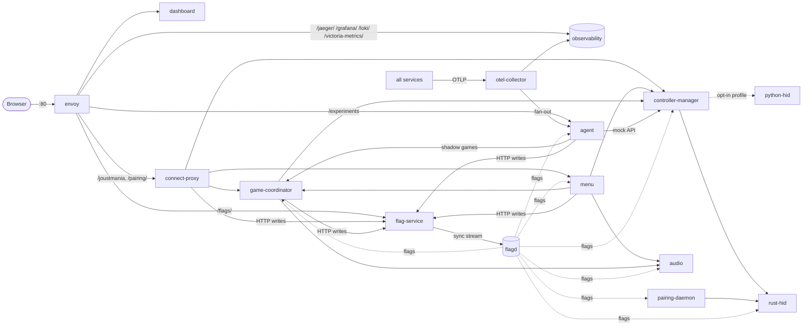

# Services

> Technical spec. Part of the [spec tree](../README.md). State: `main` @ 84c3ba15 (2026-10-16, includes PRs #1256, #1257, #1259, #1261, #1265, #1266, #1282, #1284, #1286, #1288, #1296, #1297, #1303, #1306, #1307, #1309, #1312, #1315, #1324 and #1308 (#1258 pattern games)).
> RPC tables are **generated from `proto/*.proto`**; regenerate them when a `.proto` changes (and remember the
> forwarding method in `services/connect-proxy/main.go` for browser-reachable RPCs).

## 1. Topology



Dependencies (start-up, from `depends_on` and code): audio, python-hid, rust-hid and flagd have no application
dependencies; the controller manager waits for flagd and for rust-hid and python-hid to be healthy (compose
`depends_on`) and talks to both HID adapters over gRPC; the game coordinator calls the controller manager and
audio, and the menu calls the controller manager, the game coordinator and audio (code only: in compose the
coordinator and the menu wait only for flagd); flagd waits for the flag service to be healthy and restarts with it; the agent depends only on flagd
(and calls the game coordinator and the mock control API to run shadow games, the named exception in C-005).

## 2. Service catalog

| Service (compose name) | Language | Port(s) | Host-published | Responsibility | Source |
|---|---|---|---|---|---|
| controller-manager | Python | 50052 gRPC; 50062 mock control API (mock adapter only) | 50052, 50062 via `docker-compose.override.yml` | Discover controllers, route each to one HID adapter, stream buttons and motion, apply LEDs / rumble / effects, names, rollout routing | `services/controller_manager/` |
| python-hid | Python | 50059 gRPC | no | HID access via hidapi: ControllerIOService only. Opt-in: starts only under the `python-hid` compose profile (UC-002 BR-003, #1371) | `services/python_hid/` |
| rust-hid | Rust | 50058 gRPC | `127.0.0.1:50058` (for the host-networked pairing daemon, #1319; full and lite stack) | HID access: PairingService + ControllerIOService. The default Bluetooth backend; in the full and the lite stack (UC-002 BR-003) | `services/rust-hid/` |
| pairing-daemon | Python | 8002 `/healthz`, `POST /controllers/{address}/unpair` (host network, bound to `CONTROL_BIND`) | host network | USB pairing loop, Bluetooth monitor (RSSI metrics), unpair a controller (UC-005) | `services/pairing_daemon/` |
| game-coordinator | Python | 50053 gRPC (metrics are pushed over OTLP) | 50053 via override | Game sessions (primary + shadow), game modes, death detection, events, interventions consumer | `services/game_coordinator/` |
| menu | Python | 50054 gRPC | 50054 via override | Lobby, ready state, mode selection, admin mode; writes admin settings for `game` / `user` / `agent.interventions_allowed` to the flag service as persisted admin values | `services/menu/` |
| audio | Python | 50056 gRPC | 50056 via override | Music with tempo (separate process, soxr), 8 effect channels (miniaudio), ALSA | `services/audio/` |
| agent | Go | 4317 OTLP gRPC (receiver); 13134 HTTP `/healthz`, `/experiments` | no | Observe via OTLP, decide, write interventions / rollout / experiment arms / promotions through the flag service, run experiments and promotion | `services/agent/` |
| connect-proxy | Go | 8080 HTTP | no | Connect (browser) ↔ gRPC bridge; `/canary/*` writes the `controller` set through the flag service | `services/connect-proxy/` |
| dashboard | TypeScript | 8080 HTTP (static-web-server) | no | SPA: controllers, Agent, Experiments, Metrics, Traces tabs; follows the newest live shadow game when no real game is live (`ListGames`, `GetGameState`, `StreamGameEvents(game_id)`; UC-070 BR-005); mode selector from the menu's `ListGameModes` (UC-011 BR-002) | `services/dashboard/` |
| envoy | config | 80 HTTP; 9901 admin | **80** | Single entry point / reverse proxy | `services/envoy/envoy.yaml` |
| flagd | binary v0.16.0 | 8013 RPC eval, 8014 mgmt, 8015 sync | `127.0.0.1:8015` (8013 via override) | Evaluate flags; its only source is the flag service's gRPC sync stream (no flag file mounted) | `docker-compose.yml` (`flagd`) |
| flag-service | Go | 50064 gRPC sync (flagd only), 8070 HTTP API | 8070 via override; `/flags/` through envoy | Runtime flag state in memory over the read-only baseline files; the only writer path for runtime flags (§7) | `services/flag-service/` |
| otel-collector | custom contrib build | 4317 / 4318 OTLP | `127.0.0.1:4317` | Receive OTLP + container logs + host metrics; export to Jaeger, VictoriaMetrics, Loki, agent (the :8889 Prometheus exporter was removed in #1449) | `services/otel-collector/config.yaml` |
| jaeger | 2.19.0 | 16686 UI, 4317 / 4318 OTLP | no | Trace store (badger, bounded TTL) | `services/jaeger/config.yaml` |
| victoria-metrics | v1.144.0 | 8428 | no | The only metric store (remote write, 7 d); serves the Prometheus query API to Grafana, the dashboard and the tools. The Prometheus container was removed in #1449 | `docker-compose.yml:516-544` |
| grafana | 13.0.2 | 3000 | no | Dashboards | `services/grafana/` |
| loki | 3.7.2 | 3100 | no | Logs | `services/loki/config.yaml` |
| agent-game-coordinator | Python (game-coordinator image) | 50053 gRPC (`expose` only) | no | **Test-only** (profile `agent`, #1163): a dedicated game coordinator for the agent's experiment cohort-loop soak, so the suite's per-test `coordinator_idle` quiesce never wipes the agent's shadow games. Service name `agent-game-coordinator-service`; the overlay points the agent at it with `GAME_COORDINATOR_ADDR=agent-game-coordinator:50053`; shares flagd and the controller manager | `docker-compose.agent-coordinator.yml` (layered on `docker-compose.dry-run.yml` by `tests/integration/test_experiment_cohort_loop.py`) |

**Listen-port overrides (#1524).** The Python gRPC services read their listen port from the environment, so the
service tier (`tests/service/`, T2) can run several of them from source on ephemeral ports. Compose sets none of
these, so every stack keeps the ports in the table above. An unset or empty variable means the default; a value
that is not a TCP port (1-65535) fails the start, naming the variable (`lib/grpc_utils.py` `port_from_env`).
The Python gRPC servers bind without `SO_REUSEPORT` (`get_server_options`, `grpc.so_reuseport=0`): a second
server on a taken port fails its start instead of sharing the port. Compose runs one server per port, so
deployed stacks are unchanged.

| Variable | Service | Default |
|---|---|---|
| `GRPC_PORT` | controller-manager | 50052 |
| `GRPC_PORT` | game-coordinator | 50053 |
| `GRPC_PORT` | menu | 50054 |
| `MOCK_CONTROL_PORT` | controller-manager (mock adapter only) | 50062 |

### Compose variants and host ports

Every `docker-compose*.yml` at the repository root, what it adds and which command loads it. The compose network is
`joustmania-network` (compose name `joustmania`); every container has a fixed `container_name` (`joustmania-<service>`), so a
service cannot be scaled with `--scale`.

| File | Kind | Adds or changes | Loaded by |
|---|---|---|---|
| `docker-compose.yml` | Base (full stack) | Every service of section 2; real hardware through rust-hid; the `python-hid` service only under the `python-hid` profile; loopback host ports below | Always (`-f`); the Pi runs it alone through `scripts/setup/joustmania-compose.sh` |
| `docker-compose.override.yml` | Dev and test ports | Publishes flagd 8013, flag-service `127.0.0.1:8070`, controller-manager 50052 and 50062, game-coordinator 50053, menu 50054, audio 50056. Auto-loaded by a bare `docker compose`; the Pi path names `-f docker-compose.yml` so it never loads it (#1319) | Bare `docker compose`, `make dev`, `make dry-run`, the integration suite |
| `docker-compose.dev.yml` | Hot reload | Volume-mounts Python service source and `lib/`, `pull_policy: build` for flag-service, `pull_policy` for the collector (`COLLECTOR_PULL_POLICY`, default `always`); rust-hid source mounted read-only for reference (no hot reload) | `make dev`; the integration suite with `USE_DEV_MOUNTS=true` (`make test-dev`) |
| `docker-compose.ci.yml` | No hardware | Audio without devices (`play_audio=off`), CI flag baseline `services/flagd/ci/` (`backend=mock`). Moves pairing-daemon, rust-hid and python-hid to the `hardware` profile, the agent to `agent`, and connect-proxy, dashboard and envoy to `dashboard`, so none of them starts without that profile. Needs Compose 2.24+ (`!reset`) | `make up-mock` (with the base alone, no override), `make dry-run`, the integration suite |
| `docker-compose.dry-run.yml` | Demo and experiments | On top of ci: the experiment cohort loop on, one seeded experiment, its own flag-service state file, the agent in the `agent` profile | `make dry-run` (also `IMAGE_TAG=latest`, profiles `agent` and `dashboard`) |
| `docker-compose.decide-e2e.yml` | Test only | `fake-openai` (profile `agent`, host `127.0.0.1:18089`), a dummy `DECISION_OPENAI_API_KEY` and a lifted request budget on the agent, its own flag-service state file. Not a valid project alone | None since #1600 (the decide tests moved to the service tier `AGENT` composition); layered on base + override + ci with `--profile agent`; removal is a follow-up |
| `docker-compose.agent-coordinator.yml` | Test only | `agent-game-coordinator` (profile `agent`, `expose` 50053 only) and `GAME_COORDINATOR_ADDR` on the agent, for the cohort-loop soak (#1163) | `tests/integration/test_experiment_cohort_loop.py`, layered on the dry-run stack |
| `docker-compose.lite.yml` | Standalone Pi stack | Its own project file, not an overlay: no observability (no Jaeger, VictoriaMetrics, Loki, Grafana, collector) and no agent, about 768 MB less memory; still flag-service, flagd, controller-manager, rust-hid, pairing-daemon (host network, as in the full stack), game-coordinator, menu, audio, connect-proxy, dashboard, envoy (UC-002 BR-003, #1318, #1402) | `docker compose -f docker-compose.lite.yml up -d` |

Profiles merge across files: an overlay's `profiles` list is added to the base one, never replaced (python-hid keeps `python-hid` and
gains `hardware` under the CI overlay). With no profile active, the base file starts everything except python-hid.

**Host ports are loopback-only unless they must be reachable (#1319).** In the production path (`docker-compose.yml` alone, or lite) the only
port reachable from the venue network is envoy's **80**. Three ports are published on `127.0.0.1` only, because the host-networked
pairing daemon (raw HCI, no Docker DNS) reaches them there and nobody on the venue network may read the flag config or inject telemetry:

| Host binding | Service | Why loopback |
|---|---|---|
| `127.0.0.1:8015` | flagd sync | Flag configuration must not be readable from the venue network |
| `127.0.0.1:4317` | otel-collector OTLP gRPC | The agent observes games through this telemetry; no spans or metrics may be injected from outside (full stack only) |
| `127.0.0.1:50058` | rust-hid | Pairing daemon reaches it as `RUST_HID_HOST=127.0.0.1`, so a second binding in an overlay would expose it |

Outside the Pi path, `docker-compose.override.yml` adds the dev and test bindings listed above (the gRPC ports and flagd 8013 on all interfaces,
flag-service 8070 on loopback), and `docker-compose.decide-e2e.yml` binds `127.0.0.1:18089`. Every other service is reachable only on
`joustmania-network`, or through envoy's routes. Do not add a host port to the base file without a loopback bind and a reason in this table.

**Traceability:** C-014, C-015, FR-085, NFR-020 / UC-035 / `docker-compose*.yml`, `services/envoy/envoy.yaml`, `services/*/server.py` / `tests/integration/conftest.py`, `tests/service/harness/stack.py`.

## 3. gRPC services

The RPC tables (service, kind, request and response, the `proto/*.proto` line, and the RPC count) are generated by
`make specs` (`scripts/gen_specs.py`) into **[generated/grpc-rpcs.md](generated/grpc-rpcs.md)**; do not hand-edit
them. A new or changed RPC needs its description in [notes/grpc-rpcs.yaml](notes/grpc-rpcs.yaml), keyed by
`<package>.<Service>/<Rpc>` (the generator fails without one).

### `controller_manager_mock.MockControllerService`: pattern-game changes

Pattern games (#1258, [UC-046](../use_cases/UC-046.md), PR #1308). The proto change needs
`make protos` and `make protos-agent` (committed Go stubs in `services/agent/gen`); the mock proto's `go_package`
is the connect-proxy gen, so the `Build connect-proxy` CI job must compile it, but no forwarding method is needed
because connect-proxy forwards no `MockControllerService` RPC. The controller manager never reads flagd for
archetypes: the agent resolves and pins the parameters and passes them in `AddControllers`.

| Change | Kind | Fields | Behaviour | Status |
|---|---|---|---|---|
| `AddControllersRequest.archetype`, `.archetype_params` | new fields 4 (string), 5 (string, JSON object) | archetype name; its parameter object as JSON; empty = no pattern (random resting motion, only for mock controllers outside experiments) | Validates the parameters (UC-046 BR-003), requires `count` = `players`, installs slot i on the i-th returned serial, pins the gameplay stream of these controllers to `stream_rate_hz`, and refuses `SimulateMovement` / `SimulateDeath` for them | Implemented (#1258, FR-100, FR-102, FR-103, FR-104) |
| `AddControllersResponse` | new fields 4 to 6 | `archetype`, `stream_rate_hz`, `players` | Echo of the installed archetype; `success=false` with the failed rules when the parameters are invalid | Implemented (#1258) |
| `RemoveControllerResponse` | new fields 3 to 8 | `pattern_slot`, `frames_delivered` (uint64), `signal_hash` (fixed64), `frame_overruns` (uint32), `signal_checkpoints` (repeated string), `archetype` | For a pattern controller: the replay record of UC-046 step 8 (definitions in [telemetry.md §9](telemetry.md#9-pattern-games-1258)); `archetype` is empty for other controllers | Implemented (#1258, FR-108, FR-109) |

The agent's OTLP receiver implements the standard `opentelemetry.proto.collector.{trace,metrics}.v1` Export
services (`services/agent/receiver.go`); they are not JoustMania protos.

### Browser-reachable RPCs (connect-proxy)

Four of the six `ControllerManagerService` RPCs (`RenameController`, `GetConnectedControllers`, `IdentifyController` and the proxy-only `WatchGameplayData`), all four `GameCoordinatorService` RPCs and all five `MenuService`
RPCs are forwarded under `/joustmania` (`services/connect-proxy/main.go`, the `ControllerManagerProxy`, `GameCoordinatorProxy` and `MenuProxy` methods). Audio, HID, pairing and mock
RPCs are not.

Wire format from the dashboard (`services/dashboard/src/client.ts`, `connect.ts`): unary calls are a plain
`application/json` POST. Server streams (`StreamGameEvents`) are `application/connect+json` with the request in
one 5-byte Connect envelope; the response is a sequence of envelopes ending in an end-stream frame whose
`error` the dashboard raises (a plain `application/json` POST to a stream gets 415, #1542). Browser-facing RPCs are unary or server-streaming only (#1543): the proxy owns any bidi gRPC stream to the backend internally.
`StreamGameplayData` and `StreamButtonEvents` are not forwarded and answer `unimplemented` (envoy talks HTTP/1.1 to
connect-proxy, where connect-go refuses bidi calls anyway). The dashboard's controller grid reads the server stream `WatchGameplayData` (#1595): it posts one `GameplayStreamConfig` (`{updateFrequencyHz: 30}`);
connect-proxy builds its own config from it, keeping only the rate (missing or 0 and below = 30 Hz, capped at 30 Hz) and never the browser's
colours, so the upstream is always the unfiltered observer stream with connection quality (UC-035 BR-005,
BR-006). It opens a `StreamGameplayData` stream to the controller manager with that config as its first control
message, relays every
`GameplayDataUpdate`, and cancels the upstream stream when the browser disconnects. An upstream error or end ends the
browser stream (error in the end-stream frame); the dashboard retries after 2 s. The controller manager does not
implement `WatchGameplayData` itself (UNIMPLEMENTED).

**Traceability:** C-014 / UC-002, UC-003, UC-004, UC-010, UC-027, UC-031 / `proto/*.proto`, `services/connect-proxy/main.go`, `services/dashboard/src/connect.ts`, `services/dashboard/src/client.ts` / `tests/integration/`, `services/connect-proxy/forwarding_test.go`, `services/connect-proxy/watch_gameplay_test.go`, `services/dashboard/src/__tests__/connect.test.ts`.

## 4. Key messages

| Message | Fields that matter | Source |
|---|---|---|
| `StartGameConfig` | `game_name`, `players[]`, `sensitivity` (0-4), `origin` (UNSPECIFIED / MENU / AGENT; only MENU may be primary), `experiment_id`, `arm`, `rng_seed` (shadow only), `oneof game_config` (FFA, Teams, RandomTeams, Nonstop, Tournament, FightClub, Werewolf, Zombie, Swapper, Traitor) | `proto/game_coordinator.proto:53-101` |
| `GameEvent` | `event_type`, `data` (string map), `timestamp` ms, `game_id` | `proto/game_coordinator.proto` |
| `GameInfo` / `PlayerInfo` | mode, state, players (team, colour, alive, `sensitivity_factor`; score always 0), `game_id`, `start_time_ms` | `proto/game_coordinator.proto` |
| `ControllerState` | serial, battery, buttons, accel, gyro, colour (the LED colour last written to the controller, effect frames included; #1301), rssi (always 0 from CM), name | `proto/controller_manager.proto` |
| `GameEffectCommand` | `serial` (empty = all), `effect` (`GameEffect`), optional `color`, `duration_ms`, `speed`. `GameEffect`: `NONE`, `PLAYER_WARNING`, `PLAYER_DEATH`, `PLAYER_RESPAWN`, `WINNER_RAINBOW`, `COUNTDOWN`, `ADMIN_ENTER`, `ADMIN_EXIT`, `LOW_BATTERY`, `FORCE_START_CHARGE`, `SHOW_BATTERY`, `RUMBLE`, `PULSE`, `FLASH`, `SHIELD` (14, agent shield as a persistent LED layer: fade, last-second blink, restore; short LED effects overlay it, a new base colour shows after it; death, the winner rainbow and `duration_ms=0` end it), `PARTIAL_SHIELD` (15, the weaker breathing variant) (UC-040 BR-008 to BR-010) and `IDENTIFY` (16, white 2 Hz flash plus a 500 ms rumble, then the base colour or the colour shown before; RPC-only: started by `IdentifyController`, a `GameEffectCommand` with it is rejected; a game stream configuration cancels it on its players, UC-004 BR-001 to BR-004) | `proto/controller_manager.proto:202-245`; `services/controller_manager/feedback_manager.py` |
| `MenuEvent` | `event_type` (`menu_started`, `menu_stopped`, `selection_changed`, `game_selection_changed`, `game_requested`, `game_start_cancelled`, `game_start_rejected` (web `start_game` named an unknown or unimplemented mode: `game_name`, `source`, `error`), `game_ended`), `data`, `timestamp` | `proto/menu.proto:49-53`; `services/menu/` |

Game event types actually published are listed in [UC-020](../use_cases/UC-020.md) to
[UC-027](../use_cases/UC-027.md) and in [telemetry.md](telemetry.md#5-game-events); summary:
`game_start`, `game_start_error`, `game_error`, `game_force_ended`, `game_starting`, `players_initialized`,
`countdown_start`, `countdown_end`, `game_started`, `player_revived`, `game_ended`, `game_winner`, `game_tie`,
`player_analytics`, `team_winner`, `team_formation_start` / `_end`, `traitor_signal_start` / `_end`,
`traitor_winner`, `werewolf_intro_start` / `_end`, `werewolf_reveal`, `werewolf_winner`, `zombie_intro_start` /
`_end`, `time_announcement`, `human_converted`, `zombie_winner`, `player_swapped`, `swapper_winner`,
`round_start`, `round_end`, `round_timeout`, `tournament_intro`, `match_start`, `match_end`,
`tournament_champion`, `tournament_no_winner`, `player_death` (NonStop and JoustFFA), `player_respawned`,
`agent_intervention`, `player_shielded`. Defined in `lib/types.py` but never published: `player_revive`, `player_out`, `score_update`, `team_eliminated`.

**Traceability:** FR-020 to FR-029 / UC-010, UC-020 to UC-027, UC-043 / `proto/game_coordinator.proto`, `services/game_coordinator/` / `tests/integration/test_tc002_ffa_game.py`, `tests/integration/test_parallel_lifecycle.py`.

## 5. HTTP endpoints

| Endpoint | Served by | Reachable via envoy | Purpose | Source |
|---|---|---|---|---|
| `/` | dashboard | yes | SPA | `services/envoy/envoy.yaml:121-123` |
| `/` | connect-proxy, only when `/app/static` exists in its container (not mounted in the stock compose files) | no (envoy sends `/` to the dashboard) | Static dashboard files (`http.FileServer`) | `services/connect-proxy/main.go` (`main`, "Serve static files for dashboard") |
| `/joustmania/*` | connect-proxy | yes (3600 s timeout) | Connect RPCs | `envoy.yaml:37-39` |
| `/canary/{python,rust}`, `/canary/rollback`, `/canary/status` | connect-proxy | **no** (falls through to the dashboard, D-B3) | Manual backend canary via `bluetooth_backend` (python only with the python adapter loaded, else 409, UC-052 A3) | `services/connect-proxy/canary.go:13-16` |
| `/experiments`, `/experiments/{id}` | agent :13134 | yes | Experiment dossier (JSON / HTML) | `services/agent/dossier.go` (`handleList`, mux registration) |
| `/healthz` | agent :13134 | no | Liveness | `services/agent/server.go:startHealthServer` |
| `/health` | connect-proxy; envoy direct 200 | yes | Liveness | `services/connect-proxy/main.go:129` |
| `/jaeger/`, `/grafana/`, `/loki/`, `/victoria-metrics/` | observability services | yes | UIs and APIs (`/prometheus/` was removed in #1449 and now falls through to the dashboard) | `envoy.yaml:45-89` |
| `/healthz` | pairing-daemon :8002 | host network | Liveness | `services/pairing_daemon/psmove_pairing/daemon.py` (health status for `/healthz`) |
| `POST /pairing/unpair` (JSON `{"address": "<bluetooth address>"}`) | connect-proxy | yes (envoy route timeout 40 s) | Unpair a controller (UC-005): forwards to the pairing daemon at `PAIRING_DAEMON_URL` (`http://host.docker.internal:8002` via the `host-gateway` extra host, full and lite stack) and passes its status and JSON answer through; 400 not a Bluetooth address, 403 cross-origin browser request (`Origin` host ≠ `Host`), 502 daemon unreachable. No authentication (UC-005 BR-003) | `services/connect-proxy/pairing.go` |
| `POST /controllers/{address}/unpair` | pairing-daemon :8002, bound only to `CONTROL_BIND` (loopback + docker0 gateway, full and lite stack) | host network (through `/pairing/unpair`) | Remove the address's registrations on every adapter (UC-005). 200 `{"address", "removed", "already_absent", "failed", "adapters", "results": [{"adapter", "outcome", "error"?}], "on_usb"}` when every registration found is `removed` or `already_absent`; 400 not a Bluetooth address; 404 none found; 409 a USB pairing or another unpair is running; 503 any `failed` result (same body plus `error`), a BlueZ / D-Bus error or any unexpected error | `services/pairing_daemon/psmove_pairing/control_api.py`, `usb_pairing.py`, `registrations.py` |

**Traceability:** FR-059, FR-070, FR-073, FR-084, FR-085, FR-123 / UC-005, UC-035, UC-052 / `services/envoy/envoy.yaml`, `services/connect-proxy/`, `services/agent/dossier.go`.

## 6. Per-service notes

### controller-manager

- Backend set from the `backend` flag at **startup** (default `rust`, also the fallback when the flag is unavailable; `mock` in the CI flag set; variants naming `python` are opt-in and need the `python-hid` profile, UC-002 BR-003); `mock` is always added with zero controllers. Per controller, one adapter wins: per-serial `bluetooth_backend` targeting, then the rollout router, then the flag default (`multiplexer/multiplexer_backend.py:235-291`).
- Loops: state 100 Hz, discovery 1 Hz (full enumeration at most every 0.5 s, forced every 10 s), LED batch 20 Hz (send on change or 2 s keep-alive), battery metrics every 30 s, `controller.bluetooth_health` span ~1 Hz (`discovery_loop.py`).
- Gameplay stream rate: client-requested, overridden by `game_loop.update_frequency_hz` (clamp 1..100), fallback 30 Hz. An observer stream (one that never sent colours) runs at its requested rate capped at the flag rate (UC-035 BR-006).
- Observer streams never consume game signals (UC-035 BR-006): `_build_gameplay_update` drains disconnects (#580), health counters and the mock death latch (#926) only for game streams (those that sent colours, tracked in `_game_stream_serials`), also while their alive filter is empty; an observer stream (one that never sent colours) gets frames with no `disconnects` and no `health`.
- Pattern games (#1258, FR-103): a stream whose explicit filter names pattern controllers runs at the archetype's pinned `stream_rate_hz` and ignores the flag override; a controller's frame index advances once per frame delivered on its owning stream (the first explicit stream that names it), in `_build_gameplay_update` next to the hook that drains the #926 death latch.
- `UnstableAdapter` (≈ 8.3 Hz, 10 % drops) is registered alongside python for the rollout demo; real adapters are used directly (the ChaosAdapter wrapper, D-C2, was removed in #1322).
- Mock serials `MOCK%04d`; reserved mock controllers are hidden from the roster.

#### Backend layering

Two layers (`backend.py`, `multiplexer/`): `ControllerManagerServicer` calls the async `ControllerBackend`; its only implementation, `MultiplexerBackend`, owns all state (LED colour, rumble and effects per serial, serial to adapter assignment, the 2 s LED keep-alive) and drives thin, blocking `ControllerIOAdapter`s through `asyncio.to_thread()`. `CentralizedBTDiscovery` (`multiplexer/bt_discovery.py`) scans the Bluetooth adapters.

`ControllerIOAdapter` (`multiplexer/adapter.py`): `adapter_type`, `discover(force)`, `open(serial)`, `poll(serial)`, `set_output(serial, r, g, b, rumble)` (LED and rumble in one call, like the HID output report, so an LED refresh never resets rumble), `close(serial)`, `close_all()`, `get_adapter_for_serial(serial)`.

| Adapter (`adapter_type`) | Class | Role |
|---|---|---|
| `rust` | `RustServiceAdapter` (`rust_adapter.py`) | gRPC client of `rust-hid` (`RUST_HID_HOST` / `RUST_HID_PORT`, default `localhost:50058`); background bidirectional `StreamIO` stream, `poll()` reads the cached last sample per serial, `set_output()` queues an `IOCommand` (queue capacity 256). Default. |
| `python` | `PythonHidAdapter` (`python_hid_adapter.py`) | Same shape, gRPC client of `python-hid` (`PYTHON_HID_HOST` / `PYTHON_HID_PORT`, default `localhost:50059`). Opt-in. |
| `mock` | `MockAdapter` (`mock_adapter.py`) | Simulated I/O, always loaded with zero controllers (added through `AddController`, `MockControllerService`). |
| `unstable` | `UnstableAdapter` (`unstable_adapter.py`) | Routing-only decorator around the *same* python instance: fresh polls at most every 0.12 s (about 8.3 Hz), every 10th dropped. Registered automatically when a `python` adapter is loaded (`backend_factory._build_routing_only_adapters`); never a default or fallback winner, never discovers on its own. |

**`backend` flag** (domain `controller`, read once at startup, restart to change): a comma-separated adapter list validated by `multiplexer/validation.py` (`mock`, `python`, `rust` and combinations without duplicates; anything else raises). `mock` is appended when missing. Variants in `services/flagd/controller.json`:

| Variant | Value | Adapters loaded |
|---|---|---|
| `rust` (default; fallback when the flag is empty or flagd is down) | `rust` | rust + mock |
| `python` | `python` | python + unstable + mock |
| `python_rust` | `python,rust` | python + rust + unstable + mock |
| `mock` | `mock` | mock only (default of `services/flagd/ci/controller.json`) |

A value is one variant's string; "mock,bluetooth" and similar are not valid. The `python-hid` compose service sits behind the `python-hid` profile, so reading real controllers through python-hid takes all three: the profile, a `backend` variant naming `python`, and `bluetooth_backend=python` (UC-002 BR-003, #1402).

**Per-controller routing** (`MultiplexerBackend._resolve_adapter_for_serial`), highest first:

1. `bluetooth_backend` (`python` | `rust` | `unstable`, default `rust`), honoured only when the evaluation reason is `TARGETING_MATCH` (a per-serial rule, not the default variant);
2. `RolloutRouter` (`rollout_router.py`, flag domain `rollout`, `services/flagd/rollout.json`): `strategy` `off` (default) / `immediate` / `progressive`; the target is `target_backend`, and `progressive` applies it to the first `current_controller_count` serials in sorted order (0, 1, 3, 6, 99). Any flag error degrades to "no rollout", and so to step 3;
3. the `bluetooth_backend` flag's default variant (`rust`), if that adapter is loaded; only when nothing above resolves to a loaded adapter, the first non-`mock`, non-`unstable` adapter (the fallback).

A target naming an adapter that is not loaded falls through. Routing re-runs every discovery cycle; losing adapters close their handle for the serial (unless they share the winner's device owner, as `unstable` does), and `controller_routing_decisions_total{serial,adapter,method}` counts each decision (`targeted` / `rollout` / `default` / `fallback`, the last when the preferred adapter fails to open the device). The same `bluetooth_backend` flag also picks the pairing daemon's backend (see pairing-daemon below). The python backend, `UnstableAdapter` and the rollout router are removed after the talk (UC-050 to UC-052 need them until then).

History: the in-process psmoveapi/SWIG backend was replaced by hidapi, then split out as the `python-hid` service, mirroring `rust-hid`; `lib/psmove_hid.py` documents the HID report layout.

### LED states (controller feedback)

Verified against `lib/colors.py`, `services/menu/utils/led.py`, `services/menu/handlers/` and `services/controller_manager/feedback_manager.py`. RGB values are `(r, g, b)`; "base colour" is the colour an effect restores to when it ends.

**Lobby colour (menu, `GAME_MODE_COLORS`).** A controller in CONNECTED shows the current mode colour dimmed (`DIM_FACTOR` 0.3, each channel `int(c * 0.3)`); in READY it shows the full colour. Unknown mode: orange. Only Free-for-All is a fixed product mode; the other entries exist in code.

| Mode | Colour |
|---|---|
| JoustFFA, SpeedBomb | Orange (255,128,0) |
| JoustTeams | LightBlue (0,100,255) |
| JoustRandomTeams | Turquoise (0,255,255) |
| Swapper | Magenta (255,0,192) |
| Werewolf | Green (0,255,0) |
| Traitor, Tournament | Purple (96,0,255) |
| Zombie | White40 (100,100,100) |
| Commander | Red (255,0,0) |
| FightClub | Yellow (255,255,0) |
| NonstopJoust | Pink (255,105,180) |

DISCONNECTED controllers show nothing. There is no dedicated "connection flash": a newly connected controller takes the dim lobby colour, and a reconnecting controller gets its last base colour back (`discovery_loop.py`).

**Palettes (`lib/colors.py`).**

| Palette | Colours |
|---|---|
| Team colours (first 8 of `Colors`; red is reserved for death) | Pink (255,105,180), Magenta (255,0,192), Orange (255,128,0), Yellow (255,255,0), Green (0,255,0), Turquoise (0,255,255), Blue (0,0,255), Purple (96,0,255) |
| Team selection (`teams_base.py`) | Fixed order, no randomness: team `n` takes `TEAM_COLORS[n]`, so `num_teams` teams use the first `num_teams` team colours (Pink, Magenta, Orange, Yellow, Green, Turquoise, Blue, Purple). `generate_team_colors` in `lib/colors.py` (random partners, tri/quad logic) is unused legacy; only a test calls it |
| FFA player colours (`generate_colors`) | N evenly spaced hues in 0.1 to 0.9 (full saturation and value), so red is never assigned; assigned at game setup and shown when gameplay starts, after the countdown |
| Other | White, Black, Red; White40 (100,100,100), White20 (50,50,50), Red20 (50,0,0), ZombieGray (80,80,120) |

**Effects (`FeedbackManager`, `GameEffect`).** The warning and death timings are fixed module constants in `feedback_manager.py` (the `effect.*` flags were removed in #1322); only the winner rainbow duration is a flag.

| Effect | LED | Rumble | Then |
|---|---|---|---|
| `COUNTDOWN` | FFA-style games (`feedback_manager.py`): Red, then Yellow, then Green, each phase `countdown_phase_duration_ms` (game flag, default 750 ms; 0 skips the countdown). Team games (`teams_base.py`): the player's team colour, then a White flash, then Green, each phase `countdown_phase_duration_ms` with a loud beep, plus a start sound at the end | none | base colour |
| `PLAYER_WARNING` | White flash, 200 ms (`WARNING_FLASH_MS`) | 100 intensity, 200 ms (`WARNING_VIBRATION_MS`) | base colour |
| `PLAYER_DEATH` | Red held 300 ms (`DEATH_RED_HOLD_MS`), then fade to black over 700 ms (`DEATH_FADE_MS`); also ends the agent shield | 255 intensity, 150 ms (`DEATH_RUMBLE_MS`) | base colour becomes Black |
| `PLAYER_RESPAWN` | White (spawn protection) | none | base colour becomes White |
| `WINNER_RAINBOW` | Rainbow for the `game` flag winner duration (default 3000 ms); ends the agent shield | none | base colour |
| `ADMIN_ENTER` | White flash 600 ms, then solid White | none | base colour White |
| `ADMIN_EXIT` | none (instant) | none | base colour |
| `LOW_BATTERY` | Red / Red20 twice, 150 ms each | none | base colour |
| `FORCE_START_CHARGE` | White fading out over 2 s | none | none |
| `SHOW_BATTERY` | Battery tier colour for 1 s | none | base colour |
| `IDENTIFY` | White 2 Hz flash, 3 s default (500 ms to 10 s) | 150 intensity, 500 ms | base colour (UC-004) |
| `PULSE` | Caller colour (default White), default 600 ms at speed 3 | none | base colour |
| `FLASH` | Caller colour (default White), default 400 ms at speed 5 | none | base colour |
| `RUMBLE` | none | intensity `min(255, speed * 50)` (speed default 5), default 2000 ms (secret signalling) | none |
| `SHIELD`, `PARTIAL_SHIELD` (agent) | A persistent layer over the base colour; short effects overlay it. Full: brightness falls 100% to 30%, last second blinks at 4 Hz. Partial: breathes 10% to 50% at 0.5 Hz, last second blinks at 4 Hz | none | base colour |

Battery tier colours (`SHOW_BATTERY`, `_get_battery_color`): >= 100% Green, >= 80% Turquoise, >= 60% Blue, >= 40% Yellow, otherwise Red.

**Admin option feedback (menu, `handlers/admin.py`).** The admin mode base colour is White. Cycling the option (Cross) shows the option's colour for about 1 s (1.1 s), then White: sensitivity Blue, `num_teams` Turquoise, `force_all_start` Orange, `agent_control` Purple. Changing sensitivity pulses the new level's colour (`PULSE`, 800 ms at speed 5), then restores the base colour: 0 Ultra Slow Blue, 1 Slow Turquoise, 2 Medium Green, 3 Fast Orange, 4 Ultra Fast Red (five levels). Changing the game mode flashes the new mode's colour (600 ms, speed 6), then a brief pulse, Green when cycling forward and Blue when cycling backward (400 ms, speed 6). Toggle options pulse Green (on) or Red (off). `agent_control` pulses its level colour for 800 ms at speed 5: none Red, ambient Turquoise, standard Orange, full Green (Purple otherwise).

**Per-mode in-game colours (`games/`).** Werewolf: everyone Yellow until the reveal, then werewolves LightBlue (0,100,255). Zombie: humans White, zombies ZombieGray (80,80,120). FightClub: defender Red, challenger Green, waiting players White20 (50,50,50).

**Update path.** Colours are written to the backend by the LED batch loop (20 Hz, on change or every 2 s keep-alive); every colour written is mirrored in `ControllerState.color`. A new base colour while an effect runs is stored and applied when the effect ends (cancellable effects are cancelled).

**Troubleshooting.** A controller stuck dim is CONNECTED, not READY: the trigger has not been pressed. A controller that stays White after admin mode keeps White as its base colour until the menu sends a lobby colour.

### game-coordinator

- Sessions: one primary (menu origin) + shadows; caps `max_concurrent_games` (8), `max_shadow_games` (4), `shadow_policy` (block); real starts preempt shadows (`servicer.py`: `_max_concurrent_games`, `_max_shadow_games`, `_shadow_policy`, `_preempt_shadow_sessions`, `_admit_session_locked`). Game ids `game_<12 hex>`.
- Registry `_GAME_CLASSES` (`game_factory.py:_GAME_CLASSES`), 10 modes. Death detection in `games/base.py` (UC-030).
- `InterventionManager` re-evaluates the `interventions` set on every flagd configuration change, evaluates each flag per live session with `{targetingKey=serial, gameId}` (one-shots as the game's event list, applied once per seq, UC-053 BR-006), enforces allow-list → mode matrix → battery → global backstop, applies via difficulty / lifecycle handlers and emits `agent_intervention` + `game_interventions_total`. The `end_game` intervention ends only the session whose event list it is in, through the same path as `ForceEndGame` with that `game_id` (UC-040 BR-011); per-player grant flags apply once per decision, per player (UC-040 BR-012). Threading: change detection, baselines and the enforcement chain run on the servicer's main loop; every handler side effect (apply, revert, agent cue) is handed to the owning session's `GameLoopDispatcher` (`game_loop_dispatch.py`), which runs it on that game's own thread loop (`GameSession.game_loop`, carried as `SessionView.loop`), where its audio / controller-manager clients and gameplay stream live, one at a time in decision order (each starts only after the previous one finished), awaited with a 5 s timeout. A started effect is never cancelled. An effect not started because the game loop is closed or stopping, or not started within 5 s, is not applied (`game_loop_unavailable` / `game_loop_timeout`); a started effect still running at 5 s has an unknown outcome (`game_loop_late`); both are counted in `game_intervention_dispatch_failures_total`. `end_game` stays on the main loop because force-end joins the game thread, and sends no agent cue (UC-040 BR-018, #1250).

### menu

- Service state STOPPED / RUNNING / GAME_STARTING; controller states CONNECTED / READY / ADMIN / IDLE (UC-010 to UC-014).
- Writes admin settings through the flag service (`lib/flag_service_writer.py`, `"persist": true`, writer `menu`); it mounts no flag file.

### audio

- Music in a separate process with soxr tempo resampling (also shifts pitch), output via ALSA dmix; ALSA card auto-detected at startup (prefers USB). Hardware, `ALSA_CARD` and troubleshooting: [AUDIO.md](../AUDIO.md).
- 8 effect channels (`AudioManager.MAX_CHANNELS`); only CRITICAL steals a channel (and only one of lower priority); `play_audio=off` accepts and mutes. Priorities are the `AudioPriority` enum LOW 0, MEDIUM 1, HIGH 2, CRITICAL 3; the default is 2.
- `PlaySound` returns the clip length in `duration_seconds` (0 when nothing is heard: `play_audio` off, silent hardware, failed play or unreadable file), so a caller can wait for a clip to finish (UC-020 A5, #1550). It does not block until the clip ends.
- Assets are OGG only (297 files under `services/audio/assets/<Mode>/{music,sounds,vox/<voice>}`, modes Joust, Menu, Commander, Zombie, Fight_Club; credits in `audio_credits.txt`), mounted read-only at `/app/services/audio/assets`. Effects and voice lines are registered at service start from the `*.ogg` files in the image's `services/audio/assets` (`sound_catalog.ASSETS_DIR`, not `AUDIO_ASSETS_DIR`; new sound files need a restart); music is matched by a glob at each `PlayMusic` (`Joust/music/*.ogg`) and one random decodable file is looped, decoded by miniaudio to 44.1 kHz stereo 16-bit, so no restart is needed for new tracks.
- Voices are `aaron` and `ivy` (flag `menu_voice`, default `ivy`, event-refreshed). A bare id resolves to `<mode>/vox/<voice>/<id>.ogg` (or `<mode>/sounds/`), a `/vox/` path without a voice gets the current voice.
- Volume: one master volume (`SetVolume`, 0.0 to 1.0, clamped) scales music and effects; the music player starts at 0.7. `PlayMusic.tempo` is clamped to 0.5 to 2.0 (`MusicPlayer.set_ratio`); `ChangeTempo` transitions over the requested duration without clamping (`transition_ratio`), and during playback a ratio of 0.5 or less, or above 2.0, plays at 1.0 (`_clamp_ratio`, `music_player.py:110-114`); the game uses 1.0 and 1.3 (UC-031 step 3). Tempo needs Linux with ALSA (`sys.platform`); elsewhere music plays at fixed speed.
- Not supported: layered music, crossfades, ducking, text-to-speech, input, device selection through RPC (the card is chosen by `ALSA_CARD`).
- Environment: `ALSA_CARD` (`auto` or a number), `AUDIO_PORT` (50056), `AUDIO_ASSETS_DIR` (default `services/audio/assets`; used for the music glob and sound path resolution, while the effect/voice registry always reads the packaged assets), `LOG_LEVEL`; `play_audio` and `menu_voice` are flags ([flags.md](flags.md)). The compose service maps `/dev/snd` and the host `audio` group (GID 29).
- Sound ids resolve through the registry built from the asset directories plus aliases (`services/audio/sound_catalog.py`): `agent_cue` → `Joust/sounds/beep_loud.ogg` (the lobby ready ping), `shield_up` → `Commander/sounds/power_ready.ogg` (an alias names an exact, voice-independent asset path). An id not in the registry logs a WARNING and falls back to the Joust vox path (UC-040 BR-007). `python -m services.audio.sound_catalog <id>` exits 0 when the id resolves to a file (used by `scripts/talk-preflight.sh`).

### agent

- Environment: see `docker-compose.yml:667-765`. Gates moved to live flags: `interventions_enabled`, `rollout_enabled` (#1213), experiment and verdict knobs (#1044, #1214). Still env: API keys, `AGENT_INFERENCE_*`, `AGENT_LLM_MAX_REQUESTS_PER_MINUTE`, `AGENT_PROBE_DECISIONS`, rollout dwell / cooldown, experiment seed and dynamic candidate lists, and every promotion gate (`AGENT_CODE_IMPROVEMENT_ENABLED`, `AGENT_AUTONOMOUS_ENABLED`, `GITHUB_*`), which compose does not pass through (D-A6). Env→flag audit: #1194.
- Writes: `interventions.json` (action sink), `rollout.json` (`current_controller_count`), `game.json` (experiment targeting; autonomous real default when enabled). Never `agent.json` (code guard in `experiment/gate.go`; the mount is read-write).
- Persistent volume `agent-experiments` for the experiment journal and autonomous-revert snapshots.
- Pattern games (#1258, UC-046): the one-shot runner reads `SHADOW_GAME_ARCHETYPE` and `SHADOW_GAME_SEED`; for a pattern game the runner sends no `SimulateMovement` / `SimulateDeath` and force-ends the game at the pinned safety cap `experiment.max_game_seconds` (outcome `timeout`).
- Decision backends: jev (main in-game backend, TypeSafe System One), claude (in-game backup by manual flip; also retro / proposer), openai-compatible, rules (automatic floor) (C-018). Contract: [decide-contract.md](decide-contract.md).

**Environment variables** (code is the source: `services/agent/*.go`, `experiment/`, `promote/`, `gamerunner/`; "Compose" = passed through by `docker-compose.yml`, otherwise only settable by adding it to the service). Live gates are flags, not env: see [flags.md](flags.md).

| Variable | Default | Compose | Purpose |
|---|---|---|---|
| `AGENT_LISTEN_ADDR` | `:4317` | yes | OTLP gRPC receiver listen address |
| `AGENT_HEALTH_ADDR` | `:13134` | yes | HTTP health listen address |
| `FLAGD_HOST` / `FLAGD_PORT` | `flagd` / `8013` | yes | flagd gRPC evaluation endpoint (RPC resolver) |
| `FLAGD_OFREP_URL` | `http://$FLAGD_HOST:8016` | no | flagd OFREP endpoint for the pattern-game flag digest |
| `FLAG_SERVICE_URL` | `http://flag-service:8070` | yes | flag service every agent writer calls (interventions, rollout, experiment arms, promotion) |
| `LOG_LEVEL` | `info` | yes | log verbosity |
| `OTEL_SERVICE_NAME` / `OTEL_SERVICE_NAMESPACE` | `agent` / `infrastructure` | yes | self-telemetry identity; the name also drives the self-ingestion skip |
| `OTEL_EXPORTER_OTLP_ENDPOINT`, `OTEL_RESOURCE_ATTRIBUTES`, `SERVICE_VERSION`, `DEPLOYMENT_ENVIRONMENT` | unset / unset / `0.0.0-dev` / `development` | first, second, third | self-telemetry export (no-op without an endpoint) and resource attributes |
| `AGENT_INFERENCE_BACKEND` | `stub` | yes | text backend for the retro and proposer: `claude` or the stub; not used for in-game decisions ([decide-contract.md](decide-contract.md) 10.1) |
| `ANTHROPIC_API_KEY` | empty | yes | Claude key: text backend and the `claude` decision backend; without it that backend is unavailable |
| `DECISION_OPENAI_API_KEY`, `JEV_API_KEY` | empty | yes | keys of the `openai` and `jev` decision backends, read once at startup |
| `AGENT_INFERENCE_MODEL` | `claude-opus-5-5` | yes (empty = default) | model id of the `claude` text backend |
| `AGENT_INFERENCE_EFFORT` | `medium` | yes (empty = default) | `output_config.effort` of the text backend (not sent to Haiku 4.5) |
| `AGENT_INFERENCE_TIMEOUT_SECONDS` | `120` | yes (empty = default) | per-call deadline of the text backend, also the retro deadline |
| `AGENT_LLM_MAX_REQUESTS_PER_MINUTE` | unset | yes | positive value replaces the `llm.max_requests_per_minute` flag |
| `AGENT_PROBE_DECISIONS` | unset | yes | `true` emits a synthetic `noop` decision about every 5 s (demo and verification only) |
| `AGENT_EFFECT_WINDOW_SECONDS` | `20` | no | intervention-effect follow-up window (float seconds, positive) |
| `AGENT_ROLLOUT_DWELL_SECONDS` | `15` | no | dwell between rollout expansions |
| `AGENT_ROLLOUT_COOLDOWN_SECONDS` | `30` | yes | re-expansion cooldown after a rollback |
| `AGENT_SHADOW_GAME` | unset | no | `true` runs one one-shot shadow game at startup; `SHADOW_GAME_MODE` (`JoustFFA`), `SHADOW_GAME_SENSITIVITY` (`2`, 0 to 4), `SHADOW_GAME_ARCHETYPE`, `SHADOW_GAME_SEED` tune it |
| `GAME_COORDINATOR_ADDR`, `MOCK_CONTROLLER_ADDR` | `game-coordinator:50053`, `controller-manager:50062` | no | shadow-game runner endpoints |
| `AGENT_EXPERIMENTS_ENABLED` | `false` | yes | bootstrap default of the live `experiments_enabled` flag, not a gate: the flag decides each tick |
| `AGENT_EXPERIMENT_PROPOSER_ENABLED` | `false` | no | retro-seeded thesis proposer opt-in |
| `AGENT_EXPERIMENT_TICK_SECONDS` | `30` | yes | registry allocate-and-spawn cadence |
| `AGENT_EXPERIMENT_COMPLETED_GRACE_SECONDS` | `60` | no | grace before a completed shadow game with no end datapoint releases its slot (0 or less disables) |
| `AGENT_EXPERIMENT_SEED_FLAG`, `_VALUE`, `_OBJECTIVE`, `_TARGET_N`, `_HYPOTHESIS` | unset (objective `balanced`) | yes | declare one env-seeded experiment at startup |
| `AGENT_EXPERIMENT_DYNAMIC_ENABLED` | `false` | yes | bootstrap default of the live `experiment_dynamic_enabled` flag, not a gate (the declarer also needs `experiments_enabled`) |
| `AGENT_EXPERIMENT_DYNAMIC_MAX_CONCURRENT` | `3` | yes (empty = default) | cap on live dynamically declared experiments |
| `AGENT_EXPERIMENT_DYNAMIC_CANDIDATES`, `_DENYLIST`, `_OBJECTIVE`, `_TARGET_N` | unset (built-in denylist, objective `balanced`, target 0); `_DENYLIST` set but empty = no exclusions | first, second, fourth | candidate flag list, excluded flags, default objective, games per arm of dynamic experiments |
| `AGENT_MAX_SHADOW_GAMES` | `20` | no | registry shadow-capacity cap |
| `AGENT_SHADOW_EFFECTIVE_CONCURRENCY` | `4` | no | in-flight shadow spawns, clamped to the cap above |
| `AGENT_EXPERIMENT_MAX_GAMES` | `50` | no | per-experiment games budget (0 or less disables) |
| `AGENT_VERDICT_MIN_N` / `AGENT_VERDICT_MIN_PAIRS` | `8` / `5` | no | bootstrap defaults of the `verdict_min_n` / `verdict_min_pairs` flags |
| `AGENT_FITNESS_STORE_CAPACITY` | `512` | no | finalized-fitness ring size |
| `AGENT_EXPERIMENT_DIR` | `/var/lib/joustmania/agent/experiments` | no (volume `agent-experiments` mounted there) | experiment journal and autonomous-revert snapshot root |
| `AGENT_CODE_IMPROVEMENT_ENABLED` | `false` | no | opt-in for real promotion clients (local git, GitHub) |
| `AGENT_CODE_IMPROVEMENT_TARGET` | `local` | no | env target: `local` or `github` (the live flag must agree at dispatch) |
| `AGENT_LOCAL_REPO_DIR` | unset | no | repo directory for the local target; unset = no-op |
| `GITHUB_TOKEN`, `GITHUB_REPOSITORY`, `GITHUB_BASE_BRANCH`, `GITHUB_API_URL` | unset, unset, `main`, `https://api.github.com` | no | GitHub target (`owner/repo`); misconfiguration falls back to an inert no-op |
| `AGENT_AUTONOMOUS_ENABLED` | `false` | no | opt-in for the autonomous real-default path (needs `AGENT_CODE_IMPROVEMENT_ENABLED`) |
| `AGENT_AUTONOMOUS_REVERT_COOLDOWN_SECONDS`, `_REWATCH_INTERVAL_SECONDS`, `_REWATCH_TIMEOUT_SECONDS` | `600`, `60`, `3600` | no | autonomous revert cooldown and live re-watch cadence and timeout |

### connect-proxy

- No flagd client: `/canary/*` changes `bluetooth_backend` through the flag service (`FLAG_SERVICE_URL`, writer `connect-proxy`, #1420): a full rollout is a stack overlay, `?fraction=N` a fraction overlay (`scope.fraction_percent`, the rest of the serials resolve the default, for a canary the stable counterpart), rollback clears both overlays (every serial resolves the baseline default, `rust` since #1371); `/canary/status` returns the flag service's view. A canary that routes serials to python (`/canary/python`, or a fractional `/canary/rust`, whose rest is python) first reads the `backend` flag and is refused with 409 when it names no python, since the controller manager then has no python adapter and would silently keep those serials on rust (UC-052 A3, #1402). A refusal keeps its 4xx, the flag service unreachable is 502. The proxy mounts no flag file.

### pairing-daemon

- Host network (raw HCI), privileged; USB poll every `pairing.poll_interval` (10 s), Bluetooth monitor every `pairing.bt_monitor_interval` (5 s); pairing backend chosen per poll from `bluetooth_backend` (UC-001 BR-003: `rust` → rust-hid PairingService, `python` / `unstable` → in-process hidapi, unknown or flagd down → `rust`). For a controller BlueZ does not know on the selected adapter it writes a BlueZ device record (`/var/lib/bluetooth/<adapter>/<controller>/info` + `cache/<controller>` SDP record, never overwriting, UC-001 A7, BR-008). Pairing restarts bluetoothd at most once per USB poll, after its pairings, rewriting any waiting record that vanished, and only as `pairing.bluez_restart_mode` says (UC-001 BR-005; default `when_idle`: only for a new record and only outside a real game), registering the pairing agent again after each restart; for `when_idle` it reads the primary game's state with an unary Connect JSON call (no HTTP proxy) to the game coordinator's `GetGameState` through envoy (`GAME_STATE_URL`, `http://localhost/...` over the host network), failing closed (unreadable = game running). Full and lite stack alike (#1402): host network, so it reaches flagd (`127.0.0.1:8015`) and rust-hid (`127.0.0.1:50058`) through their loopback-published ports, and the connect-proxy reaches it through `host.docker.internal:8002`.
- Registration reset (operator tool, C-011): `python -m psmove_pairing.registrations [--dry-run]` in the pairing-daemon container (wrapped by `scripts/hardware/reset_bluetooth_connections.sh`; `tools/clear_devices.py` runs the same module on the host). It removes only PS Move registrations: live BlueZ `Device1` objects whose Modalias is Sony `054c` with `03d5` / `0c5e` (fallback when there is no Modalias: name "Motion Controller", class `0x002508` and the HID service UUID) via `Adapter1.RemoveDevice`, and saved `/var/lib/bluetooth/<adapter>/<controller>` directories whose `[DeviceID]` is a PS Move, only under adapters BlueZ does not currently present (when bluetoothd is absent, i.e. `ServiceUnknown` / `NameHasNoOwner` or no bus socket: saved directories only, for any adapter; any other D-Bus error such as `AccessDenied` or `NoReply` is a failure: nothing is removed, exit 1). Navigation controllers (`042f`) and all other devices are never touched. Each removal is attempted independently and reported (`removed`, `already absent` for `org.bluez.Error.DoesNotExist` / a vanished directory, `failed`); exit code 1 on any failure. After a real run the wrapper script restarts `pairing-daemon`, because `UsbPairingManager` keeps the serials it verified this session in memory and would skip re-pairing them until restart.
- Unpair one controller (UC-005) and stale-registration cleanup after a re-pair (UC-001 A5, BR-004) use the same module: `remove_controller_registrations(address, keep_adapter=None, require_psmove=True)` returns one `RemovalResult` per registration found (`removed`, `already_absent`, `failed`), removing through `clear_psmove_registrations`; the unpair takes the address's registrations only if one is a PS Move (then identity-less copies too, UC-005 BR-001), the re-pair cleanup matches by address alone (`require_psmove=False`). One `asyncio.Lock` serialises USB pairing (adapter selection through trust) and unpairs (409 when held). A controller unpaired while on USB is not paired again until it leaves USB or reappears under another HID device path, re-checked under the lock (UC-005 A8). rust-hid `GetUSBControllers` / `PairController` calls carry a 15 s gRPC deadline and the pair step a 20 s `asyncio.wait_for`. The HTTP port binds only to `CONTROL_BIND` (default `127.0.0.1`).

**Traceability:** FR-001 to FR-008, FR-040, FR-053, FR-070 to FR-074, FR-123, FR-124, NFR-001 to NFR-003, NFR-018, C-011 / UC-001 to UC-003, UC-005, UC-040, UC-050 to UC-052 / service directories above / `services/*/tests/`, `tests/integration/`.

### Mode to config message, privileges, libraries and proto files

`oneof game_config` in `StartGameConfig` (`proto/game_coordinator.proto`):

| Mode | Config message | Fields (default) |
|---|---|---|
| JoustFFA, Zombie, Swapper | `FFAConfig`, `ZombieConfig`, `SwapperConfig` | none (base settings; Zombie duration from player count; Swapper always 2 teams) |
| JoustTeams | `TeamsConfig` | `num_teams` (2-6, 2), `random_assignment` (true) |
| JoustRandomTeams | `RandomTeamsConfig` | `num_teams` (2-6, 2) |
| NonstopJoust | `NonstopConfig` | `time_limit_seconds` (0 = unlimited) |
| Tournament | `TournamentConfig` | `invincibility_seconds` (4.0) |
| FightClub | `FightClubConfig` | `invincibility_seconds` (4.0), `min_rounds` (10) |
| Werewolf | `WerewolfConfig` | `reveal_time_seconds` (35.0) |
| Traitor | `TraitorConfig` | `num_teams` (0 = auto from player count) |

Container privileges (`docker-compose.yml`): `controller-manager`, `python-hid`, `rust-hid` and `pairing-daemon` run `privileged` (pairing-daemon also on the host network); `audio` is not privileged but gets sound devices; all other services run as standard containers.

Shared libraries in `lib/`: `types.py` (enums such as `Games`), `colors.py`, `controller_constants.py`, `psmove_hid.py` and `bluez_dbus.py` (controller I/O and BlueZ), `grpc_tracing.py`, `grpc_metrics.py`, `grpc_utils.py`, `telemetry.py`, `otel_metrics.py`, `otel_logging.py`, `otel_resource.py`, `openfeature_otel_hooks.py`, `system_metrics.py`, `feature_flags.py`, `flag_eval_visibility.py`, `flag_service_writer.py`, `clock.py`.

Proto files: `controller_manager.proto` is `ControllerManagerService`; `controller_manager_mock.proto` is `MockControllerService`; `game_coordinator.proto` is `GameCoordinatorService`; `menu.proto` is `MenuService`; `audio.proto` is `AudioService`; `psmove_hid.proto` is `PairingService` and `ControllerIOService`. Regenerate with `make protos`.

## 7. Flag service (epic #1407)

> Delivered in PR #1417. Use case [UC-053](../use_cases/UC-053.md); requirements FR-130 to FR-139,
> NFR-050 to NFR-053, C-030 to C-033; design and decisions in
> [architecture/flag-service.md](../architecture/flag-service.md).

| Item | Value |
|---|---|
| Compose name | `flag-service` (Go, `services/flag-service/`), in every compose file that runs flagd (base, lite, ci, dry-run, decide-e2e, agent-coordinator) |
| Ports | `50064` gRPC: `flagd.sync.v1.FlagSyncService` (flagd only). `8070` HTTP/JSON: the write and read API and `/healthz`. 50064 is not published; 8070 is published only on `127.0.0.1` by `docker-compose.override.yml` (tests and host scripts on the same machine, C-015); envoy routes `/flags/` to `flag-service:8070` with the prefix stripped |
| Inputs | the eight baseline files `services/flagd/{system,controller,observability,game,user,agent,interventions,rollout}.json` (or `ci/`), an explicit list, mounted **read-only** and read once at start (FR-130); refuses to start on a duplicate flag key across sets |
| State | in memory, except admin settings written with `"persist": true`: the state file `FLAG_SERVICE_STATE_FILE` (default `/var/lib/flag-service/admin.json`) on the stack's own `flag-service-state` volume, loaded over the baseline at start and rewritten atomically (temp file + rename) on each persisted change (C-030, FR-018). A corrupt file is moved aside to `admin.json.corrupt-<ts>` and the service starts from the baseline; stale entries are dropped with a warning ([architecture note §10.1](../architecture/flag-service.md#101-admin-persistence-re-review-n4)). Never `services/flagd/*.json` |
| Config | `FLAG_SERVICE_SETS` (sets included in the sync payload; every stack lists all eight; serving `interventions` without `agent` is a startup error, since the coordinator gates interventions on the `agent` allow-list's snapshot stamp, [UC-053](../use_cases/UC-053.md) A9 step 4), `FLAG_SERVICE_MAX_GAMES` (live game scopes, default 64), `GOMEMLIMIT` (48MiB in compose), `FLAG_SERVICE_BASELINE_DIR`, `FLAG_SERVICE_BASELINE_FILES` (the explicit file list, default the eight set files), `FLAG_SERVICE_STATE_FILE`, `FLAG_SERVICE_REGISTRY` (default the image's `registry.yaml`), `FLAG_SERVICE_EVENT_LIST_LEN` (K, default 16), `FLAG_SERVICE_MAX_GAME_AGE` (default 1 h), `FLAG_SERVICE_EXPERIMENT_IDLE` (default 2 h: an experiment's arm values are dropped once no registered game has carried its id, and nobody wrote them, for this long), `FLAG_SERVICE_GRPC_PORT` (50064), `FLAG_SERVICE_HTTP_PORT` (8070) |
| flagd wiring | one gRPC source `--uri grpc://flag-service:50064` and nothing else; `depends_on: flag-service: {condition: service_healthy, restart: true}`; no flagd `readyz` check (flagd #1985) |
| Memory | limit 64 MiB (NFR-051) |
| Authorization | none, by decision (local party game, architecture note D11) |

### 7.1 `flagd.sync.v1.FlagSyncService` (server, for flagd)

The upstream schema (`buf.build/open-feature/flagd`, `flagd/sync/v1/sync.proto`), implemented unchanged:

| RPC | Behaviour |
|---|---|
| `SyncFlags(SyncFlagsRequest{provider_id, selector}) → stream SyncFlagsResponse{flag_configuration}` | Sends the merged configuration of every served set at once, then again after every accepted write, admin change or game-scope change. Every flag carries `metadata.flagSetId` (flagSetIds partition the flags, architecture note §5.2). An empty selector gets every served set; `flagSetId=<set>` (from the `flagd-selector` header or the body) gets that set only; an unknown selector key is `INVALID_ARGUMENT` (counted as `unknown_selector` in `flagservice_sync_rejected_total`; no alert rules, #1425); `flagSetId=<set>` naming a set that is not served is `INVALID_ARGUMENT` too (counted as `unknown_flag_set`). No `sync_context`. flagd opens **one** stream for all sets. |
| `FetchAllFlags` | The current merged configuration, filtered like `SyncFlags`. |
| `GetMetadata` | Deprecated upstream; `UNIMPLEMENTED`. |

Keepalive: the server sends pings (`ServerParameters{Time: 30s, Timeout: 10s}`; flagd v0.16.0's sync client sets
none) and allows client pings (`EnforcementPolicy{MinTime: 10s, PermitWithoutStream: true}`).

### 7.2 HTTP/JSON API (resource-style)

One endpoint per flag set: the flag set id and the flag name are the path. All bodies are JSON. A write is
validated only against the mutable-flag registry ([flags.md §13](flags.md#13-mutable-flag-registry)), the game
scope and the sync stream; there are no roles or tokens. `writer`, `decision_id` and `reason` are informational:
they go on the write span and are never checked. Writers use a 500 ms deadline and fail closed.

| Method and path | Purpose | Success |
|---|---|---|
| `GET /` | flag sets with their flag counts and whether each is served | 200 |
| `GET /{flagSetId}` | every flag of the set: registry policy (mutable, kind, scope, bounds, persist), baseline and effective default, declared variants with their values, overlays (stack, persisted admin, real, fraction), scoped values | 200 |
| `GET /{flagSetId}/{flagName}` | one flag's effective state (same fields), plus the rendered flagd JSON | 200 |
| `PUT /{flagSetId}/{flagName}` | set a value in a scope (state, level, grant, overlay, experiment arm, fraction); `?dry_run=true` validates and renders the write without applying it and adds `rendered_before` / `rendered` (both computed under one lock; no persist) | 200 `WriteResult` |
| `POST /{flagSetId}/{flagName}` | append one event to a game's event list (registry kind `event` only) | 200 `WriteResult` with `seq` |
| `DELETE /{flagSetId}/{flagName}` | clear the value in the scope given by query parameters (`game_id`, `serial`, `experiment_id`, `arm`, `game_kind=real`, `fraction=true`); no scope = the in-memory stack overlay; `?persist=true` clears the persisted admin value instead (it returns to the baseline and leaves the state file). The persisted admin value is a layer under the in-memory overlay: clearing a stage or test overlay shows the host's setting again | 204 |
| `DELETE /{flagSetId}?writer=stage` | clear every in-memory overlay (stack, real, fraction) of that writer label in the set (talk reset); persisted admin values stay (only `DELETE …?persist=true` removes one) | 204 |
| `PUT /games/{gameId}` | register a game | 200 (`already_registered` on a repeat) |
| `DELETE /games/{gameId}` | end a game: drop its scope and every value written for it | 204 |
| `PUT /coordinators/{instance}/games` | reconcile one coordinator instance's live games; drops that instance's other games only | 200 with the dropped ids |
| `GET /games` | registered game scopes | 200 |
| `GET /state` | epoch, snapshot version, served sets, open sync streams (one per connected flagd), live games, overlay counts | 200 |
| `GET /healthz` | baseline loaded and the gRPC listener up | 200 |

`games`, `coordinators`, `state` and `healthz` are reserved and cannot be flag-set ids.

**`PUT /{flagSetId}/{flagName}` body**

```jsonc
{
  "variant": "jev",                       // one of: a declared variant name ...
  "value": 5,                             // ... or a value within the registry bounds
  "scope": {
    "game_id": "game_0a1b2c3d4e5f",       // game-scoped write (registered game)
    "serial": "MOCK0003",                 // player in that game (level, grant)
    "experiment_id": "exp_42",            // experiment arm write (with arm)
    "arm": "experimental",
    "game_kind": "real",                  // promotion: the real default
    "fraction_percent": 10                // controller canary: fractional on serial
  },
  "ttl_seconds": 600,                     // optional: overlay expires (not with persist)
  "persist": true,                        // optional: admin setting, kept in the state file (registry must allow it)
  "writer": "agent",                      // informational
  "decision_id": "dec_7f3",               // informational
  "reason": "grant_shield"                // informational
}
```

Exactly one of `variant` and `value`. The scope must match the registry row's scope (flags.md §13): a
`game+serial` flag needs `game_id` and `serial`, a `stack` flag takes no scope (or `game_kind: "real"` for a
promotion), an `experiment+arm` flag needs both ids. `"persist": true` is allowed only on a stack overlay of a
flag whose registry row says `persist: yes`, and never with `ttl_seconds`; without it a write stays in memory
(the stage scripts, the harness and the tests never persist; the menu admin does).

**`POST /{flagSetId}/{flagName}` body** (event flags: `end_game`, `eliminate_player`, `revive_player`,
`audio_cue`, `controller_effect`): `{"scope": {"game_id": "..."}, "payload": {"serial": "MOCK0003"}, "writer",
"decision_id", "reason"}`. The service appends `{"seq": n, "payload": ...}` to the game's list and keeps the last
K; the flag resolves in that game to `{"epoch": "<boot id>", "seq": n, "events": [...]}`.

**`WriteResult`**: `{"flag_set", "flag", "variant" (opaque, carries the epoch), "seq" (event writes), "epoch",
"snapshot_version" (monotonic; flagd has it once the stream sent it), "persisted" (admin flags)}`.

**`PUT /games/{gameId}` body**: `{"coordinator_instance": "<stable id: FLAG_SERVICE_INSTANCE, set in every compose stack (game-coordinator; agent-game-coordinator for the second coordinator); the same after a restart or a container recreate, so the new process's reconcile drops the previous process's games (A10). The hostname fallback is only for runs outside compose: a container's hostname is its id and changes on recreate>", "game_kind": "real" | "shadow",
"serials": ["MOCK0001", ...], "experiment_id": "", "arm": ""}`. An unspecified kind is stored as is and never
treated as real (FR-041). **`PUT /coordinators/{instance}/games` body**: `{"games": [<same objects>]}`.

**Errors**: `{"error": "<reason>", "detail": "..."}`.

| Status | Reason codes |
|---|---|
| 400 | `malformed` (bad JSON, both or neither of `variant` / `value`, scope does not fit the flag, `persist` on a flag or scope that cannot persist, `persist` with `ttl_seconds`) |
| 404 | `unknown_flag_set`, `unknown_flag` |
| 409 | `game_not_live` (game not registered or ended), `set_not_served` (the set is not in this stack's `FLAG_SERVICE_SETS`, so flagd would not see the write; every stack lists all eight), `too_many_games` (`PUT /games/{gameId}`, or a `PUT /coordinators/{instance}/games` reconcile, that would leave more than `FLAG_SERVICE_MAX_GAMES` live game scopes, default 64, NFR-051; a reconcile over the cap is rejected whole and changes nothing, it is never truncated), `experiment_unknown` (reserved for #1415; not raised before it) |
| 422 | `flag_read_only` (no registry row), `out_of_bounds`, `serial_not_in_game` |
| 503 | `no_sync_stream` (flagd has no open sync stream, so the write would not reach readers). The game lifecycle calls (`/games`, `/coordinators`) are exempt and never return it |

**Callers**: the game coordinator (`PUT /games/{id}` awaited for at most 200 ms before the game is RUNNING,
outside `_sessions_lock`; `DELETE` at retire; the reconcile call at its start, after a failed call, when the service's boot epoch changes (read from `GET /healthz` every 2 s and from every response) and every 15 s; a `DELETE` waits for a still-running `PUT` of the same game);
the agent (interventions, rollout count, experiment arms, promotion; it retries `game_not_live` once after
100 ms); the menu (admin settings, kill switch); the connect-proxy (canary); the stage scripts and the
validation harness (`curl http://localhost/flags/...`); the integration fixtures.

**Traceability:** FR-130 to FR-139, NFR-050 to NFR-053, C-030 to C-033 / UC-053 / `services/flag-service/`
/ `services/flag-service/*/*_test.go`, `tests/service/test_flag_service_*.py`, `tests/service/test_tc019_flag_service_restart.py`, TC-018 to TC-020.
