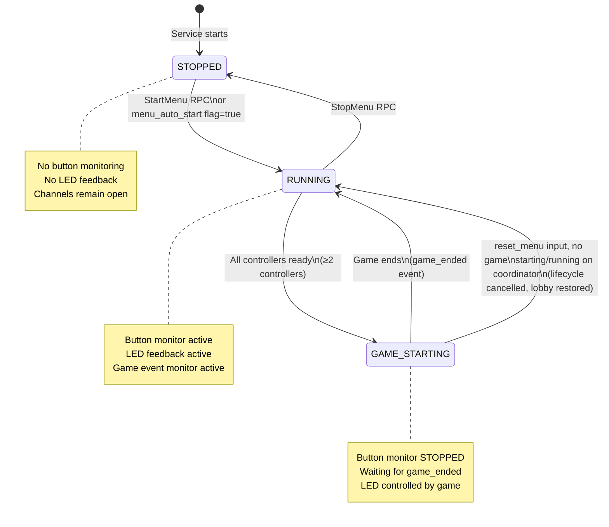
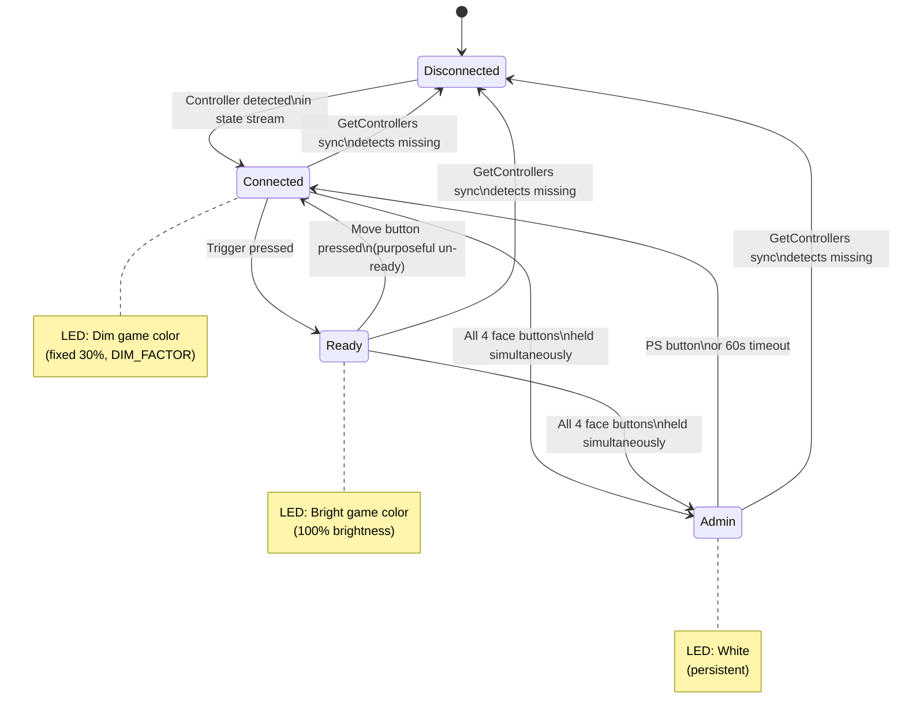
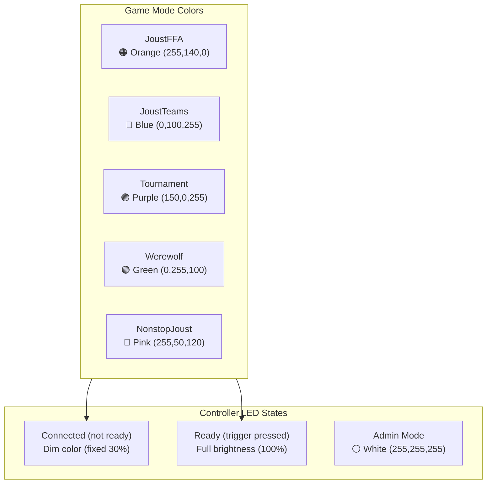
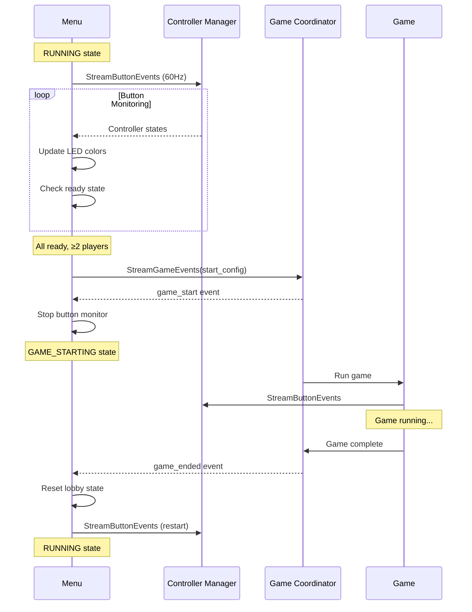

# Menu Service

**Part of JoustMania Microservices Architecture**

## Overview

The Menu Service manages the game selection menu and lobby experience. It handles:

- Game mode selection (JoustFFA, JoustTeams, Tournament, Werewolf, NonstopJoust)
- Controller lobby state (connected/ready detection)
- LED feedback based on game mode and player ready state
- Admin mode for in-game configuration
- Event streaming for UI updates

## Quick Reference

| Property | Value |
|----------|-------|
| **gRPC Port** | 50054 |
| **Metrics Port** | 8000 |
| **Proto Definition** | `proto/menu.proto` |
| **Health Check** | gRPC health protocol |

## gRPC API

### StartMenu

Starts the menu and begins controller monitoring.

```protobuf
rpc StartMenu(StartMenuRequest) returns (StartMenuResponse);
```

**Response:**
- `success`: Whether the menu started successfully
- `error`: Error message if failed (e.g., "Menu already running")

### StopMenu

Stops the menu and clears all lobby state.

```protobuf
rpc StopMenu(StopMenuRequest) returns (StopMenuResponse);
```

### ProcessInput

Process menu input from controllers or web UI.

```protobuf
rpc ProcessInput(ProcessInputRequest) returns (ProcessInputResponse);
```

**Input Types:**

| Type | Data | Description |
|------|------|-------------|
| `button_press` | `{button: "trigger"}` | Start game with current selection |
| `button_press` | `{button: "select"}` | Cycle to next game mode |
| `web_command` | `{command: "start_game"}` | Start game from web UI |
| `web_command` | `{command: "select_game", game_name: "..."}` | Select specific game mode |
| `reset_menu` | `{}` | Cancel GAME_STARTING state, return to RUNNING; recovers a stale game lifecycle when the coordinator reports no active game (UC-010 BR-008) |

### StreamMenuEvents

Stream real-time menu events.

```protobuf
rpc StreamMenuEvents(StreamMenuEventsRequest) returns (stream MenuEvent);
```

**Event Types:**

| Event | Data | Description |
|-------|------|-------------|
| `menu_started` | `{}` | Menu has started |
| `menu_stopped` | `{}` | Menu has stopped |
| `selection_changed` | `{game_name, source?, serial?}` | Game mode changed |
| `game_requested` | `{game_name, source?, serial?}` | Game start requested |
| `game_start_cancelled` | `{game_name, player_count, minimum_players}` (roster below the mode's minimum) or `{}` (`reset_menu`) | Game start was cancelled |
| `game_start_rejected` | `{game_name, source, error}` | Web `start_game` named an unknown or unimplemented mode; no game starts |

## Lobby Feedback

Controllers receive LED feedback based on their state and the selected game mode.

> **Full Reference:** See [UC-010](../../docs/use_cases/UC-010.md) and [UC-012](../../docs/use_cases/UC-012.md) for the LED states including admin mode.

### Game Mode Colors

| Game Mode | Color | RGB |
|-----------|-------|-----|
| JoustFFA | Orange | (255, 140, 0) |
| JoustTeams | Blue | (0, 100, 255) |
| Tournament | Purple | (150, 0, 255) |
| Werewolf | Green | (0, 255, 100) |
| NonstopJoust | Pink | (255, 50, 120) |

### Controller States

| State | LED Behavior | Transition |
|-------|--------------|------------|
| Connected (not ready) | Dim game color (fixed 30%, `DIM_FACTOR`) | Trigger → Ready |
| Ready | Bright game color (100% brightness) | Move → Connected |
| Admin Mode | White (see full reference for details) | PS or timeout → Connected |

### Auto-Start

When all connected controllers are ready (trigger pressed) and there are at least 2 controllers, the game automatically starts.

## State Diagrams

### Menu Service States



### Controller State Machine

Each connected controller goes through these states in the lobby:



### LED Color Flow



### Lobby Decision Flow

```mermaid
flowchart TD
    Start([Menu RUNNING]) --> Stream[Stream controller states<br/>from Controller Manager]

    Stream --> Update{Controller<br/>state update?}
    Update -->|No| Stream
    Update -->|Yes| NewCtrl{New<br/>controller?}

    NewCtrl -->|Yes| AddConnected[Add to connected set<br/>Set dim game color]
    NewCtrl -->|No| CheckTrigger{Trigger<br/>pressed?}

    AddConnected --> CheckTrigger

    CheckTrigger -->|Yes, not ready| MarkReady[Add to ready set<br/>Set bright game color<br/>Play beep sound]
    CheckTrigger -->|Yes, already ready| SyncControllers
    CheckTrigger -->|No| CheckMove

    CheckMove{Move button<br/>pressed?} -->|Yes, is ready| UnReady[Remove from ready set<br/>Set dim game color]
    CheckMove -->|No| CheckAdminCombo
    UnReady --> Stream

    MarkReady --> SyncControllers[Sync with GetControllers<br/>Remove disconnected]

    SyncControllers --> CheckAllReady{All connected<br/>are ready?}

    CheckAllReady -->|No| CheckAdminCombo
    CheckAllReady -->|Yes| CheckMinPlayers{≥2 players?}

    CheckMinPlayers -->|No| CheckAdminCombo
    CheckMinPlayers -->|Yes| StartGame[🎮 Start Game!<br/>State → GAME_STARTING<br/>(no game_requested: only a force start publishes it)]

    CheckAdminCombo{All 4 face<br/>buttons held?} -->|Yes| EnterAdmin[Enter Admin Mode<br/>White LED]
    CheckAdminCombo -->|No| Stream

    EnterAdmin --> Stream
    StartGame --> StopMonitor[Stop button monitor]
    StopMonitor --> WaitEnd([Wait for game_ended event])
    WaitEnd --> ResetLobby[Reset lobby state<br/>Clear ready controllers<br/>Restart button monitor]
    ResetLobby --> Start
```

### Game Event Integration



## Admin Mode

Enter admin mode by pressing all 4 face buttons (Cross + Circle + Square + Triangle) simultaneously.

### Controls

| Button | Action |
|--------|--------|
| Move | Cycle through settings (sensitivity, num_teams, force_all_start, agent_control) |
| Select | Increase current setting value |
| Start | Decrease current setting value |
| Cross | Cycle game mode |
| Circle | Cycle sensitivity (5 levels, Ultra Slow to Ultra Fast) |
| Triangle | Show battery levels on all controllers |
| Square | Toggle instruction display |
| Trigger | Hold 3s = force start game |
| PS | Exit admin mode |

> **Controller-cycled surface (issue #815):** Only `sensitivity`, `num_teams`,
> and `force_all_start` are cycled via Move. The per-mode tunables
> `random_assignment`, `nonstop.time_limit_seconds`, `invincibility_seconds`,
> `fight_club.min_rounds`, and `werewolf.reveal_time_seconds` remain flags of
> the `game` set, read from the baseline `services/flagd/game.json` (a reviewed
> baseline edit plus `scripts/flags.sh restart` changes them; at runtime only the
> agent's experiment arms and promotion overlays touch them); they are no longer
> cycled on the controller. See [Ownership Model §3.1](../../docs/OWNERSHIP_MODEL.md#31-controller-cycled-admin-surface-issue-815).

### Timeout

Admin mode exits automatically 60 seconds after entry (the timer is not extended by button presses). Every exit (PS, timeout) returns the controller to CONNECTED, so it is no longer ready.

### Admin Mode LED Feedback

| Action | LED Response |
|--------|--------------|
| Enter admin mode | White flash 3x, then persistent white |
| Cycle option (Move) | Option color 1s (blue=sensitivity, turquoise=teams, orange=force_all, purple=agent_control), then white |
| Change sensitivity | Blue/Turquoise/Green/Orange/Red pulse (ultra slow to ultra fast) |
| Show battery | Green/Yellow/Red per controller (2s) |
| Toggle instructions | Green/Red pulse (on/off) |
| Change team count | White flash N times |
| Change force_all_start | Green/Red (true/false) |

## Configuration

### Environment Variables

| Variable | Default | Description |
|----------|---------|-------------|
| `LOG_LEVEL` | `INFO` | Logging level (DEBUG, INFO, WARNING, ERROR) |
| `CONTROLLER_MANAGER_HOST` | `controller-manager` | Controller manager hostname |
| `CONTROLLER_MANAGER_PORT` | `50052` | Controller manager port |
| `FLAGD_HOST` | `flagd` | flagd service hostname |
| `FLAGD_PORT` | `8015` | flagd gRPC port |
| `FLAG_SERVICE_URL` | `http://flag-service:8070` | Flag service HTTP API; admin settings are written here with `persist: true` (`lib/flag_service_writer.py`) |
| `GAME_COORDINATOR_HOST` | `game-coordinator` | Game coordinator hostname |
| `GAME_COORDINATOR_PORT` | `50053` | Game coordinator port |
| `OTEL_EXPORTER_OTLP_ENDPOINT` | `http://localhost:4317` | OpenTelemetry endpoint |
| `OTEL_SERVICE_NAME` | `menu-service` | Service name for tracing |

## Metrics

Metrics are pushed over OTLP to the collector (no `/metrics` endpoint); names are listed in [docs/specs/telemetry.md §6](../../docs/specs/telemetry.md#6-metrics).

### gRPC Metrics

| Metric | Type | Labels | Description |
|--------|------|--------|-------------|
| `grpc_requests_total` | Counter | method, status | Total gRPC requests |
| `grpc_request_duration_seconds` | Histogram | method | Request duration |

### Button Monitoring Metrics

| Metric | Type | Labels | Description |
|--------|------|--------|-------------|
| `menu_button_frames_processed_total` | Counter | - | Button-stream events dispatched (connect, disconnect, button) |
| `menu_button_presses_total` | Counter | button, action | Button presses received (`action` = `press`) |
| `menu_button_dispatch_seconds` | Histogram | event_type | Time to dispatch one button-stream event |

### Stream Metrics

| Metric | Type | Labels | Description |
|--------|------|--------|-------------|
| `menu_stream_connections_active` | Gauge | - | Active StreamMenuEvents connections |
| `menu_stream_events_published_total` | Counter | event_type | Events published to subscribers |

### System Metrics

| Metric | Type | Description |
|--------|------|-------------|
| `process_cpu_seconds_total` | Counter | Total user and system CPU time in seconds |
| `process_resident_memory_bytes` | Gauge | Resident memory size in bytes |
| `process_threads` | Gauge | Active thread count |

## Testing

```bash
# Run unit tests
cd services/menu
pytest tests/

# Test with grpcurl
grpcurl -plaintext localhost:50054 list
grpcurl -plaintext localhost:50054 joustmania.menu.MenuService/GetMenuStatus
```

## Dependencies

- **controller-manager**: Streams controller states, sets LED colors
- **settings**: Gets/updates game configuration
- **game-coordinator**: Receives game start requests

## Development

See [DEVELOPMENT.md](../../docs/DEVELOPMENT.md) for development workflow.
